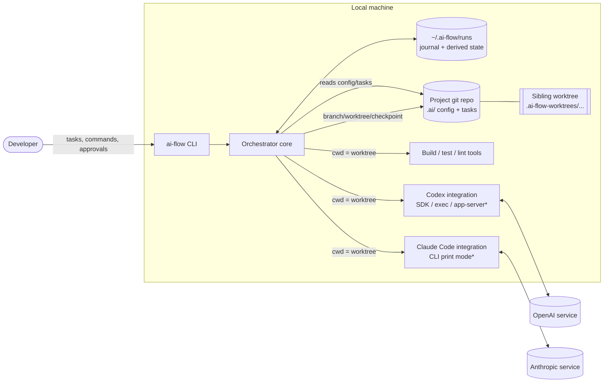
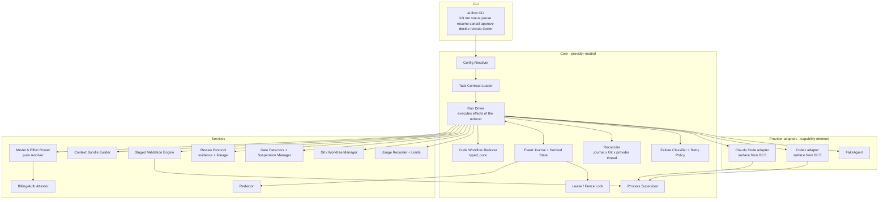
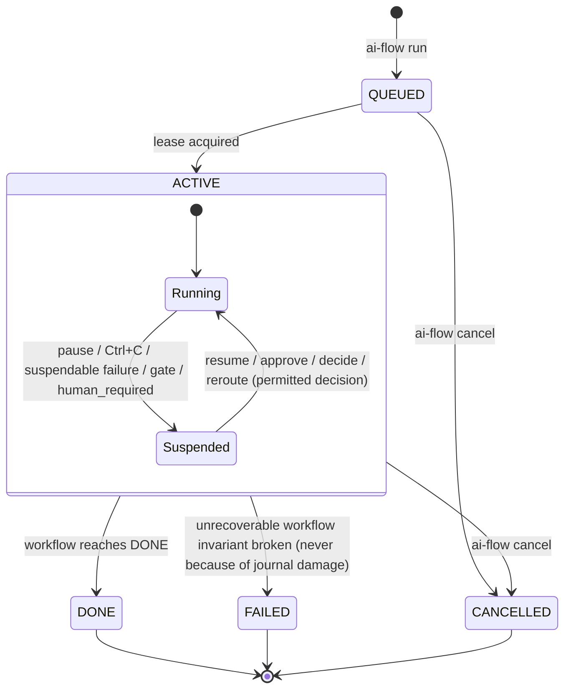
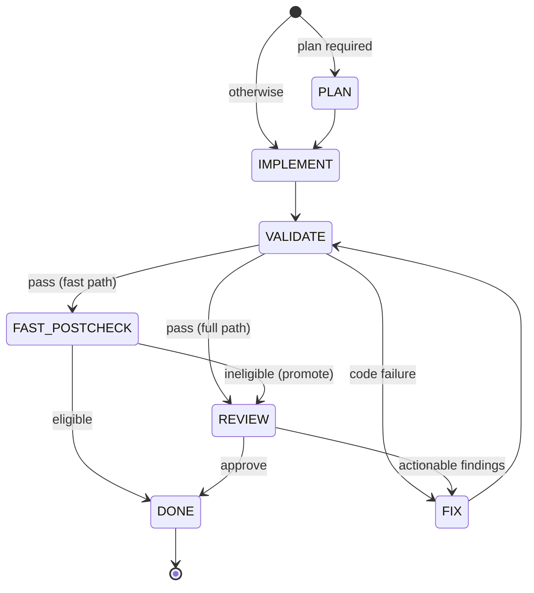
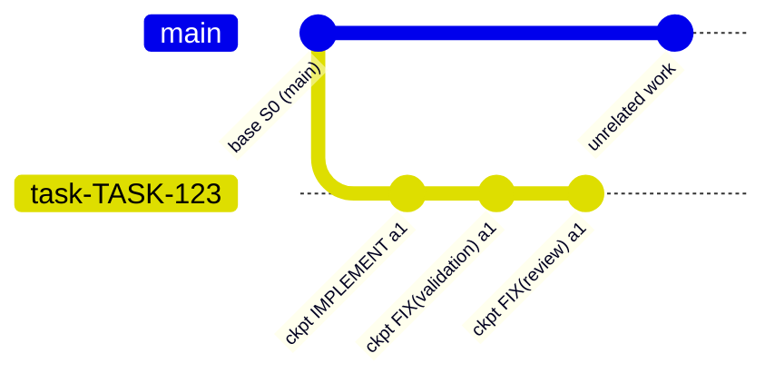
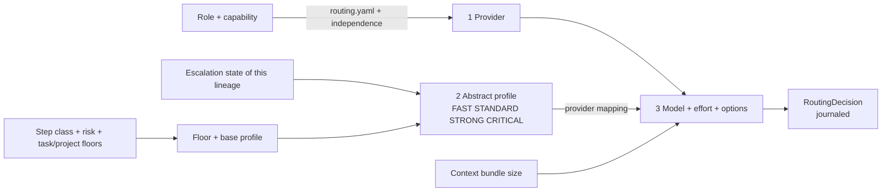

# ai-flow — Architecture (D0, revision r7)

> Status: **D0 r7 — APPROVED.** r7 was a minimal correction after the sixth independent review (CHANGES_REQUESTED, two material defects in the r6 recovery procedure); the seventh independent review (Codex, targeted re-review of r7) returned APPROVE.
> Scope: architecture/specification only. No orchestrator code exists yet.
> Companion documents: [`DECISIONS.md`](./DECISIONS.md) (ADRs + review resolution log), [`D1_PLAN.md`](./D1_PLAN.md) (D0.5 / D1A / D1B plan).
>
> **D0 APPROVAL (2026-10-08).** D0 revision r7 is **APPROVED**.
> - Independent review: Codex D0 r7, verdict **APPROVE** (two-phase acquisition: PASS; `B = 0` recovery: PASS; initial-run crash safety: PASS; material findings: none; checkpoint readiness: READY).
> - Required changes remaining: **zero**.
> - Review scope: specification-level only. No executable implementation exists or was tested; feasibility assumptions remain to be proven by the D0.5 spikes.
> - Next phase: **D0.5** (provider & platform feasibility spikes, [`D1_PLAN.md`](./D1_PLAN.md) §2). D0.5 has not started.
> - Architecture checkpoint (D0 r7): approval commit `b9e2b451f84419d1e9ff95443d3f86f770f14744` (`docs: approve D0 r7 architecture`).

**What changed in r7 (summary).** No redesign and no transaction manager. Everything approved in r6 stands except the two defects below (resolution log R6-M1, R6-M2 in DECISIONS.md):

- **Lock ownership separated from the lease record (R6-M1):** r6 step P3 ran the ordinary §13.5 acquisition, which appends `LEASE_ACQUIRED` itself, before P4 had installed the verified predecessor prefix. Acquisition now consists of two explicit operations. `acquire_lock_only` establishes exclusive ownership and the fence and writes only lock files: no journal append, no `state.json`, no Git. `append_lease_acquired` appends and fsyncs exactly one `LEASE_ACQUIRED`, and only after every required check has passed under the held lock. Ordinary acquisition, takeover, `resume` (including `--break-lock`) and recovery P3–P5 all use this contract. A check that fails under the held lock appends nothing (§13.5, §12.1.2).
- **No successor without a valid prefix (R6-M2):** with `B = 0` the successor journal would begin with its own `LEASE_ACQUIRED`, which the structural classification reserves for normal runs. `recover --journal` now refuses when `B = 0`, before it creates any staging directory, descriptor, journal, seal or marker. The supported options are a restore from an independently verified copy, or abandon (§12.1.1, §12.1.2).

**What changed in r6 (summary; the lease ordering of P3–P5 is corrected in r7).** No redesign. The fifth review confirmed that the r5 journal-integrity and cleanup-safety corrections hold. Everything approved in r5 stands except the items below (resolution log R5-M1, R5-m1..m3 in DECISIONS.md):

- **Recovery successor publication (R5-M1):** r5 created the successor run in place and appended its recovery records one at a time. A crash after `LEASE_ACQUIRED` and before `JOURNAL_RECOVERED` therefore left a run that looked ordinary, could be resumed, and could not be found by a rerun of `recover`. r6 builds the successor in a **staging area**. It publishes a **recovery descriptor** first, then completes `LEASE_ACQUIRED` → `JOURNAL_RECOVERED` → the `JOURNAL_RECOVERED` suspension → the predecessor seal → a publication marker. Only then does **one same-volume directory rename** make the successor visible; that rename is the atomic visibility boundary. The successor id is derived deterministically, so a rerun finds and finishes the same successor. Every mutating command runs a read-only **publication readiness gate** before any side effect, and `status`/`doctor` stay read-only. `continue` is bound to the predecessor journal hash and the successor id (§12.1.2, §13.6).
- **Minor alignments (R5-m1..m3):** the D0.5 start gate now names the current D0 revision. The §6.1 diagram no longer suggests that a corrupt journal is "repaired" or ends in `FAILED`. `cancel --cleanup` quarantines the worktree by an identity-verified rename and never deletes it (§13.6).

**What changed in r5 (summary; the successor procedure is completed in r6).** No redesign. Everything approved in r4 stands except the two mechanisms below, which are replaced by fail-closed rules per owner decision (resolution log R4-M1, R4-M2 in DECISIONS.md):

- **Damaged journal tail (R4-M1):** r4's automatic truncation of a damaged final record is **withdrawn**. `state.json` is a non-authoritative cache, so its absence or staleness cannot prove that a record was never acknowledged. An interrupted append and a later-damaged acknowledged record leave identical bytes. Any damaged final record now fails closed (`JOURNAL_TAIL_AMBIGUOUS`): no truncation, no append, no seq reuse, journal byte-identical. A read-only diagnostic and an explicit human recovery (successor run from the verified valid prefix) are specified. Git is not claimed to reconstruct lost decisions, routing or suspensions. No acknowledgement watermark is introduced. The journal is append-only without exception (§12.1.1).
- **Destructive ignored-file cleanup (R4-M2):** on Windows in D1, `cleanup: delete` **never** executes path-based deletion. The same holds on any platform unless D0.5 proves race-resistant, handle-relative no-follow deletion. Otherwise the outcome is `IGNORED_STATE_UNSAFE` (`NO_SAFE_DELETE_PRIMITIVES`), or an explicitly configured whole-worktree quarantine/recreation with identity verification before the rename, after it and before the replacement is created. Post-deletion detection is no longer claimed as a safety guarantee (§13.2.1).

**What changed in r4 (summary; partly superseded by r5).** No redesign. Everything approved in r3 stands. Two recovery-safety gaps are closed (resolution log R3-M1, R3-M2 in DECISIONS.md):

- **Torn journal tail (R3-M1)** (truncation withdrawn in r5; checksums and fail-closed middle corruption kept): a damaged final record is no longer only skipped logically. Under exclusive, verified ownership, and **before** `observed_lines` is captured or any event is appended, the damaged final suffix is preserved as a forensic artifact, physically truncated to the last valid record boundary and flushed. Every record now carries a checksum. Corruption anywhere other than the final record fails closed. The repair is the single, explicit exception to append-only (§12.1.1, §13.5).
- **Safe ignored-path cleanup (R3-M2)** (path-based deletion disabled in r5 on Windows and unproven platforms; validation and overlap rejection kept): `cleanup: delete` follows an explicit no-follow policy: no traversal of symlinks, junctions or reparse points; ancestor and file-identity checks (a lexical in-worktree path is not proof of containment); destructive rules overlapping protected/stateful/provisioned/preserved paths are rejected at config load; concrete candidates are revalidated immediately before deletion; deletes are non-recursive. Where safe deletion cannot be proven on the platform, ai-flow suspends (`IGNORED_STATE_UNSAFE`) or uses the opt-in, quarantine-based worktree recreation. The remaining TOCTOU window is documented (§13.2.1).

**What changed in r3 (summary).** No redesign. Three MAJOR findings and the related MINOR findings of the second review are corrected (resolution log R2-M1..M3, R2-m1..m10 in DECISIONS.md):

- **Lease/fencing (R2-M1):** automatic takeover requires lease expiry **and** positive verification that the previous owner (PID + process start time, same host) is dead. Otherwise human recovery. Fence = max(journal fence, lock fence) + 1. Replay excludes stale events appended after the taker's observation point. Abandoned takeover markers, clean release and every crash window are specified (§13.5). No distributed-system guarantee is claimed.
- **Ignored local files (R2-M2):** effect locations are split into `tracked_worktree`, `untracked_nonignored`, `ignored_local` and `external_side_effecting`. `git reset --hard` + `git clean -fd` do not touch ignored files, so retry of an interrupted attempt is gated by an ignored-state check and a declared policy, or worktree recreation, or a human (§13.2, §13.3).
- **Fast path (R2-M3):** off by default; explicit project opt-in. Acceptance oracles must exist at `base_sha`; any change to an oracle file promotes to full review; mapped tests are verified against their trusted base versions (§16.7).
- MINOR corrections: D0.5 gates split (platform → D1A, provider → D1B); read-only `RECOVERY_REQUIRED` display; attempt-bound, hash-verified `result.json` for checkpoint adoption; `PAUSING` is transient; tag-based doc discovery deferred; reroute = D1A stub / D1B implementation; unverifiable reported model fails closed; escalation triggers named by observed evidence.

**What changed in r2 (summary).**

- Codex review A1–A18 resolved. See the resolution log in DECISIONS.md.
- Provider integration is now capability-oriented, and Codex is SDK-first, conditional on D0.5.
- A mandatory **D0.5 feasibility milestone** comes before any D1 code.
- The "exactly-once" claim is replaced by a narrower, honest invariant.
- PAUSED/WAITING_HUMAN are suspension overlays, not terminal states.
- Billing protection fails closed.
- The journal is authoritative and Git is reconciled.
- Fenced lease locking.
- Runtime state and worktrees moved outside the repo.
- Security enforcement levels.
- Staged validation.
- Incremental re-review context.
- **New owner requirements:** a Model & Effort Router (separate provider/model/effort decisions, abstract profiles, risk floors, bounded escalation) and a small-task fast path.
- **Simplification:** D1A uses **one typed code workflow + reducer**. There is no YAML workflow DSL and no plugin registry.

Conventions:

- **MUST / SHOULD / MAY** follow RFC 2119.
- Phase tags:
  - **[D0.5]** verified by feasibility spikes before D1.
  - **[D1A]** deterministic local core (FakeAgent only).
  - **[D1B]** real provider integrations.
  - **[SOON]** designed now, implemented after D1.
  - **[FUTURE]** deferred; extension seam only.
- Marks:
  - **[ASSUMPTION]** taken as true without verification.
  - **[UNCERTAIN]** a decision the reviewer should actively challenge.
  - **[OWNER]** a decision made explicitly by the project owner.
- Snippets are illustrative. Normative schemas are produced in D1A.

---

## Table of contents

1. [Goals](#1-goals)
2. [Non-goals](#2-non-goals)
3. [System context](#3-system-context)
4. [Core architectural principles](#4-core-architectural-principles)
5. [Component architecture](#5-component-architecture)
6. [Workflow / state-machine model](#6-workflow--state-machine-model)
7. [Task contract](#7-task-contract)
8. [Provider integration (agent adapter contract)](#8-provider-integration-agent-adapter-contract)
9. [Review contract](#9-review-contract)
10. [Context Builder](#10-context-builder)
11. [Validation Engine](#11-validation-engine)
12. [Persistence, checkpoint and audit model](#12-persistence-checkpoint-and-audit-model)
13. [Retry / recovery model](#13-retry--recovery-model)
14. [Git / worktree strategy](#14-git--worktree-strategy)
15. [Security boundaries](#15-security-boundaries)
16. [Routing: provider, model and effort](#16-routing-provider-model-and-effort)
17. [Usage, budget and billing protection](#17-usage-budget-and-billing-protection)
18. [Extension seams and versioning](#18-extension-seams-and-versioning)
19. [Spec Kit / Skills / MCP integration points](#19-spec-kit--skills--mcp-integration-points)
20. [Delivery phases: D0.5 / D1A / D1B](#20-delivery-phases-d05--d1a--d1b)
21. [Deferred capabilities](#21-deferred-capabilities)
22. [Major trade-offs](#22-major-trade-offs)
23. [Open questions](#23-open-questions)
24. [Answers to the r2 revision questions](#24-answers-to-the-r2-revision-questions)
25. [D0 REVIEW CHECKLIST](#d0-review-checklist)

---

## 1. Goals

| # | Goal |
|---|------|
| G1 | **D1 scope:** a **provider-neutral local orchestrator for Git-based projects**. The engine must contain no project-specific assumptions; projects supply configuration and context. |
| G2 | Agents (Codex, Claude Code, future providers) are **interchangeable executors of roles** (PLANNER, IMPLEMENTER, REVIEWER). The orchestrator owns the workflow; agents only execute steps. |
| G3 | Every run operates on an explicit **task contract** with acceptance criteria. Review is judged against the contract, not the reviewer's taste. |
| G4 | **Deterministic before AI**: tools check what tools can check, before any provider quota is spent. |
| G5 | **Reliability first**: any run can be interrupted at any point (network, quota, crash, reboot) and resumed. Accepted results are never redone; only interrupted work is repeated. |
| G6 | **Usage efficiency is a first-class requirement.** Minimum context per step. Use the **cheapest provider/model/effort configuration that satisfies a quality floor**. Bounded loops and bounded escalation. Pause instead of runaway spending. |
| G7 | **Safety**: agents never work on `main` or in the user's working tree. Reviewers are more restricted than implementers. No secrets in prompts, logs or artefacts. **Billing protection fails closed.** |
| G8 | **Reconstructable and attributable runs** (not "perfectly reproducible"). A run can be traced to the exact workflow/prompt versions, provider surface, model, effort, routing epoch and context bundle, with enough metadata to evaluate routing empirically later. |
| G9 | **Boring, small implementation**: local-first, CLI-first, plain files. One typed workflow in D1. No speculative frameworks. |

Future use cases (content, research, non-Git workspaces) **inform the extension seams** but MUST NOT force abstractions into D1 (ADR-028).

## 2. Non-goals

- Not a hosted service, not multi-user, not multi-machine.
- Not an agent: ai-flow does not call LLMs to "think". It drives provider integrations and deterministic tools.
- Not a replacement for the agents' own tool loops (editing, shell, search happen inside the provider).
- Not a CI system, not a deploy tool, and not responsible for merging to `main`.
- **Not a general-purpose workflow platform** in D1: no YAML workflow DSL, no plugin registry, no dynamic extension loading (ADR-024).
- **Not an AI/ML-based router**: routing in D1 is deterministic policy over configuration. History informs *later* policy changes.
- Not able to guarantee exactly-once **external** side effects. It provides a narrower invariant (§13.2) and prohibits external writes by default.
- Not a security sandbox in itself. It reports the **enforcement level** of each security property honestly (§15.1).
- No non-Git workspaces in D1.

## 3. System context



`*` The exact integration surface per provider is selected by D0.5 (§8.3, ADR-003, ADR-018).

External dependencies:

- **Provider integrations**, installed and authenticated by the user. ai-flow never handles provider credentials, but it **verifies the active auth/billing mode** before use (§17.3).
- **Git** with worktree support. The minimum version is fixed in D0.5.
- **Project toolchain**, invoked only via project-configured validation commands.
- **Network**, only via provider integrations and explicitly declared validation stages.

### Technology assessment

The requested direction (local-first, Node.js/TypeScript, CLI-first, Git-based) is **accepted**. Pinned to **Node.js 22 LTS**. Objections and risks:

| Concern | Severity | Mitigation | Verified in |
|---|---|---|---|
| **Windows process semantics.** No real POSIX signals. Killing a parent does not kill detached grandchildren. Console-attached processes, PowerShell/`cmd` wrapper shims (`.cmd`/`.ps1` launchers for npm-installed CLIs), and PID reuse are all involved. | High | Process Supervisor with a Windows strategy chosen in D0.5: **Job Objects** (preferred, if usable from Node without native-build pain) or `taskkill /T /F` plus PID+start-time identity. POSIX: process groups. | D0.5 SP-W1..W4 |
| **Atomic rename and lock contention on Windows** (antivirus, indexers, open handles → EPERM/EBUSY). | Medium | Atomic-write helper with bounded retry. Exclusive-create lock files. Leases + fencing (§13.5). | D0.5 SP-W5..W6 |
| **Paths**: MAX_PATH, Unicode, case-insensitive comparisons, worktrees on other volumes. | Medium | Short run ids. Sibling worktrees on the same volume. Normalised path comparison. `core.longpaths` check. | D0.5 SP-W7..W8 |
| **Provider surface drift** (SDK/CLI flags, event shapes, error messages). | High | Capability-oriented adapters (§8) with recorded fixtures per provider version. "Uncertain ⇒ suspend" classification. | D0.5, D1B |
| **SDKs may wrap the CLI binary.** [ASSUMPTION] The Codex TypeScript SDK is expected to spawn the `codex` binary. If so, the Windows process-tree concerns remain even with the SDK. | Medium | Treat the SDK as typed events + thread API, **not** as process isolation. Supervision still applies. | D0.5 SP-C2 |
| **Heavy orchestration frameworks** (Temporal, LangGraph, Airflow, Prefect). | — | Rejected: a server/runtime and a second persistence model for a single-user tool. | ADR-014 |

Intended D1 dependencies: a schema library, a YAML parser (config files only), a CLI argument parser, the provider SDK(s) selected by D0.5, and the Node built-in test runner. Nothing else in the core.

## 4. Core architectural principles

1. **The orchestrator owns the workflow.** Agents return structured outcomes; a deterministic reducer chooses transitions.
2. **Roles, not providers.** Routing maps roles to providers. It is frozen per **routing epoch** and changed only by human-approved reroute.
3. **Three routing decisions, not one.** Provider, model and effort are chosen separately. The router picks the **cheapest configuration at or above a quality floor**.
4. **Contract-driven.** Task contract in, schema-validated results out.
5. **Deterministic before probabilistic.** No provider quota is spent rediscovering what a tool can report.
6. **Journal is truth, state is cache, Git is an external fact.** Every decision is journaled before it is acted upon. State is rebuildable. Git is reconciled on resume.
7. **Honest guarantees.** At most one accepted result per attempt identity. Execution may repeat. Only tracked and untracked-non-ignored worktree effects are reconciled automatically by Git; ignored local files only under a declared policy (§13.2). External side effects are prohibited by default.
8. **Fail closed** on billing/auth uncertainty, on security-relevant capability gaps, and on unknown Git state.
9. **Enforcement levels are explicit.** A security property is never claimed at a stronger level than what actually enforces it.
10. **Minimum, stable, hashed context.** Only structured artefacts pass between steps. Stable prompt prefixes help caching. Re-review is incremental.
11. **Bounded everything.** Iterations, review rounds, escalations, retries, runtime and context size all have limits with explicit suspensions.
12. **Isolation.** One run = one branch = one worktree, outside the repository directory.
13. **No speculative generality.** One typed workflow in D1. Seams, not frameworks.

## 5. Component architecture



| Component | Responsibility | Phase |
|---|---|---|
| CLI | Thin command layer. First Ctrl+C = graceful pause; second = hard exit. `status` is strictly read-only. | D1A (`reroute`: stub in D1A, implemented in D1B) |
| Config Resolver | Built-in → global (`~/.ai-flow`) → project (`.ai/`) → task (task may only tighten limits/floors). Frozen snapshot per run. | D1A |
| Task Contract Loader | Schema validation, defaults, canonical hash, snapshot. | D1A |
| **Code Workflow Reducer** | Pure function `reduce(state, event) → { state, effects[] }` for the single typed code workflow (full path + fast path). No I/O. | D1A |
| Run Driver | Executes the reducer's effects (invoke provider, run validation, checkpoint, suspend). Journals before acting. | D1A |
| Event Journal + Derived State | `events.jsonl` (authoritative) + `state.json` (derived cache). Replay. | D1A |
| Lease / Fence Lock | Atomic acquisition, lease renewal, monotonic fencing token. Stale writers are fenced out (§13.5). | D1A |
| Reconciler | On resume: reconcile journal with Git HEAD/worktree and provider thread state (§13.3). | D1A |
| Failure Classifier + Retry Policy | Normalised failure classes; retry only safe effect classes (§13.1–13.2). | D1A (Fake) / D1B (real signatures) |
| Process Supervisor | Spawn/kill process trees with env allowlist, timeouts, output capture. | D1A (validation) / D1B (providers) |
| **Model & Effort Router** | Pure resolver: role → provider; step class + risk floor + escalation rung → abstract profile → provider mapping (model, effort). Journals every decision (§16). | D1A (resolver, Fake mappings) / D1B (real mappings) |
| **Billing/Auth Attestor** | Positive verification of auth/billing mode per provider. Fail closed. Non-secret attestation (§17.3). | D1B (interface stub in D1A) |
| Context Bundle Builder | Minimum, ordered, hashed context bundle per step. Incremental re-review (§10). | D1A |
| Staged Validation Engine | Stage pipeline with effect classes. Environment failures never go to AI repair (§11). | D1A |
| Review Protocol | Schema validation, evidence rules, lineage, test-decided ACs, loop guards (§9). | D1A |
| Gate Detectors + Suspension Manager | Deterministic gate triggers. Suspension records with permitted decisions (§6.3, §15.6). | D1A (minimal set) |
| Git / Worktree Manager | Repo-instance identity, sibling worktree, checkpoint commits, reconciliation helpers (§14). | D1A |
| Usage Recorder + Limits | Measured/estimated/unknown usage. Counters and runtime limits (§17). | D1A (counters) / D1B (provider usage) |
| Redactor | Pattern + known-sensitive-value redaction for everything persisted or rendered. | D1A |
| Adapters | Capability-oriented provider adapters; FakeAgent is first-class (§8). | Fake: D1A; Codex/Claude: D1B |

**Dependency rule:** the core depends only on interfaces (`ProviderAdapter`, `CheckRunner`, `GateDetector`, `ContextSource`). These are **seams**: plain TypeScript interfaces with a fixed set of in-tree implementations. There is no registry, no dynamic loading and no plugin API in D1 (ADR-024, §18).

### 5.1 Directory layout

```text
~/.ai-flow/                                  # global (Windows: %USERPROFILE%\.ai-flow)
  config.yaml                                # limits, retry policy, risk floors, ladder defaults
  providers/
    codex.yaml                               # surface, billing class, verification mode, profile→model/effort mapping
    claude.yaml
  prompts/                                   # versioned prompt templates (id@semver), shipped defaults overridable
  policies/default.yaml                      # permission profiles, env allowlists, protected paths, redaction patterns
  repos/<repo-instance-id>.json              # known repo instances: path(s), remote URL, created_at
  runs/<repo-instance-id>/<run-id>/          # AUTHORITATIVE runtime state (§12)
    events.jsonl  state.json  run.lock
    snapshots/  attempts/  validation/  report.md

<project repo>/                              # committed, reviewable
  .ai/
    project.yaml                             # project id, base branch, validation stages, gates, floors, fast-path policy
    routing.yaml                             # role → provider per capability; independence
    context.yaml                             # include/exclude, budgets (doc index/tags: [SOON])
    tasks/TASK-123.yaml                      # task contracts

<repo parent>/.ai-flow-worktrees/<repo8>/<run8>/   # sibling worktree, same volume (configurable root)
```

- **Repo-instance identity.** On `ai-flow init`, a random UUID is written to `<git-common-dir>/ai-flow/instance-id`. It lives inside `.git`, so it is never committed, and all worktrees of the clone share it. `~/.ai-flow/repos/<id>.json` records the absolute path(s) and remote URL.
  - Separate clones have distinct ids.
  - A copied clone that carries the same id but sits at a different path is detected (path mismatch) → `WAITING_HUMAN: REPO_IDENTITY` with decisions `adopt-as-moved` / `regenerate-id`.
- **Run id**: `<task-id>-<short-ulid>`. `<repo8>`/`<run8>` are short hashes, to stay well below Windows path limits.
- **Precedence**: task > project > global > built-in. **Task and project may only raise floors and lower limits** relative to the layer below (§7.3). The resolved config is frozen into `snapshots/config.yaml` and never re-resolved on resume.
- `.ai/` holds **no runtime state**. `ai-flow status` prints the run directory path. `ai-flow report TASK-123 --export <path>` [SOON] copies the report into the project if wanted.

## 6. Workflow / state-machine model

### 6.1 Run status and suspension overlay

Run **status** has two non-terminal and three terminal values. **Suspension** is an overlay on an active run, not a state the workflow ends in.

| Field | Values | Terminal? |
|---|---|---|
| `status` | `QUEUED`, `ACTIVE` | no |
| `status` | `DONE`, `FAILED`, `CANCELLED` | **yes** — the only terminal states |
| `suspension` | `null`, or `{ kind: PAUSED \| WAITING_HUMAN, ... }` (§6.3) | never terminal; an `ACTIVE` run may be suspended |

The displayed state is derived: `RUNNING` = ACTIVE ∧ no suspension; `PAUSED` / `WAITING_HUMAN` = ACTIVE ∧ suspension. This preserves the familiar vocabulary (QUEUED, RUNNING, PAUSED, DONE, FAILED, CANCELLED) for the future queue without making suspensions terminal.

Two further **display conditions** (r3) are derived by `status` and are **neither run statuses nor suspension kinds**. They are never persisted as status:

- `PAUSING`: ACTIVE ∧ a journaled `PAUSE_REQUESTED` ∧ no suspension yet (the interrupt is in progress). It is transient (§13.6).
- `RECOVERY_REQUIRED`: the run cannot continue without `ai-flow resume` and possibly a human action. Examples: lock held by a dead or unverifiable owner, an abandoned takeover marker, a non-final corrupt journal record, a damaged final journal record (r5: `JOURNAL_TAIL_AMBIGUOUS` or acknowledged damage; never repaired automatically, §12.1.1), a sealed run, an interrupted attempt awaiting reconciliation, (r6) a recovery successor that is not yet published (reason `RECOVERY_PREPARING`) or fails the publication readiness check (reason `RECOVERY_INCONSISTENT`, §12.1.2). `status` computes it read-only (§13.6). It writes no journal event, lock or `state.json`. The persisted suspension, if any, is written later by the process that holds the lease.

`RECOVERY_PREPARING` (r6) is only a **reason** shown under `RECOVERY_REQUIRED`, derived from the staging area of §12.1.2. It is not a run status, not a suspension kind and not a workflow step. Nothing transitions into or out of it, and the reducer never sees it.

A damaged or corrupt journal **never** moves a run to `FAILED`. No event can be appended to such a journal (§12.1.1), so the run stays `ACTIVE` in its valid prefix and is displayed as `RECOVERY_REQUIRED` until a human restores it, abandons it, or recovers it into a successor run (§12.1.2).



`FAILED` is rare by design. Almost every problem becomes a suspension with a required action, because almost every problem is resumable after human action. The diagram shows journaled transitions only. A non-`clean` journal (§12.1.1) produces no transition: it is the read-only display condition `RECOVERY_REQUIRED`, never a `FAILED` run.

### 6.2 The typed code workflow (D1)

D1 ships **one** workflow, defined in TypeScript as a typed transition table plus a pure reducer. The YAML workflow DSL from D0 r1 is **withdrawn** for D1 (ADR-024). The table is still serialised into the run snapshot and hashed (`code-workflow@<version>`, §18.2).

Steps:

| Step | Kind | Role | Writes worktree? | Notes |
|---|---|---|---|---|
| `PLAN` | agent | PLANNER | no | Only when the task needs it (risk ≥ HIGH, or `plan: required`). Skipped otherwise. |
| `IMPLEMENT` | agent | IMPLEMENTER | yes | — |
| `VALIDATE` | validation | — | stage-dependent (bootstrap only) | Staged (§11). |
| `REVIEW` | agent | REVIEWER | no (read-only) | Rounds ≥ 2 use incremental re-review context (§10.4). "RE-REVIEW" is REVIEW with `round > 1`. |
| `FIX` | agent | IMPLEMENTER | yes | `source: validation \| review`. One step type with two context profiles. |
| `FAST_POSTCHECK` | deterministic | — | no | Fast path only: verifies post-diff eligibility (§16.7). |
| `DONE` | terminal | — | — | — |

Transition table (illustrative; normative in D1A):

| From | Outcome | To | Guard / counter |
|---|---|---|---|
| (start) | — | `PLAN` if required, else `IMPLEMENT` | fast path → `IMPLEMENT` with fast flags |
| PLAN | `done` | IMPLEMENT | — |
| PLAN | `human_required` | *suspend* WAITING_HUMAN | — |
| IMPLEMENT | `done` | VALIDATE | — |
| VALIDATE | `pass` | fast ? FAST_POSTCHECK : REVIEW | — |
| VALIDATE | `code_failure` | FIX(source=validation) | `validation_fixes < max` else suspend `VALIDATION_FIX_LIMIT` |
| VALIDATE | `environment_failure` | *suspend* PAUSED `VALIDATION_ENVIRONMENT` | never routed to AI repair |
| VALIDATE | `policy_violation` (scope/protected path) | FIX(source=validation) or *suspend* | per policy `warn \| block` |
| VALIDATE | `gate_triggered` | *suspend* WAITING_HUMAN `APPROVAL` | — |
| FAST_POSTCHECK | `eligible` | DONE, or REVIEW(light) if project requires a light review | — |
| FAST_POSTCHECK | `ineligible` | REVIEW (promoted to full path) | promotion only, never demotion |
| REVIEW | `approve` | DONE | — |
| REVIEW | `changes_requested` (actionable) | FIX(source=review) | `fix_iterations < max` else suspend `FIX_LIMIT` |
| REVIEW | `human_required` / disagreement | *suspend* WAITING_HUMAN | §9.4 |
| FIX | `done` | VALIDATE | re-validate before re-review |
| any agent step | `invalid_output` ×2 | *suspend* PAUSED `INVALID_OUTPUT` | — |
| any | escalation ladder exhausted | *suspend* WAITING_HUMAN `ESCALATION_EXHAUSTED` | §16.6 |



Environment failures, gates and limits are **suspension overlays** on the current step (§6.3), not workflow states, so they do not appear in this diagram.

### 6.3 Suspension record

Every suspension persists a **continuation record**. Resume is deterministic: it can only take one of the permitted decisions.

```json
{
  "kind": "WAITING_HUMAN",
  "reason": { "code": "AGENT_DISAGREEMENT", "message": "Reviewer and implementer disagree on lineage L3 (AC-2)." },
  "required_action": "Run `ai-flow status TASK-123` to compare positions, then `ai-flow decide`.",
  "suspended_step": { "step": "REVIEW", "seq": 7, "round": 3 },
  "pending_action_id": "act_01JA…",
  "permitted_decisions": [
    { "id": "accept_finding", "params": ["lineage"], "transition": "FIX(source=review, constraint=human_decision)" },
    { "id": "reject_finding", "params": ["lineage"], "transition": "REVIEW(round+1, lineage suppressed)" },
    { "id": "escalate_reviewer", "transition": "REVIEW(profile=CRITICAL)", "requires": "allow_critical" },
    { "id": "cancel", "transition": "CANCELLED" }
  ],
  "checkpoint_sha": "9f8e…",
  "provider_thread": { "role": "IMPLEMENTER", "provider": "codex", "thread_id": "…", "resumable": "unknown" },
  "interrupted_attempt": { "attempt_id": "…", "validity": "none | valid_result_committed | invalid | unknown" },
  "routing_epoch": 1,
  "created_at": "…",
  "auto_resume_after": null
}
```

- `PAUSED` is used for machine-recoverable conditions (rate limit with a reset time, network, provider outage, interrupt). Decisions are usually just `resume`, `cancel`, and possibly `reroute` (D1B only; never offered in D1A, §16.10).
- `WAITING_HUMAN` is used where a human judgement is required (auth, billing unverified, Git divergence, disagreement, gates, contract change).
- `interrupted_attempt.validity`:
  - `none`: suspended between steps.
  - `valid_result_committed`: the step finished and only the transition is pending.
  - `invalid`: partial attempt; the effects must be reconciled.
  - `unknown`: crash inside the commit/journal window; resolved by the Reconciler (§13.3).
- Decisions are journaled (`DECISION_APPLIED`) with the decision id, the parameters and an optional human note. A decision not in `permitted_decisions` is rejected.

### 6.4 Reducer shape (illustrative)

```ts
type Event =
  | { t: "STEP_COMPLETED"; step: Step; outcome: Outcome; attemptId: string; checkpointSha?: string }
  | { t: "STEP_FAILED"; step: Step; failure: ClassifiedFailure; attemptId: string }
  | { t: "DECISION_APPLIED"; actionId: string; decision: string; params?: object }
  | { t: "PAUSE_REQUESTED" } | { t: "RESUMED" } | { t: "CANCEL_REQUESTED" } /* … */;

type Effect =
  | { e: "RUN_AGENT"; step: Step; role: Role; routing: RoutingDecision; contextProfile: string }
  | { e: "RUN_VALIDATION"; stages: Stage[] }
  | { e: "CHECKPOINT"; attemptId: string }
  | { e: "SUSPEND"; record: SuspensionRecord }
  | { e: "FINISH"; status: "DONE" | "FAILED" | "CANCELLED" };

function reduce(s: RunState, ev: Event, cfg: FrozenConfig): { state: RunState; effects: Effect[] };
```

- The reducer is pure and exhaustively unit-tested. The Run Driver journals each event, applies the reducer, and executes its effects.
- Replay = fold the reducer over the journal. Effects are **not** re-executed during replay. They are re-derived and executed only for the current, unfinished position (§13.3).

### 6.5 Other workflows (future)

The architecture, content and Spec Kit workflows are **[FUTURE]**. Each would be either an additional typed workflow (same reducer pattern) or, once there are three or more workflows with real shared structure, a small declarative format extracted from them (rule of three). Neither is built in D1.

## 7. Task contract

### 7.1 Schema (illustrative)

```yaml
id: TASK-123
project: acme-web                    # must equal .ai/project.yaml id
type: code                           # D1: only "code"
title: Add rate-limit headers to public API responses
goal: Public API responses include standard rate-limit headers so clients can back off.
capability: backend                  # routing key (§16.2)
risk: NORMAL                         # LOW | NORMAL | HIGH | CRITICAL (§7.2)
minimum_profile: STANDARD            # optional; may only raise the floor
size_hint: small                     # tiny | small | medium | large (claim; verified for fast path)
fast_path: auto                      # auto | never   (eligibility still verified, §16.7)
plan: auto                           # auto | required | skip (skip ignored if risk >= HIGH)
scope:
  include_paths: [src/api/**, src/middleware/**, test/api/**]
  exclude_paths: [src/billing/**]
  out_of_scope: [changing the rate-limit algorithm, adding dependencies]
constraints:
  - { id: C-1, text: No new runtime dependencies. }
  - { id: C-2, text: Public API response bodies must not change. }
acceptance_criteria:
  - id: AC-1
    text: Responses from /api/v1/* include X-RateLimit-Limit/Remaining/Reset.
    verify: test
    tests: ["test/api/rate-headers.test.js"]       # decided by these tests (§9.3)
  - id: AC-2
    text: Existing API tests pass unchanged.
    verify: test
    tests: ["test/api/**"]
  - id: AC-3
    text: Header computation is documented in the middleware.
    verify: review
limits: { max_fix_iterations: 2, max_review_rounds: 2, max_runtime_minutes: 90 }
gates: [{ on: dependency_change, mode: APPROVAL_REQUIRED }]
routing: { reviewer: { provider: claude } }       # optional; still subject to independence + floors
references: { specs: [docs/api/rate-limits.md], files: [src/middleware/rateLimiter.js] }
```

- **Required:** `id`, `project`, `type`, `goal`, `scope`, at least one `acceptance_criteria`. Defaults come from the project/global config.
- The contract is canonically hashed and snapshotted at run start. Editing the task file mid-run is detected on resume → `WAITING_HUMAN: CONTRACT_CHANGED`, with decisions `continue-with-original` / `cancel`. Mid-run amendment is [SOON].

### 7.2 Risk classes

| Risk | Meaning |
|---|---|
| LOW | Mechanical, local, reversible (renames, small fixes with tests, docs). |
| NORMAL | Ordinary feature work. |
| HIGH | Architecture-affecting, complex refactor, important review. |
| CRITICAL | Security-sensitive, destructive operations, production-sensitive, repeated agent disagreement. |

The task's declared risk is a **lower bound only**. Deterministic detectors may **raise** effective risk (e.g. diff touches auth/crypto paths or migrations → at least HIGH; protected destructive changes → CRITICAL). Nothing can lower it below the declared value or the project minimum. Risk drives the floors (§16.5) and fast-path eligibility (§16.7).

### 7.3 Scope-creep prevention

1. Actionable findings must cite a contract reference **and** carry evidence (§9.2). Everything else is non-actionable.
2. Out-of-scope ideas go to `follow_ups`. They are persisted and reported, but never trigger FIX.
3. A deterministic diff-scope check runs after every writing step (`warn` or `block` policy).
4. Implementer prompts include constraints and `out_of_scope` verbatim. FIX prompts include only actionable findings, not reviewer prose.
5. **Monotonic config:** a task can lower limits and raise floors, never the reverse. Raising limits requires a project config change.
6. The reviewer cannot add acceptance criteria. Contract inadequacy → `human_required: CONTRACT_INSUFFICIENT`.
7. ACs with `verify: test` are decided by tests, not by reviewer opinion (§9.3).

## 8. Provider integration (agent adapter contract)

### 8.1 Capability-oriented adapters

The core does **not** assume that every provider is "a CLI subprocess". Each adapter exposes a **capability set**. The core is written against capabilities, with a documented fallback per missing capability. No lowest-common-denominator interface is forced.

```ts
interface ProviderAdapter {
  id: "codex" | "claude" | "fake" | string;
  surface: string;                         // e.g. "codex-sdk", "codex-exec", "claude-cli-print"
  version(): Promise<SurfaceVersions>;     // adapter impl version, SDK/CLI versions
  capabilities(): Capabilities;            // static + probed (§8.2)
  attestBilling(): Promise<BillingAttestation>;         // §17.3, fail closed
  health(): Promise<HealthResult>;                      // binary/SDK present, auth present, reachable (best effort)
  startTurn(req: TurnRequest, signal: AbortSignal): Promise<TurnResult>;
  resumeThread?(threadId: string): Promise<ThreadHandle | "expired">;   // optional capability
  interrupt?(turn: TurnHandle): Promise<void>;                           // optional capability
}

interface TurnRequest {
  runId: string; attemptId: string; step: Step; role: Role;
  bundle: ContextBundle;                   // rendered prompt + manifest + hash (§10)
  cwd: string;                             // worktree
  permissions: PermissionProfile;          // abstract (§15.2)
  resolved: { model: string; effort: string; options: object };  // from Router (§16)
  outputSchema?: JsonSchema;
  timeouts: { totalMs: number; idleMs: number };
  env: Record<string, string>;             // already allowlisted by the core
  artifactDir: string;
  threadId?: string;                       // only if the core chose to continue a thread
}

interface TurnResult {
  status: "ok" | "failed";
  failure?: ClassifiedFailure;             // §13.1
  structured?: unknown;                    // re-validated by the core
  ids: { threadId?: string; turnId?: string; requestIds?: string[]; sessionId?: string };
  resolvedModel?: string;                  // as reported by the provider, if available
  usage: UsageRecord;                      // measured | estimated | unknown, incl. cached tokens
  enforcement: EnforcementReport;          // effective levels for this turn (§15.1)
  toolEvents?: ToolLifecycleSummary;       // commands/tools started/finished (redacted)
  exit?: { code: number | null; signal?: string };
  timing: { startedAt: string; endedAt: string; monotonicMs: number };
}
```

Capabilities (each `supported | unsupported | unknown`, plus an enforcement level where relevant):

- `structured_output` (native schema, or extraction)
- `thread_resume`
- `interrupt` (keeps the thread resumable / kills it)
- `read_only_mode`, `workspace_write_scope`, `network_deny`
- `model_select`, `effort_select` (+ supported effort values)
- `usage_tokens`, `usage_cached_tokens`, `cost_reporting` (informational only, **not** billing evidence)
- `auth_mode_inspection`
- `rate_limit_signal`, `quota_signal`
- `max_turns`
- `context_window` (declared per model mapping)

Rules:

- If a step **requires** a capability (e.g. the reviewer requires `read_only_mode` at enforcement ≥ `native`) and the adapter cannot provide it, routing **fails clearly** (§16.4, §15.1). It never degrades silently.
- Adapters own invocation, timeouts (via the Supervisor where a process is involved), error classification (versioned pattern tables + fixtures), structured-output extraction, permission/profile translation, usage extraction and redacted raw capture.
- Adapters **do not retry**, choose steps, alter prompts or commit.

### 8.2 Provider capability matrix (to be filled by D0.5)

| Capability | Codex SDK | `codex exec` | Codex app-server | Claude Code CLI (`-p`) | Claude Agent SDK |
|---|---|---|---|---|---|
| Non-interactive turn | expected | expected | expected | expected | expected |
| Structured output (schema) | expected | expected | expected | expected (verify flag/version) | expected |
| Thread/session resume by id | expected | expected | expected | expected | expected |
| Interrupt keeping thread resumable | ? | ? (process kill) | expected | ? | ? |
| Read-only sandbox | expected | expected | expected | expected (permission mode / tool allowlist) | expected |
| Network deny | expected (sandbox) | expected | expected | partial (tool rules) — verify | partial — verify |
| Model + effort selection | expected | expected | expected | model: expected; effort: ? | ? |
| Token + cached-token usage | expected | expected | expected | expected | expected |
| Auth/billing mode inspection | ? | via a login-status command — verify | expected richer — verify | ? | ? (billing implications to verify) |
| Rate-limit / quota signals | ? | stderr/event patterns — verify | expected — verify | result/error fields — verify | ? |
| Windows process behaviour | wraps binary? — verify | process | long-lived process | process (+ `.cmd` shim?) | wraps binary? — verify |

"expected" = believed true from documentation and experience; **not verified**. "?" = unknown. D0.5 replaces every cell with `verified (version, evidence)`, `unsupported` or `workaround`.

### 8.3 Integration surface selection

**Codex** (ADR-003):

1. **Preferred for D1B: the official Codex SDK**, subject to D0.5. Reasons: officially supported programmatic surface; typed thread/turn API; thread ids for resume; structured events with usage; schema-constrained output; model/sandbox options without hand-built command lines.
2. **`codex exec`**: a bounded scripting/reference surface. Used in D0.5 to establish ground truth (flags, JSONL events, exit codes, error messages). It is the fallback if the SDK is missing something exec has.
3. **Codex app-server**: only if D0.5 shows that the SDK cannot cleanly provide one of the following. Each of these is a D1 requirement. Escalating to app-server is a recorded ADR amendment, not an adapter-internal choice.
   - interrupting a turn while keeping the thread resumable;
   - positive auth-mode / account inspection required for fail-closed billing (§17.3), if not otherwise available;
   - distinguishable rate-limit vs quota-exhaustion signals;
   - approval/sandbox policy control sufficient for a native read-only reviewer;
   - reliable process-lifecycle behaviour on Windows that exec/SDK cannot give.

**Claude Code** (ADR-003):

1. Expected D1B surface: **Claude Code CLI in print mode** with JSON/stream-JSON output and session resume by id. This is the surface known to work with subscription login for local use.
2. **Claude Agent SDK** is evaluated in D0.5. It is selected only if it is superior **and** its auth/billing behaviour is compatible with subscription usage under fail-closed rules. [UNCERTAIN]
3. D0.5 must prove for Claude:
   - non-interactive JSON results with distinguishable error results;
   - schema-constrained output or reliable extraction;
   - session resume by id;
   - read-only enforcement for the reviewer (permission mode / tool allowlist) and what it does with shell tools;
   - how network access can be denied;
   - model and effort selection;
   - usage including cache tokens;
   - **auth-mode detection** and every source that can switch billing (env vars, settings files including project-level settings in the worktree, API-key helpers);
   - Windows process behaviour.

### 8.4 Session/thread continuity

Correctness **never** depends on provider thread state. Every step can be reconstructed from the contract, the run artefacts and the worktree. Thread continuation (e.g. FIX continuing the IMPLEMENT thread to reuse the provider's cache) is an **optimisation**. It is allowed only if all of the following hold, and the choice is journaled:

- the thread id was recorded;
- the routing epoch is unchanged;
- the provider confirms the thread is resumable;
- the worktree is at the checkpoint the thread last saw.

Otherwise a fresh turn is started from a context bundle. D1B default: **fresh turns**. Thread continuation is enabled per step class only if D0.5 shows a clear benefit.

### 8.5 FakeAgent

A first-class adapter for D1A. It has scripted per-step/attempt behaviours: edits to the worktree, structured outputs, invalid outputs, every failure class, hangs, and slow streams. It also declares configurable capabilities and enforcement levels, so routing/fail-closed logic is testable. It reports synthetic usage labelled `estimated`.

## 9. Review contract

### 9.1 Review result schema

```json
{
  "schema": "review@2",
  "verdict": "APPROVE | CHANGES_REQUESTED | HUMAN_REQUIRED",
  "summary": "≤ 500 chars",
  "acceptance": [
    { "ref": "AC-3", "status": "MET | NOT_MET | UNVERIFIABLE", "evidence": { "kind": "code_location", "file": "src/middleware/rateLimiter.js", "lines": [10, 24], "observation": "≤ 300 chars" } }
  ],
  "findings": [
    {
      "id": "F-1",
      "severity": "blocker | major | minor | nit",
      "category": "correctness | acceptance | scope | security | tests | performance | maintainability | style",
      "ref": "AC-1 | C-2 | SCOPE | VALIDATION | SECURITY",
      "location": { "file": "src/middleware/rateLimiter.js", "symbol": "applyHeaders", "lines": [40, 52] },
      "evidence": { "kind": "code_location | validation_result | test_output | contract_text", "observation": "≤ 400 chars" },
      "required_behavior": "≤ 200 chars: what must be true after the fix",
      "repeat_of": "optional, advisory only",
      "confidence": "high | medium | low"
    }
  ],
  "follow_ups": [ { "text": "…", "reason": "out of scope" } ],
  "human_required": { "reason": "CONTRACT_INSUFFICIENT | ARCHITECTURE_DECISION | SECURITY_CONCERN | OTHER", "question": "…" }
}
```

`blocking / important / non_blocking` is a derived view: blocker / major / (minor + nit + follow_ups).

### 9.2 Actionability rules (computed by the core)

A finding is **actionable** (triggers FIX) only if **all** of the following hold:

1. severity is `blocker` or `major`;
2. `ref` names an existing AC/constraint, or is `SCOPE`/`VALIDATION`/`SECURITY` backed by a deterministic fact or a concrete code location;
3. `evidence` is present and concrete (file + lines/symbol, or a validation/test result id), and the location exists at the reviewed checkpoint;
4. `required_behavior` is present;
5. it is not contradicted by deterministic results (e.g. "tests fail" when they passed → marked `contradicted`, non-actionable);
6. its lineage has not been suppressed by a human decision.

Normalisation:

- Non-actionable findings are kept and reported as `minor`/`nit`, but never drive FIX.
- `CHANGES_REQUESTED` with zero actionable findings → normalised to **approve-with-notes** (`VERDICT_NORMALISED` event). This ends "the reviewer always finds something" loops.
- `APPROVE` that contains actionable blockers → treated as `CHANGES_REQUESTED` and logged as a reviewer-quality signal.
- Style findings are never actionable unless they cite a constraint (e.g. `C-n: follow project formatter`), and formatting is checked deterministically anyway.

### 9.3 Test-decided acceptance criteria

For ACs with `verify: test` and `tests:` selectors:

- The **focused test stage** (§11) runs the mapped tests.
- The AC is `MET` iff the mapped tests exist, were executed, and pass. It is `NOT_MET` if they fail. It is `UNVERIFIED` if no mapped test exists or was collected, and that produces a deterministic actionable finding: "add/restore test for AC-n".
- The reviewer's `acceptance` entry for such an AC is **ignored for status**. The reviewer may file a `tests`-category finding claiming the test does not actually exercise the AC. That finding is actionable only under §9.2 (with evidence). It cannot flip a passing AC to failing on opinion alone.
- ACs with `verify: review` are judged by the reviewer, with evidence. `verify: manual` ACs are listed in the report for the human.

### 9.4 Finding lineage, fix responses and disagreement

**Lineage identity** is computed by the core, primarily from structured fields:

```text
lineage_key = (ref, category, normalized_file, location_anchor)
location_anchor = enclosing symbol if determinable, else nearest diff-hunk anchor (stable across small edits)
```

- `required_behavior` similarity and text similarity are **tie-breakers** within a bucket that shares `(ref, category, normalized_file)`. They are never authoritative.
- Model-supplied `repeat_of` is a **hint** that is logged and compared, never trusted.
- When matching is ambiguous, the core **prefers merging** into an existing lineage. Wrongly merging escalates to a human earlier; wrongly splitting would allow loops.
- Normalised file: POSIX separators, repo-relative; case-folded on case-insensitive filesystems.

FIX returns per-lineage responses:

```json
{ "schema": "fix_response@2",
  "responses": [ { "lineage": "L3", "action": "FIXED | DISPUTED | CANNOT_FIX", "explanation": "≤ 400 chars", "evidence": { "kind": "code_location", "file": "…", "lines": [1, 9] } } ] }
```

Loop guards (engine-enforced):

| Condition | Result |
|---|---|
| `review_rounds > max_review_rounds` | WAITING_HUMAN `REVIEW_LIMIT` |
| `fix_iterations > max_fix_iterations` | WAITING_HUMAN `FIX_LIMIT` |
| Lineage actionable again after the implementer answered `DISPUTED` or `CANNOT_FIX` | WAITING_HUMAN `AGENT_DISAGREEMENT` |
| Lineage actionable in 3 consecutive rounds regardless of answers | WAITING_HUMAN `AGENT_DISAGREEMENT` |
| Lineage actionable again after `FIXED` and the escalation ladder for that lineage is exhausted | WAITING_HUMAN `ESCALATION_EXHAUSTED` (§16.6) |
| Reviewer output invalid after one repair attempt | PAUSED `INVALID_OUTPUT` |

The **disagreement record** persists:

- the lineage with every round's finding;
- the implementer's responses;
- the relevant diff hunks (refs);
- validation status;
- routing (provider/model/effort) of both sides.

`ai-flow status` shows both positions. Permitted decisions: `accept_finding`, `reject_finding`, `escalate_reviewer` (only if CRITICAL is permitted), `cancel`.

## 10. Context Builder

### 10.1 Responsibility and limit

The Context Builder produces the **minimum sufficient initial context bundle** for a step. It controls **what is supplied in the prompt**. It does **not** control total provider consumption: agents with read tools can inspect the worktree, and their tool loops consume tokens outside the bundle. Total consumption is bounded by other means: limits on turns/runtime, routing profiles, permission profiles, and step granularity. Usage is reported separately (§17).

### 10.2 Context bundle

A bundle is an **ordered** list of segments, rendered deterministically:

| Order | Segment | Stability | Examples |
|---|---|---|---|
| 1 | Role instructions (prompt template) | static per prompt version | `code/review@2.1.0` |
| 2 | Task contract (goal, constraints, ACs, out-of-scope) | static per run | contract snapshot |
| 3 | Stable references | static per run | referenced spec excerpts, scoped file tree |
| 4 | Semi-stable state | changes per round | unresolved lineages, plan JSON |
| 5 | Volatile evidence | changes per attempt | diff, validation delta, failing-test excerpts |

Stable-first ordering maximises **provider prefix caching** where the provider supports it. Cached-token counts are captured when reported. Bundles persist:

- `bundle_hash`: sha256 of the exact rendered bytes;
- per-item `{ key, source, hash, tokens_est, reason, included | omitted(reason) }`;
- `checkpoint_sha` the bundle was built against;
- `prompt_template` id@version + hash;
- `profile` name and budget.

### 10.3 Profiles (D1)

| Profile | Includes | Excludes |
|---|---|---|
| `plan` | contract, references, scoped file tree | run history |
| `implement` | contract, plan JSON (if any), references, scoped file tree | review history, transcripts |
| `fix_validation` | contract, **failing checks only** (bounded excerpts), relevant diff hunks | passing results, raw logs |
| `review` (round 1) | contract, references, diff base..checkpoint (generated/lockfiles as stats), validation summary, scope facts, test-decided AC statuses | implementation transcript, plan rationale, raw logs |
| `re_review` (round ≥ 2) | contract, **unresolved lineages + fix responses**, **validation delta** since the last reviewed checkpoint, **diff since the last reviewed checkpoint** | full original diff, resolved lineages (counts only), prior review prose |
| `fix_review` | contract, **actionable lineages only**, relevant diff hunks | non-actionable findings, reviewer prose |

Re-review falls back to the full (bounded) diff when:

- the routing epoch changed (a different reviewer has not seen round 1);
- the incremental diff touches files outside the previously reviewed set by more than a threshold;
- the human requests it.

### 10.4 Size limits, compaction and routing interaction

1. Mandatory items (contract, actionable lineages) are never dropped. If mandatory items alone exceed the budget → `WAITING_HUMAN: CONTEXT_TOO_LARGE` (decompose / narrow scope).
2. Optional items are truncated in priority order and replaced by stubs (`[omitted: docs/x.md ~12k tokens — budget]`).
3. **No transcript forwarding, no chain-of-thought forwarding.** Inter-step memory is structured artefacts only. Summaries are used only where a structured artefact does not exist (e.g. a long validation log → parser excerpt).
4. Token counts are estimated (labelled `estimated`) unless the provider reports them.
5. Bundle size is an **input to routing** (§16.8): the router will not route a bundle to a model mapping whose declared context window cannot hold it with margin.
6. Provider-reported context-limit errors → one retry with a reduced budget; then `WAITING_HUMAN: CONTEXT_TOO_LARGE`.
7. Large-task decomposition: the planner may return `recommend_decomposition`. The run then suspends with `HUMAN_DECISION` options. Spec Kit (§19) is the intended path for large features.

### 10.5 D1 context sources

- D1A: contract, explicit `references` (paths named in the task), include/exclude and budgets from `.ai/context.yaml`, scoped file tree, git diff/stat, validation summary/delta, lineages.
- [SOON] (r3: deferred beyond D1A, not in D1): tag-based doc discovery from `.ai/context.yaml`, dependency expansion (1-hop import signatures), doc-index search. D1 uses only explicitly referenced documents.
- [FUTURE]: semantic retrieval, and only if simple selection demonstrably fails.

## 11. Validation Engine

### 11.1 Stages


- **Within a stage**, all checks run and failures are collected together (cheap failures are reported at once). **Between stages**, the run fails fast: a failing stage stops later stages.
- Stage 5 checks are pure and cheap. They MAY be computed early, but their outcome is applied at stage 5 so the result order is stable.
- **Failure categories:**
  - `code_failure` → FIX(source=validation) with the failing checks only.
  - `environment_failure` → PAUSED `VALIDATION_ENVIRONMENT`. Examples: missing tool, broken baseline, unavailable service, network down, dependency registry unreachable, disk full. **Never sent to AI repair.**
  - `policy_violation` → per policy.
  - `gate_triggered` → WAITING_HUMAN `APPROVAL`.

### 11.2 Configuration (illustrative)

```yaml
# .ai/project.yaml (excerpt)
validation:
  preflight:
    - { id: node,  run: "node --version", expect: "^v22" }
  bootstrap:
    - { id: install, run: "npm ci", when_changed: [package-lock.json], effects: workspace_local, needs_network: true }
  static:
    - { id: lint, run: "npm run lint", effects: pure }
  focused:
    - { id: ac_tests, run: "node --test {ac_tests}", effects: pure }
  broad:
    - { id: test, run: "node --test", effects: pure }
  policy: builtin       # scope, protected paths, gate detectors, secret patterns
```

- **Effect classes** for checks: `pure`, `workspace_local`, `external_side_effecting` (§13.2). D1 accepts **only `pure` and `workspace_local`** checks. External checks are rejected at config load [deferred].
- **Bootstrap only if needed**: skipped when the `when_changed` inputs hash equals that of the last successful bootstrap in this worktree, unless the ignored-state check (§13.2) invalidated it (r3).
- **Baseline**: at run start, stages 0–4 run once on `base_sha`. The result is cached by `(repo-instance, base_sha, validation-config hash)`. A failing baseline → `WAITING_HUMAN: BASELINE_BROKEN`, with decisions `proceed_excluding(check ids)` (recorded; those checks are excluded from "implementer must fix") or `cancel`. D1A excludes at check granularity. Test-level exclusion is [SOON].
- Results per check: `status (pass | fail | error | skipped | timeout)`, `category`, `exit_code`, `duration (monotonic)`, `log_ref`, `excerpt` (bounded; parser-based where a parser exists), and `validator_version` (command + tool version probe).
- **Validation delta** (for re-review): checks whose status changed since the last reviewed checkpoint.

## 12. Persistence, checkpoint and audit model

### 12.1 Sources of truth

| Store | Role |
|---|---|
| `events.jsonl` | **Authoritative history.** Append-only **without exception** (r5: the r4 torn-tail truncation is withdrawn, §12.1.1), fsync'd. Every record carries `seq`, `schema`, `fence` (§13.5), timestamp, monotonic time and (r4) `chk`, a checksum of the record. |
| `state.json` | **Derived, non-authoritative cache**: fold of the reducer over the journal. Written atomically (temp + fsync + rename, with Windows retry). Rebuildable at any time. It never authorises a journal mutation, and its absence or staleness is never evidence about the journal (r5). |
| Git (task branch + worktree) | **External fact.** Never assumed to match the journal; reconciled on resume (§13.3). |
| Provider thread/session | **External hint.** Only used as an optimisation (§8.4). |

Load procedure: read the journal → classify its tail (§12.1.1) → apply the fence replay rule (§13.5: exclude older-fence events beyond a newer owner's observation point) → fold → compare with `state.json` (`last_event_seq`) → rebuild if missing, stale or corrupt. A writer stops at any non-`clean` tail: `JOURNAL_TAIL_AMBIGUOUS`, or `STATE_CORRUPT` for a corrupt non-final record or positively acknowledged damage. It appends nothing and truncates nothing (§12.1.1). Read-only readers (`status`, `doctor --journal`) display the condition and the valid prefix, labelled incomplete, and never modify anything.

`state.json` is written only after every event it folds has been fsync'd. A valid `state.json` can therefore be **positive** evidence that a record was acknowledged. Its absence or staleness is no evidence that a record was not acknowledged (r5).

#### 12.1.1 Journal record validity and damaged-tail handling (r4, r5)

(r3 dropped a torn final line on replay, but the next writer could append after the damaged bytes. r4 then truncated a damaged final record automatically, treating it as an interrupted, never-acknowledged append unless a valid `state.json` proved otherwise. The fourth review found that unsafe: `state.json` is a disposable cache, so its absence or staleness cannot prove that a record was never acknowledged. An acknowledged final record that is damaged later (media fault, external tool, partial restore) is byte-for-byte indistinguishable from an interrupted append. **r5 withdraws automatic damaged-tail truncation entirely** [OWNER].)

**Record format.** One record = one UTF-8 JSON object followed by exactly one `\n`, written with a single append and then fsync'd. `chk` = sha256 (hex, truncated to 16 characters) over the canonical JSON of the record without `chk`. Records are bounded by `max_record_bytes` (e.g. 1 MiB). Large payloads live in attempt files referenced by hash.

**Valid record:** `\n`-terminated, parses as JSON, `chk` matches, and the envelope (`seq`, `schema`, `fence`, `type`) is schema-valid. Fence acceptance and seq ordering are replay rules (§13.5), not structural validity.

**Acknowledgement and evidence (r5).**

- A record is **acknowledged** when its fsync (`FlushFileBuffers` on Windows) has returned to the writer.
- The writer takes **no action that depends on a record before that record is acknowledged**: no next append, no `state.json` write, no Git mutation, no provider turn, no confirmation to the human, no lock release.
- So a downstream effect is **positive evidence** that a record was acknowledged. Its **absence is not evidence** of non-acknowledgement: the writer can crash after fsync returns and before its first downstream effect.
- D1 has **no authoritative durable evidence that a damaged final record was never acknowledged**, and r5 deliberately introduces none (no acknowledgement watermark, no commit protocol) [OWNER].
- `state.json` stays a **non-authoritative cache**. A valid `state.json` may provide positive evidence that a record was acknowledged, and so that truncation would be unsafe. A missing, stale, deleted or corrupt `state.json` never authorises truncation and is never read as evidence that a record was unacknowledged.

**Tail classification.** A byte scan. `B` = the byte offset just after the last valid record (0 if there is none).

| Class | Condition | Outcome |
|---|---|---|
| `clean` | The file ends exactly at `B` | Normal operation |
| `tail_ambiguous` | The suffix after `B` is non-empty, at most `max_record_bytes` long, and contains **no** `\n` except optionally as its very last byte. So it holds at most one candidate record: a partial line, a zero- or garbage-filled extension, or one complete line with an unparseable body or a bad checksum. No positive evidence of acknowledgement exists. | **Fail closed:** `JOURNAL_TAIL_AMBIGUOUS`. It may be an interrupted append **or** a damaged acknowledged record; ai-flow cannot tell which. |
| `acknowledged_tail_damaged` | Same shape as `tail_ambiguous`, **plus positive evidence** that a record after `B` was acknowledged: a valid `state.json` whose `last_event_seq` exceeds the last valid seq, or no `run.lock` at all (a lock is deleted only after `LEASE_RELEASED` is acknowledged, §13.5) | **Fail closed:** `STATE_CORRUPT` |
| `corrupt_middle` | An invalid record followed by further bytes that contain a `\n`-terminated line (valid or not), or a suffix longer than `max_record_bytes` | **Fail closed:** `STATE_CORRUPT` |

The evidence only selects the stricter label. The handling of the last three classes is identical.

**Journal fail-closed invariant (r5).** For every non-`clean` tail, ai-flow performs:

- **no truncation and no rewrite**: the journal stays byte-identical, and every byte (valid prefix and damaged suffix) is preserved;
- **no append and no seq reuse**: no event of any kind, `LEASE_ACQUIRED` included, and the damaged record's seq is never reassigned within the run;
- **no `state.json` write and no Git mutation**.

The process that found the tail expires its own lock without journaling (the lock is kept, so its fence stays counted, §13.5), deletes its takeover marker if it holds one, and exits non-zero. `resume` and `resume --break-lock` stop the same way. `status` shows `RECOVERY_REQUIRED`. The journal is append-only **without exception**.

**Interrupted append vs a later-damaged acknowledged record.** These are different events, but in D1 they leave the same bytes. Telling them apart would need durable evidence written after the fsync, which is exactly the watermark the owner declined. ai-flow therefore **suspends** and never guesses. The only evidence ever consulted is positive evidence of acknowledgement, and it can only make the outcome stricter. Even a live writer whose own append fails does not truncate: an append error means the storage is suspect, so the writer stops without repair, and the tail is then handled as above.

**Read-only recovery diagnostic.** `ai-flow status` and `ai-flow doctor --journal TASK` never take the lease and write nothing. They show:

- the class and `B`;
- the last valid record (seq, type, fence);
- the damaged suffix: length, sha256, and a bounded, escaped hex/text preview;
- a best-effort parse of the damaged bytes, labelled **UNTRUSTED** (type, seq, fence, checksum result, if they parse);
- `state.json` evidence (present / absent / stale, `last_event_seq`), labelled non-authoritative;
- lock and marker owners with their liveness verdicts;
- Git facts: the task-branch head vs the last checkpoint accepted in the valid prefix, and commits carrying this run's trailers that the valid prefix does not reference;
- what Git can and cannot recover (below), and the recovery commands. (r7) When `B = 0` the successor option is not offered, and the diagnostic says why (below).

**Human recovery procedure (D1).**

1. **Stop** every process of the run. Owner liveness rules apply as in §13.5: `alive` → refuse; `unverifiable` → explicit confirmation that the owner is stopped.
2. **Inspect** the diagnostic.
3. **Choose one:**
   - **Restore** an intact journal from an independent copy (backup, filesystem snapshot), outside ai-flow. ai-flow trusts nothing about it: it re-classifies the tail and re-applies every check (`chk`, replay rule, snapshot hashes).
   - **Successor run** (r7: only when `B > 0`): `ai-flow recover TASK --journal --tail-sha256 <hash shown by the diagnostic>` (interactive confirmation, or `--confirm-tail-lost`). The hash binds the human's confirmation to the exact bytes they inspected. If the tail changed since the diagnostic → refuse. If `B = 0` → refuse with `RECOVERY_NO_VALID_PREFIX` (below). ai-flow then builds the successor with the **initialization and publication protocol of §12.1.2** (r6). In outline:
     - the old run directory stays **byte-identical**, including `events.jsonl`. Its only new file is `run.sealed { successor_run_id, recovery_generation, descriptor_sha256, journal_size, journal_sha256, tail: { offset: B, length, sha256 }, confirmed_by, reason, time }`, created exclusively (an existing seal is never overwritten). A sealed run refuses every mutating command (`RUN_SEALED`);
     - the successor is built in the staging area, never in the run namespace. Its recovery descriptor (provenance) is published first;
     - it takes the staging lock without journaling anything (r7: `acquire_lock_only`, §13.5);
     - under that lock, its journal is installed as a verbatim copy of bytes `[0, B)`, verified by hash, and the descriptor, the seal state and the successor initialization state are verified;
     - only then does it append `LEASE_ACQUIRED { mode: recovered, run_id, recovery_generation, observed_lines, fence = max(prefix fence, old lock fence, staging fences) + 1 }` (r7: `append_lease_acquired`);
     - it appends `JOURNAL_RECOVERED { prev_run_id, prev_journal_sha256, prefix_end: B, last_valid_seq, lost_seq: last_valid_seq + 1, tail: { offset, length, sha256 }, successor_run_id, recovery_generation, descriptor_sha256, confirmed_by: human, reason }`. The seq `last_valid_seq + 1` is reserved for the possibly lost record and is **never reused**: new events start at `last_valid_seq + 2`. The replay rule only requires strictly increasing seq, so a gap is valid;
     - it journals the suspension `WAITING_HUMAN: JOURNAL_RECOVERED`, bound to the predecessor journal hash and the successor id. Permitted decisions: `continue`, `cancel`;
     - only after the predecessor seal and the publication marker are durable is the successor published by one atomic directory rename. Before that, no ordinary command can resume or reconcile it.

     A crash anywhere in `recover` is handled by rerunning it (§12.1.2). The rerun derives the same successor id, verifies everything already written, and finishes the remaining steps. The old run can never continue, because its tail is still non-clean and, once sealed, it is `RUN_SEALED`.
   - **No valid prefix (`B = 0`, r7).** `B = 0` means the journal contains no complete valid record: nothing precedes the damage. There is no verified prefix to carry into a successor, and a successor journal would have to begin with its own `LEASE_ACQUIRED`, which the structural classification of §12.1.2 reserves for normal runs. `recover --journal` therefore **refuses** with `RECOVERY_NO_VALID_PREFIX`. The refusal is decided read-only at P0 of §12.1.2, before any side effect: no staging directory, recovery descriptor, successor journal, predecessor seal or publication marker is created, no lock is written, and the predecessor journal stays byte-identical. The diagnostic (`recover`, `status`, `doctor --journal`) states that successor recovery is unavailable because no complete valid record exists, so there is no prefix to verify and carry over, and names the two supported options: **restore** an intact journal from an independently verified copy (above), or **abandon** (below). There is no special empty-prefix successor format.
   - **Abandon:** leave the run as it is (`ai-flow recover TASK --abandon` writes only `run.sealed { abandoned }`, exclusively; refused if a seal already names a successor). The task branch and worktree are kept for the human.
4. On **`continue`**, which is a separate human act from the `recover` confirmation and is bound to `{ predecessor_journal_sha256, successor_run_id }` (§12.1.2), the successor runs the normal resume order (§13.3). **Git reconciliation recovers only workspace effects:**
   - a lost `STEP_COMPLETED` whose checkpoint meets **every** case-2 adoption condition (verified, attempt-bound `result.json`) is adopted;
   - anything else is handled as case 1 or case 3.

   **Git cannot reconstruct** lost human decisions, routing choices (`ROUTING_DECIDED`, `ESCALATED`), suspensions, pause requests, billing attestations or lease events. The successor never infers them from Git, from provider threads or from the untrusted parse of the damaged bytes. A lost human decision must be made again, as a new, currently-dated decision. Routing for the next attempt is decided afresh from the recovered state by the deterministic router. The report flags the run as recovered, names `lost_seq`, and labels the lost record's usage and escalation effects as unknown.

ai-flow never edits, truncates or rewrites an existing `events.jsonl`, whether in `doctor --journal`, `--break-lock` or `recover`.

**Interactions.**

- **Fence:** allocated as before (`max(journal, lock) + 1`, §13.5). A damaged `LEASE_ACQUIRED` cannot hide a fence, because the lock fence is counted.
- **observed_lines and replay:** `observed_lines` is only ever captured over a `clean` journal (or, in a successor, over the verified prefix). The replay and fencing rules of §13.5 are unchanged.
- **Append guard:** the journal writer tracks the expected end-of-file offset. Before each append it checks that the file size equals that offset and that it still owns the lock. Lost lock → `FENCED`; unexpected bytes → `STATE_CORRUPT`. It never appends after a non-`clean` tail.
- **Checksums:** a record with a bad `chk` is invalid wherever it is. As the final record it makes the tail `tail_ambiguous` (or `acknowledged_tail_damaged`); anywhere else it is `corrupt_middle`.

**Storage assumptions.** The rule needs no truncate primitive. It still relies on fsync/`FlushFileBuffers` durability for acknowledged records, on single-append atomicity, and on every torn-append shape after a kill or power loss classifying as non-`clean` (D0.5 SP-W6/SP-W9). Run state on unsupported storage (network share, cloud-synced folder; §13.5 scope) is refused by `doctor`.

#### 12.1.2 Recovery successor: initialization and publication (r6)

(r5 created the successor in the run namespace and appended its recovery records one by one, and a rerun of `recover` found an incomplete successor only through `JOURNAL_RECOVERED.prev_journal_sha256`. The fifth review found the gap: a crash after `LEASE_ACQUIRED` and before `JOURNAL_RECOVERED` left a run whose journal was a clean, valid prefix plus a lease record. Ordinary `resume` could pick it up and reconcile Git without the mandatory human continuation, and a rerun of `recover` could not find it. r6 closes this with a fixed sequence for this one command. It is **not** a transaction manager and adds no workflow state. It uses only primitives the design already depends on: exclusive publish and the lease protocol (§13.5, SP-W6), temp + fsync + rename (SP-W5), and one same-volume directory rename (as in the §13.2.1 quarantine; SP-W8). (r7) The sixth review found two defects in r6: P3 ran the ordinary acquisition, which appended `LEASE_ACQUIRED` before P4 had installed the prefix; and `B = 0` produced a successor whose first record contradicted the classification below. r7 runs P3–P5 as the two-phase acquisition of §13.5 and refuses `B = 0`.)

**Successor publication invariant.** A recovery successor becomes visible to ordinary commands only after **all** of the following are durable:

- its recovery descriptor (provenance);
- its hash-verified journal prefix;
- `LEASE_ACQUIRED { mode: recovered }` and `JOURNAL_RECOVERED`;
- the suspension `WAITING_HUMAN: JOURNAL_RECOVERED`;
- the predecessor's `run.sealed`, naming this successor;
- the successor's publication marker.

Until then the successor exists only in the staging area, which no ordinary command resumes, continues or reconciles. A successor whose journal contains only the prefix and `LEASE_ACQUIRED` is therefore **never** eligible for ordinary resume or Git reconciliation. If any part of the publication state is missing, incomplete, inconsistent or unverifiable, every mutating command fails closed.

**Normal run vs recovery successor.** The distinction is structural. It is never inferred from what the journal tail looks like, so a successor cannot be mistaken for an ordinary new run:

| | Normal run | Recovery successor |
|---|---|---|
| Created by | `ai-flow run`, directly as `runs/<repo>/<run-id>/` by exclusive `mkdir`. An existing directory is never adopted. | Only `ai-flow recover --journal`, always first in the staging area `runs/<repo>/.recovering/<successor-id>/` |
| First journal record | `LEASE_ACQUIRED { mode: fresh, run_id: <its own id>, recovery_generation: 0 }`. (r6: the first record of every run names its run.) | The predecessor's first record, copied verbatim with the **non-empty** prefix (r7: `B > 0` is required). Its `run_id` is therefore **not** the successor's own id. |
| `recovery.json`, `recovery.published` | absent | both required |
| `recovery_generation` | 0 | the predecessor's generation + 1 |

**Classification rule** (applied by every command that opens a run): a run is a **successor** iff its first journal record names a different `run_id` **or** a `recovery.json` exists in its directory. A successor must pass the readiness check below. The rule fails closed in both directions:

- a first record naming the directory's own id together with a `recovery.json` → `RECOVERY_INCONSISTENT`;
- a foreign first `run_id` without a valid descriptor and marker → `RECOVERY_INCONSISTENT`.

So deleting or losing `recovery.json` or `recovery.published` cannot turn a successor into an ordinary run. (r7) Because `recover` refuses `B = 0`, every successor has a non-empty verified prefix, so its first record is always the predecessor's. A descriptor with `prefix_end: 0` is schema-invalid → `RECOVERY_INCONSISTENT`. A directory in the run namespace without a valid first record is never opened for mutation (`status`/`doctor` report it).

**Deterministic identity.**

- `recovery_generation` = the predecessor's `recovery_generation` + 1.
- `successor_run_id` = a fixed-length id derived from sha256(`predecessor_run_id` ‖ `predecessor_journal_sha256` ‖ `recovery_generation`).

Every rerun of `recover` over the same predecessor bytes computes the same id, so it finds the same successor and cannot create a second one. If the predecessor bytes changed (e.g. an outside restore), the id and the descriptor no longer match, and the run is refused as inconsistent rather than mixed.

**Files.**

- Predecessor directory: `run.sealed` only (§12.1.1 fields). Nothing else there is created, changed or deleted, and the predecessor journal is never written.
- `recovery.json`, the **recovery descriptor**: published exclusively and immutable afterwards. `{ schema, predecessor_run_id, predecessor_journal_size, predecessor_journal_sha256, prefix_end: B, prefix_sha256, last_valid_seq, lost_seq, tail: { offset, length, sha256 }, successor_run_id, recovery_generation, confirmed_by, reason, created_at }`.
- `recovery.published`, the **publication marker**: written atomically and immutable. `{ successor_run_id, descriptor_sha256, seal_sha256, journal_recovered_seq, suspension_seq, journal_sha256_through_suspension }`. The last field hashes the successor journal from byte 0 to the end of the suspension record. Because the journal is append-only, that hash stays verifiable after later appends.

**Procedure.** The r5 preconditions come first, and all of them are read-only: the `--tail-sha256` binding, the owner liveness rules of §13.5 for the predecessor's lock and marker, and the human's confirmation that the tail is lost. Then (r7: P3–P5 are the two-phase acquisition of §13.5. P3 writes only lock files, and the only journal append before P6 is the single `LEASE_ACQUIRED` of P5):

| Step | Action | Durable result |
|---|---|---|
| P0 | Recompute the predecessor's journal size and sha256, `B`, the prefix hash, the generation and `successor_run_id`. (r7) If `B = 0` → refuse with `RECOVERY_NO_VALID_PREFIX` (§12.1.1) and stop; nothing is created and no lock is taken. If the predecessor already has `run.sealed`, go to the rerun checks (below). | nothing |
| P1 | `mkdir` the staging directory `.recovering/<successor-id>/` (an existing one is reused). | an empty staging directory |
| P2 | Publish `recovery.json` exclusively (temp + fsync + exclusive publish, as for the lock in §13.5), then fsync the directory. If it already exists, its identity fields must equal the recomputed values; otherwise → `RECOVERY_INCONSISTENT`. If it is absent but a staging `events.jsonl` or lock already exists (impossible in this order, so evidence of tampering or loss) → `RECOVERY_INCONSISTENT`; it is never re-created next to existing state. | **provenance** |
| P3 | (r7) **`acquire_lock_only`** on the staging `run.lock` (§13.5): the acquire path, or the takeover path if a lock exists. A dead previous `recover` is taken over only after lease expiry and `dead_verified`; `alive` → refuse; `unverifiable` → `--confirm-owner-stopped`. Fence = max(prefix fence, predecessor lock fence, staging journal fence, staging lock fence) + 1; the prefix fence is read from the predecessor's bytes `[0, B)`. P3 writes only the lock (and, on takeover, the marker). It does **not** create, append to or rewrite `events.jsonl`, writes no `state.json` and runs no Git command. This lock serialises concurrent `recover` invocations. | lock ownership (nothing journaled) |
| P4 | (r7) **Under the held lock**, re-check ownership, then install or verify the prefix and verify the initialization state. If there is no `events.jsonl`: copy `[0, B)` to a temp file, fsync, verify its sha256 against `prefix_sha256`, rename it to `events.jsonl` and fsync the directory. The journal is therefore either absent or a complete, verified prefix. If it exists: verify the prefix hash and classify the tail (§12.1.1). Then verify, read-only: the descriptor's identity fields equal the P0 values; the predecessor journal still has the descriptor's size and sha256; the predecessor's `run.sealed` is absent, or names this successor, generation and descriptor hash; and the records after `B` are only `LEASE_ACQUIRED { mode: recovered, run_id: successor }` records of earlier acquisitions (one each, strictly increasing fences), at most one `JOURNAL_RECOVERED` and at most one suspension (the suspension only after `JOURNAL_RECOVERED`), each equal to the descriptor and binding. This state decides the next step (P6, P7 or P8). Record `observed_lines`. Any failure → `RECOVERY_INCONSISTENT` with **zero journal append**: the lock is expired (kept, so its fence stays counted), the marker is deleted, and the process exits. | verified prefix and initialization state |
| P5 | (r7) **`append_lease_acquired`**, only after P4 succeeded in this process: re-check ownership and the expected end-of-file offset, then append and fsync exactly one `LEASE_ACQUIRED { mode: recovered, run_id: successor, recovery_generation, observed_lines, fence }` carrying the fence of the P3 lock. Every acquisition that passes its checks journals exactly one lease record, as in §13.5. An acquisition that never reaches P5 journals none. | lease record |
| P6 | Append `JOURNAL_RECOVERED` (§12.1.1 fields, including `descriptor_sha256`), unless it is already present and equal to the descriptor. | recovery record |
| P7 | Append the suspension `WAITING_HUMAN: JOURNAL_RECOVERED` with `binding { predecessor_journal_sha256, successor_run_id }` and permitted decisions `continue`, `cancel`, unless it is already present and equal. | **recovery suspension** |
| P8 | Create the predecessor's `run.sealed` exclusively. If it already exists, it must name this successor, generation and descriptor hash; otherwise → `RECOVERY_INCONSISTENT`. | **predecessor seal** |
| P9 | Write `recovery.published` atomically (temp + fsync + rename) and fsync the staging directory. | marker |
| P10 | **Publication:** rename `.recovering/<successor-id>/` to `runs/<repo>/<successor-id>/` with one same-volume directory rename that never replaces a non-empty target, then fsync the parent directory. Before the rename the process closes every handle it holds inside the directory. | **visible** |
| P11 | Clean release of the lease (§13.5) in the published directory. | — |

**Atomic visibility boundary.** The P10 directory rename is the single point at which the successor becomes visible. Before it, the successor exists only under `.recovering/`. After it, the successor exists under the run namespace, and everything it contains was made durable before the rename (descriptor, journal through the suspension, marker), as was the predecessor seal. A same-volume directory rename is atomic in the namespace on the supported local filesystems (NTFS, and the POSIX test filesystem; SP-W8/SP-W9). The marker does not create visibility. It makes the published state self-verifying, so a directory that reaches the run namespace any other way (e.g. a manual move or a partial restore) still fails the readiness check. A failed rename (Windows `EPERM`/`EBUSY` after the SP-W5 retry bound) leaves the successor unpublished and safe. A rerun retries P10.

**Publication readiness check.** This check is read-only. Every mutating entry point (§13.6) performs it before any side effect, including before writing a lock:

1. **Staging area:** any unpublished `.recovering/` entry for a run of this task → `RECOVERY_PREPARING`; only `recover` may proceed. An entry that cannot be attributed to a task (missing or unparseable descriptor) blocks every mutating command in the repo instance, which D1 limits to one active run anyway (§14).
2. **Predecessor:** a sealed run → `RUN_SEALED` (its successor is named in the seal).
3. **Successor** (per the classification rule), **all** of:
   - `recovery.json` is schema-valid and its `successor_run_id` equals the directory name;
   - `recovery.published` is present and valid, and its `descriptor_sha256` equals the descriptor's hash;
   - the predecessor's `run.sealed` exists, names this successor, generation and descriptor hash, and its hash equals `seal_sha256`;
   - the predecessor's `events.jsonl` still has the descriptor's size and sha256;
   - the successor journal's `[0, B)` hashes to `prefix_sha256`, and its bytes through the suspension hash to `journal_sha256_through_suspension`;
   - `JOURNAL_RECOVERED` at `journal_recovered_seq` and the suspension at `suspension_seq` equal the descriptor and binding.

   Any failure → `RECOVERY_INCONSISTENT`.
4. The check is **repeated under the held lock** (r7): after `acquire_lock_only` and before `append_lease_acquired` (§13.5), and therefore before the first journal append, `state.json` write or Git command. This closes the window between the check and acquisition. A failure here appends nothing: the process expires its own lock (kept, so its fence stays counted), deletes its marker if it holds one, and exits with the reason.

A successor that passes is an ordinary run from then on, except that while its suspension is `JOURNAL_RECOVERED` the only permitted decisions are `continue` and `cancel`.

**Mandatory human continuation.**

- `resume` on a `JOURNAL_RECOVERED` suspension does not imply `continue`. It exits `WAITING_HUMAN` and names the required command.
- `ai-flow decide TASK continue --predecessor-journal-sha256 <h> --successor <id>` is the required command. Interactively, both values are displayed and confirmed.
- After the gate and lease, ai-flow verifies that both values equal the suspension's `binding` and the descriptor, then journals `DECISION_APPLIED { decision: continue, binding, confirmed_by: human }`.
- Only then does the §13.3 resume order run, including Git reconciliation.
- A mismatch → refused, with nothing written.
- The `recover` confirmation (`--confirm-tail-lost`) is a separate act and never counts as `continue`.
- No lost decision, routing choice, suspension or attestation is reconstructed (§12.1.1).

**Rerun of `recover` (idempotency).** A rerun recomputes P0, so a `B = 0` predecessor is refused on every rerun exactly as on the first run (r7). It then finds the successor by its deterministic id, in the staging area or in the run namespace. It verifies every artifact already written against the recomputed values and the descriptor, and continues at the first missing step. It **never**:

- creates a second successor directory;
- republishes or overwrites a descriptor, seal or marker;
- appends a second `JOURNAL_RECOVERED` or suspension;
- (r7) appends more than one `LEASE_ACQUIRED` for its own acquisition, or any `LEASE_ACQUIRED` before its P4 checks have passed;
- writes to the predecessor's journal;
- applies `continue`.

If the successor is already published and passes the readiness check, the rerun takes no lock, writes nothing and reports "recovered; awaiting `continue`".

| Crash point | State left | Ordinary mutating commands | Rerun of `recover` |
|---|---|---|---|
| Before successor creation (before P1) | nothing new | predecessor tail non-clean → `RECOVERY_REQUIRED` | starts from P1 (r7: refused again at P0 if `B = 0`) |
| After the staging directory is created (P1) | empty staging directory, maybe temp files | `RECOVERY_PREPARING`, refused | reuses the directory; temp files are ignored; continues at P2 |
| After the descriptor is published (P2) | descriptor | refused (`RECOVERY_PREPARING`) | verifies the descriptor; continues at P3 |
| After lock ownership, before the prefix (P3) (r7) | staging lock of a now-dead owner; **no** `events.jsonl` (P3 never writes the journal), possibly a temp file | refused | `acquire_lock_only` takeover of the staging lock (expiry + `dead_verified`); P4 installs the prefix; P5 appends exactly one `LEASE_ACQUIRED`; continues |
| After the prefix, before the lease record (P4) (r7) | staging lock of a now-dead owner; a complete verified prefix with no `LEASE_ACQUIRED` after it | refused | `acquire_lock_only` takeover; P4 verifies the existing prefix (no reinstall); P5 appends exactly one `LEASE_ACQUIRED`; continues |
| After `LEASE_ACQUIRED`, before `JOURNAL_RECOVERED` (P5) | prefix + one `LEASE_ACQUIRED` | refused: not in the run namespace; even if moved there by hand, its foreign first `run_id` without a marker → `RECOVERY_INCONSISTENT` | `acquire_lock_only` takeover; P4 verifies the prefix and the earlier lease record; P5 appends exactly one new `LEASE_ACQUIRED` (new fence); then P6, P7, … |
| After `JOURNAL_RECOVERED`, before the seal (P6/P7) | + `JOURNAL_RECOVERED` (+ suspension) | refused | verifies the existing records against the descriptor; appends only what is missing; P8 |
| After the seal, before publication (P8/P9) | predecessor sealed; successor unpublished | predecessor `RUN_SEALED`; successor `RECOVERY_PREPARING` | verifies the seal; P9 (if missing), P10 |
| Immediately after publication (P10, before or after P11) | published successor, possibly a lock of a dead owner | readiness check passes; suspended `JOURNAL_RECOVERED`; only a bound `continue`, or `cancel`, after normal §13.5 takeover | writes nothing; reports "recovered" |

**Inconsistent state.** `RECOVERY_INCONSISTENT` covers:

- a descriptor whose identity fields differ from the recomputed values (e.g. the predecessor journal changed, or a different `--tail-sha256` was given);
- a seal that names another successor or descriptor;
- a `JOURNAL_RECOVERED` or suspension that differs from the descriptor;
- a prefix hash mismatch;
- a published successor without a valid marker, or with a marker that does not match;
- a staging journal or lock without a descriptor;
- the same successor id present in both the staging area and the run namespace;
- a non-`clean` tail in a staging journal (a torn append during P5–P7);
- (r7) records after `B` in a staging journal that do not have the shape P4 allows, or a descriptor with `prefix_end: 0`.

The outcome is always the same: nothing is written anywhere, every mutating command is refused, and `status`/`doctor --journal` show the specific mismatch (recorded vs recomputed values). ai-flow never repairs, overwrites or deletes a descriptor, seal, marker or journal. The human may:

- restore the evidence from an independent copy;
- if and only if the successor is **unpublished and no seal names it**, run `ai-flow recover TASK --journal --tail-sha256 <h> --set-aside-preparing`. This renames the staging directory to `.recovering/<successor-id>.set-aside-<ts>`, with no deletion, and a rerun then rebuilds the successor under the same deterministic id. A set-aside directory is never read as a successor.
- abandon the predecessor (if it is not sealed yet).

**Read-only commands.** `status` and `doctor --journal` read the staging area, unpublished and inconsistent successors, and sealed predecessors. They show:

- the last completed step (P1–P10);
- the descriptor, seal and marker, and every recomputed hash beside its recorded value;
- the lock and its liveness verdict;
- the next command.

They never take a lease and never write.

### 12.2 Run directory

```text
~/.ai-flow/runs/<repo-instance-id>/<run-id>/
  events.jsonl  state.json  run.lock
  run.sealed                 # r5: only after human journal recovery (§12.1.1); names the successor run or "abandoned"; events.jsonl stays byte-identical
  recovery.json              # r6: successors only; recovery descriptor (provenance), immutable (§12.1.2)
  recovery.published         # r6: successors only; publication marker, immutable (§12.1.2)
  snapshots/
    task.yaml  config.yaml  code-workflow.json  prompts/<id@version>.md  providers/<id>.yaml (sanitized)
  attempts/<seq>-<step>-a<n>/
    routing.json             # RoutingDecision (§16.9)
    bundle.rendered.md       # redacted
    bundle.manifest.json     # §10.2
    request.json             # sanitized TurnRequest; invocation/config hash
    provider.events.jsonl    # redacted provider event stream (no reasoning content)
    result.json              # TurnResult (structured); attempt-bound + hashed, written atomically (§13.3 case 2)
    ignored.before.json      # ignored-state inventory at attempt start (writing attempts, §13.2)
    partial.patch            # if an interrupted attempt left changes (§13.3); tracked + untracked-non-ignored only
  validation/<seq>/results.json  validation/<seq>/logs/*.log
  diffs/<seq>.patch          # diff introduced by each checkpoint
  report.md

~/.ai-flow/runs/<repo-instance-id>/.recovering/  # r6: staging area for recovery successors (§12.1.2); never opened by ordinary commands
  <successor-id>/                     # an unpublished successor; becomes ../<successor-id>/ by one directory rename (P10)
  <successor-id>.set-aside-<ts>/      # set aside by a human; never read as a successor; removed only by a human
```

### 12.3 Audit metadata — reconstructable and attributable

Per run:

- ai-flow version
- event/schema versions
- OS/arch, Node, Git versions
- repo-instance id, base SHA
- contract hash, workflow version + hash, config snapshot hash
- routing epochs
- billing attestations
- terminal state + reason

Per attempt, where available:

| Group | Fields |
|---|---|
| Integration | provider, **surface** (sdk/exec/cli/app-server), adapter implementation version, SDK/CLI version |
| Identity | thread/session id, turn id, provider request ids |
| Routing | role, routing epoch, abstract profile, **resolved model**, **resolved effort**, floor + floor sources, escalation rung + reason |
| Config | sanitized invocation/config **hash** (never the raw command line or env values), sandbox/approval policy, permission profile, **effective enforcement levels** (§15.1) |
| Billing | attestation id (machine_verified / human_attested) |
| Context | bundle hash, per-item hashes, checkpoint SHA, compaction/truncation events, provider-reported context-compaction events |
| Usage | input/output/cached tokens, turns, cost-as-reported (informational); each labelled measured/estimated/unknown |
| Lifecycle | wall-clock timestamps + monotonic durations, command/tool start/finish summary (redacted), exit info, retries with classified failures |
| Outcome | outcome code, structured result hash, checkpoint SHA, diff stat |
| Validation | per check: validator version, status, duration, category |

This makes runs **reconstructable and attributable**: you can say what each agent was given, under which configuration, and what it produced. They are **not reproducible**: providers are non-deterministic and models change behind stable names.

### 12.4 Full content vs references/hashes

| Data | Stored as |
|---|---|
| Contract, workflow table, prompt templates, provider mapping | Full snapshot + hash |
| Rendered bundle | Full (redacted) + hash |
| Repo file content used in context | Path + content hash (recoverable from Git at checkpoint SHA) |
| Diff per checkpoint | Full patch + stat |
| Provider event stream | Full (redacted), compressible; retention configurable [SOON: `gc`] |
| Reasoning / chain-of-thought content | **Not persisted**, even if emitted; only its token counts if reported |
| Structured outputs | Full JSON |
| Validation logs | Full log (redacted) + bounded excerpt |
| Environment | Variable **names** of the allowlist only, never values |
| Credentials, tokens | Never |
| Billing attestation | Non-secret fields only (§17.3) |

## 13. Retry / recovery model

### 13.1 Failure taxonomy

| Class | Examples | Default handling |
|---|---|---|
| `NETWORK` | DNS, reset, offline | Retry with backoff + jitter (bounded), then PAUSED `NETWORK` |
| `PROVIDER_UNAVAILABLE` | 5xx, overloaded | Backoff, then PAUSED `PROVIDER_OUTAGE` |
| `RATE_LIMITED` | 429 | Honour `retry_after`; if the wait exceeds `max_inline_wait` → PAUSED `RATE_LIMIT` (with `auto_resume_after` if known) |
| `QUOTA_EXHAUSTED` | Subscription/plan cap | **No retry.** PAUSED `QUOTA_EXHAUSTED`; decisions: `resume` (later), `reroute` (D1B only; human-approved, §16.10), `cancel`. Never auto-switch. |
| `TIMEOUT` | total/idle timeout | Kill the tree; retry once if the step's effect class allows (§13.2); then PAUSED `TIMEOUT` |
| `CLI_CRASH` / `SDK_ERROR` | Unrecognised abnormal exit | Retry once if safe; then PAUSED `AGENT_CRASH` |
| `INVALID_OUTPUT` | Schema-invalid result | One repair turn; then PAUSED `INVALID_OUTPUT` |
| `CONTEXT_LIMIT` | Provider context overflow | One retry with a reduced budget (or a larger-window mapping, if permitted by §16.8); then WAITING_HUMAN `CONTEXT_TOO_LARGE` |
| `AUTH` | Not logged in / expired | **No retry.** WAITING_HUMAN `AUTH_REQUIRED` (exact login hint) |
| `BILLING_UNVERIFIED` | Attestation cannot be established / changed mode | **No retry.** WAITING_HUMAN `BILLING_UNVERIFIED` (§17.3) |
| `GIT_DIVERGED` / `GIT_ERROR` | Unexpected HEAD, foreign commits, index.lock, worktree missing | WAITING_HUMAN `GIT_STATE` / `GIT_DIVERGED` |
| `STATE_CORRUPT` | Invalid non-final journal record (`corrupt_middle`); a damaged final record with **positive** evidence of acknowledgement (`acknowledged_tail_damaged`: a valid `state.json` beyond it, or no lock); snapshot hash mismatch (§12.1.1) | Nothing is truncated or appended; `resume` exits; display `RECOVERY_REQUIRED`; human recovery (§12.1.1) |
| `JOURNAL_TAIL_AMBIGUOUS` (r5; replaces r4's `JOURNAL_TAIL_UNREPAIRABLE`) | Damaged final record (partial, zero-filled, unparseable or checksum-invalid) with no positive evidence either way. It may be an interrupted append or a damaged acknowledged record. | **Fail closed:** no truncation, no append, no seq reuse; journal byte-identical; `resume` exits; display `RECOVERY_REQUIRED`; read-only diagnostic + human recovery (§12.1.1) |
| `RECOVERY_PREPARING` / `RECOVERY_INCONSISTENT` (r6) | A recovery successor is unpublished (a crash during `recover`), or its descriptor, seal, marker, prefix or recovery records are missing, inconsistent or unverifiable (§12.1.2) | **No side effect.** Every mutating command is refused before it acquires a lease. (r7) If the condition is detected only by the re-check under the held lock, nothing is appended: the lock is expired (kept, fence counted) and the process exits (§13.5). Display `RECOVERY_REQUIRED` with the reason. `PREPARING` → rerun `recover`; `INCONSISTENT` → human (restore evidence, set aside an unpublished successor, or abandon). Never repaired automatically. |
| `FENCED` | This process lost the lease | Stop immediately, mutate nothing; the newer owner continues |
| `VALIDATION_ENVIRONMENT` | Toolchain/service/network for checks | PAUSED |
| `POLICY_VIOLATION` | Writes outside allowed scope, reviewer modified the worktree | Discard the attempt's changes; WAITING_HUMAN `POLICY_VIOLATION` |
| `IGNORED_STATE_UNSAFE` (r3, r4, r5) | Interrupted attempt changed undeclared/stateful/unverifiable ignored files; a declared cleanup cannot execute (r5: `NO_SAFE_DELETE_PRIMITIVES`, always on Windows in D1 and on any platform without proven race-resistant deletion); or a cleanup on a proven platform stops (link/reparse point, identity mismatch, policy match on a concrete candidate); or quarantine cannot be verified (`QUARANTINE_UNVERIFIED`) | **No automatic retry, no deletion, no replacement worktree.** WAITING_HUMAN `IGNORED_STATE_UNSAFE` (§13.2, §13.2.1) |
| `MODEL_UNVERIFIED` (r3) | Provider-reported model not verifiable against the floor | Result not accepted; WAITING_HUMAN `MODEL_UNVERIFIED` (§16.4) |
| `LEASE_UNVERIFIABLE` (r3) | Lock owner liveness cannot be verified | No takeover; `resume` exits; display `RECOVERY_REQUIRED` (§13.5) |
| `INTERRUPTED` | pause / Ctrl+C | PAUSED `INTERRUPTED` |
| `UNKNOWN` | Anything else | Like `CLI_CRASH`: once if safe, then pause |

[UNCERTAIN] Telling 429 vs quota vs auth apart depends on provider signals. D0.5 records the real signatures. **Misclassification must fall towards suspension, never towards repeated retries.** Unknown ⇒ suspend.

### 13.2 Invariant, effect classes and idempotency

**Invariant** (replaces the r1 wording):

> ai-flow provides **at most one accepted result and at most one accepted checkpoint per attempt identity**. Agent and validator **execution may occur more than once**. Only **`tracked_worktree` and `untracked_nonignored` effects** are automatically reconciled by Git. **`ignored_local` effects are not restored by Git**; they are handled only by the ignored-state check and a declared policy, otherwise by a human. External side effects are not reconciled by ai-flow.

An attempt identity is `(run_id, step seq, attempt n)`. A result is "accepted" when its `STEP_COMPLETED` event (with a valid fence) is in the journal. A checkpoint is "accepted" when that event references its SHA.

**Effect classes** (for validators, agent steps and future actions):

| Class | Meaning | Auto-retry? |
|---|---|---|
| `pure` | No persistent effects (lint, tests without external services, read-only review) | Yes |
| `workspace_local` | Effects confined to the task worktree. **What Git restores depends on the effect location** (table below). | Only after reconciliation (§13.3) **and** the ignored-state check (below) |
| `external_side_effecting` | Effects outside the worktree (network writes, package publish, DB, deploy, external APIs) | **No**, unless it has an **idempotency key** honoured by the target, or is a **declared-safe** operation (explicitly configured), otherwise **human recovery** |

**Effect locations (r3).** r2 wrongly implied that gitignored files are "reconcilable by Git reset". They are not. Reconciliation distinguishes four locations:

| Location | Examples | Restored by `git reset --hard S` + `git clean -fd`? | Retry rule |
|---|---|---|---|
| `tracked_worktree` | edits to tracked files | **Yes** (reset) | Automatic, after the partial capture |
| `untracked_nonignored` | new source/test files not matched by `.gitignore` | **Yes** (`clean -fd` removes them) | Automatic, after the partial capture |
| `ignored_local` | `node_modules/`, build output, caches, coverage, local SQLite DBs, generated files, `.env*` copies inside the worktree | **No.** `git clean -fd` never removes ignored files; only `-x`/`-X` would, and ai-flow **never** uses them | Only via the ignored-state policy below |
| `external_side_effecting` | anything outside the worktree | No | Per the effect-class rule above |

**Ignored-state check (r3).** Automatic retry never assumes that Git restored ignored caches, databases, generated files or secrets.

1. At the start of every **writing** attempt (IMPLEMENT, FIX, bootstrap), the Git manager records `ignored.before.json`: the ignored entries reported by `git status --ignored` (collapsed at directory level) with a stat fingerprint (size, mtime, type). Undeclared ignored directories get a recursive stat fingerprint up to a configured bound; beyond the bound the entry is marked `unverifiable`. Paths with a declared `stateful` or `protected` class (below) get a content hash. Declared `derived` + `restore: bootstrap` paths are **not** deep-fingerprinted. Their policy is applied **unconditionally** before any retry of an interrupted writing attempt, so contamination inside them does not need to be detected. (r5) Declared `derived` + `cleanup: delete` paths are treated the same way only where the proven-platform cleanup procedure is available (§13.2.1). Everywhere else, which includes Windows in D1, they are fingerprinted like undeclared paths, because they cannot be cleaned.
2. Before an interrupted or failed writing attempt is retried, the inventory is recomputed and compared. Each changed, created or deleted ignored entry must be covered by the project's `ignored_local` policy:

```yaml
# .ai/project.yaml (excerpt, illustrative)
ignored_local:
  - { paths: [node_modules/**], class: derived, restore: bootstrap }     # declared idempotent: bootstrap (npm ci) is forced before retry
  - { paths: [dist/**, coverage/**, .cache/**], class: derived, cleanup: delete }   # explicit, scoped cleanup before retry; r5: executes only on a proven platform (never Windows D1, §13.2.1)
  - { paths: [.env, .env.*], class: protected }                          # never modified or deleted by ai-flow
  - { paths: [data/dev.sqlite], class: stateful }                        # no declared reset ⇒ human recovery
  on_undeclared_change: suspend          # suspend (default) | recreate_worktree (explicit opt-in)
  on_cleanup_unavailable: suspend        # r5: suspend (default) | recreate_worktree (explicit opt-in); used where cleanup cannot execute
worktree:
  provision: [{ path: .env, from: "<main-tree>/.env" }]   # copied into every new worktree (never into prompts, §15.4)
  preserve: []                                          # paths carried over on recreation (default: none)
```

| Outcome of the comparison | Action |
|---|---|
| Always, before any retry of an interrupted writing attempt | Declared `derived` + `restore: bootstrap` paths are not deleted by ai-flow. They invalidate the bootstrap skip-cache, so bootstrap regenerates them before the retry. Declared `derived` + `cleanup: delete` paths: **only on a proven platform** (§13.2.1), they are deleted by the handle-relative procedure: **exactly** the declared paths, inside the task worktree only, each concrete candidate revalidated before deletion; if the procedure stops, nothing more is deleted and the outcome is `IGNORED_STATE_UNSAFE`. (r5) **Elsewhere (always on Windows in D1), nothing is deleted.** A change under those paths → `IGNORED_STATE_UNSAFE` (`NO_SAFE_DELETE_PRIMITIVES`), or quarantine/recreation if `on_cleanup_unavailable: recreate_worktree` is configured. |
| No other change (outside declared `restore: bootstrap` paths, and outside `cleanup: delete` paths that were actually cleaned) | Retry. |
| A `protected` entry changed | `WAITING_HUMAN: POLICY_VIOLATION`. ai-flow neither restores nor deletes it. |
| A `stateful` entry changed, an undeclared entry changed, or any entry is `unverifiable` | `WAITING_HUMAN: IGNORED_STATE_UNSAFE`, unless the project opted into `on_undeclared_change: recreate_worktree`. Decisions: `recreate_worktree`, `retry_as_is` (the human accepts the risk; journaled), `cancel`. |

- **Worktree recreation with safe preservation:** the old worktree is **moved aside (quarantined)**, never deleted. A fresh worktree is created at `S`. Only paths declared under `provision` (e.g. a `.env` copied from a declared source) are re-provisioned, and bootstrap runs. Nothing is copied from the quarantined worktree unless declared under `preserve`. Removing a quarantined worktree is a human action (`gc` is [SOON]). Quarantine is a same-volume directory rename of the whole worktree to `<worktree-root>/.quarantine/<run8>-<attempt>-<ts>/`, followed by an update of Git's administrative entry only (SP-W8 selects the exact Git steps). It never deletes, recurses into or copies the old tree. (r5) The original worktree's identity is verified before the rename, after the rename, and again before the replacement is created (§13.2.1). If identity cannot be verified, or the rename cannot be completed safely (e.g. a locked file on Windows), **no replacement worktree is created** and the outcome is `IGNORED_STATE_UNSAFE`. `preserve` copies follow the no-follow rules of §13.2.1: a preserved path that is, or lies under, a link or reparse point is refused.
- **Never indiscriminate deletion:** config load rejects a `cleanup: delete` rule that matches a secret pattern (§15.4), `.git/**`, a path outside the worktree, or (r4) any rule overlapping a non-destructive policy (§13.2.1). `git clean` is never run with `-x`/`-X`. A broad glob is never sufficient reason to delete secret or user-owned state. (r5) On Windows in D1, and on any platform without proven race-resistant deletion, ai-flow performs **no** per-path deletion of ignored files at all (§13.2.1).
- The check also gates re-running an **interrupted validation** whose checks declared `workspace_local` effects, because a test may leave a local database or cache behind.
- Detection is best effort: stat fingerprints can miss a same-size, same-mtime rewrite, and bounded recursion marks large undeclared trees `unverifiable` instead of trusting them. That is why the safe default is suspension. (r4) The inventory itself never follows links: a symlink, junction or other reparse point is recorded as a link entry (type + target string hash) and is not traversed.

#### 13.2.1 Ignored-path cleanup: platform restriction, no-follow policy and quarantine (r4, r5)

(r3 required cleanup to stay "inside the worktree", but checked it only lexically. A `dist` that is a symlink or junction to a directory outside the worktree, or a linked ancestor, would have let a recursive delete escape. Overlapping rules such as `cleanup: delete` on `data/**` next to `stateful: data/dev.sqlite` were also not rejected. r4 added no-follow checks but still deleted by path. The fourth review found that path-based checks followed by a path-based `unlink`/`rmdir` cannot prevent an ancestor from being swapped for a link in between, and that detecting the swap afterwards does not protect external data that has already been deleted. **r5 disables path-based destructive cleanup in D1** [OWNER].)

This is a narrow procedure for one operation (removing declared `derived` paths), not a general filesystem security layer.

**Policy precedence.** Higher precedence always wins for a concrete path:

| Rank | Class | What ai-flow may do to a matching path |
|---|---|---|
| 1 | `.git/**`, the worktree's `.git` file, secret patterns (§15.4), `protected` | Never modify or delete |
| 2 | `stateful` | Never delete; a change → human |
| 3 | `worktree.provision`, `worktree.preserve` targets | Never delete by cleanup; written only by the declared provisioning/preservation mechanism |
| 4 | `derived` + `restore: bootstrap` | Never delete by ai-flow; regeneration via bootstrap |
| 5 | `derived` + `cleanup: delete` | Delete only via the proven-platform procedure below. Never on Windows in D1, and never where SP-W8 has not proven race-resistant deletion (r5). |
| — | Undeclared ignored paths | Never delete |

**Static validation (config load).** A `cleanup: delete` rule is rejected unless all of the following hold:

- **Normalised relative pattern:** `/` separators only, NFC Unicode, no empty, `.` or `..` segments, no absolute form (`/…`, `C:…`, `\\…`, `\\?\…`), no backslash, NUL, `:` (alternate data streams), or trailing dot/space in a segment. Comparison is case-insensitive on Windows and on case-insensitive volumes.
- **Literal root:** its first segment(s) form a literal directory (e.g. `dist/**`, `.cache/**`), with no glob character before the first `/`. Patterns such as `**/dist`, `*`, `**` or `.` are rejected.
- **No overlap with ranks 1–4.** Two path-anchored patterns overlap if one's literal root is an ancestor of, equal to, or a descendant of the other's, or if a glob-intersection test finds a possible common path. "Cannot decide" counts as overlap. So `cleanup: data/**` with `stateful: data/dev.sqlite` is a config error, as is `cleanup: .cache/**` with `preserve: .cache/keys`. Overlaps are **rejected, not resolved** by precedence.
- Basename-anywhere patterns (secret patterns such as `*.pem`, or `**/`-prefixed protected patterns) cannot be excluded statically for every possible file. A rule that explicitly targets them (e.g. `**/*.pem`, `.env*`) is rejected. Every other match is caught per concrete candidate at runtime (below).

Static validation, policy precedence and the protected/stateful/secret safeguards apply on **every** platform, including those where cleanup never deletes. A misconfigured rule is an error even when it would never execute.

**D1 platform restriction (r5) [OWNER].**

- **Windows (D1):** ai-flow **never** executes path-based destructive cleanup of ignored files or directories. There is no `unlink`, `rmdir`, recursive delete or delete-by-rename of any ignored path, whatever SP-W8 finds. Path-based no-follow checks (`lstat`, file identity, `realpath`) cannot prevent a junction, symlink or other reparse point from replacing an ancestor between the check and the deletion. No native helper is required or built in D1.
- **Other platforms (D1):** the same rule applies unless D0.5 SP-W8 **empirically proves**, for that platform and filesystem, a **no-follow, race-resistant** deletion mechanism usable from D1 without a native helper. Race-resistant means every deletion is made relative to an already-open, verified directory handle (`openat`/`unlinkat` with no-follow semantics), so replacing the root or an ancestor with a link cannot redirect it. Node 22's path-based `fs` APIs do **not** qualify. The expected D1 outcome is that cleanup is disabled everywhere. The D1A deletion executor is built only after a positive SP-W8 verdict.
- **Outcome where cleanup is disabled:** the declared `cleanup: delete` paths are still validated and inventoried read-only (stat fingerprint, like undeclared paths, §13.2). If the inventory is unchanged, the retry proceeds. If anything changed, or anything is `unverifiable`, the outcome is `WAITING_HUMAN: IGNORED_STATE_UNSAFE` (reason `NO_SAFE_DELETE_PRIMITIVES`), with **zero destructive operations**. The exception is a project that explicitly configured `on_cleanup_unavailable: recreate_worktree`: it then gets whole-worktree quarantine/recreation (below). The human decisions at the suspension are `recreate_worktree`, `retry_as_is` (journaled) and `cancel`.
- **No silent fallback:** never a recursive delete, never `git clean -x`/`-X`, never `git worktree remove`, never a copy-then-delete "rename", never a partial best-effort deletion.
- **Post-deletion detection is not a safety guarantee.** Re-checking identities after deleting reveals an escaped deletion only after external data may already be gone. r5 relies on it nowhere.

**Proven-platform procedure** (only where SP-W8 passed the gate above; runs only while this process holds the lease and after every ai-flow-spawned process in the worktree has been terminated and verified gone, §13.6 / SP-W1):

1. **Capability gate:** the proven mechanism is available for this worktree's filesystem. Unsupported storage (network share, synced folder, FAT/exFAT without identities) fails the gate.
2. **Worktree identity:** the worktree root `W` is a real directory (not a link or reparse point) whose identity equals the one journaled in `WORKTREE_CREATED { path, identity }` and whose `realpath` equals the recorded path. ai-flow opens a directory handle on `W` and re-verifies that handle's identity.
3. **Handle-relative descent:** for each literal root segment, open the child **relative to the parent handle** with no-follow semantics. It must be a real directory on the same device/volume. Any link, mount point or reparse point → stop.
4. **No-follow inventory** through those handles. Any link or reparse point → stop. Links are neither traversed nor deleted in D1.
5. **Revalidate** every concrete candidate against ranks 1–4 and the secret patterns. Any match → stop.
6. **Delete bottom-up, non-recursively, relative to the held parent handle** (`unlinkat`; directory removal without recursion), after re-checking the entry's identity through that handle. Entries created after the inventory are never deleted, so the parent's removal fails → stop.
7. **Journal:** `IGNORED_CLEANUP_PLANNED { rule, candidate_count, inventory_hash }` before step 6, and `IGNORED_CLEANUP_DONE { deleted_count }` after it. An identity re-check after step 6 is defence in depth and audit, never the safety argument. A crash during step 6 leaves a partially deleted `derived` tree; on resume the procedure runs again from step 1.

"Stop" always means: delete nothing further, keep everything that remains, journal the reason with the offending path, and suspend `IGNORED_STATE_UNSAFE`. Steps 2–5 complete for every rule **before** the first deletion of any rule, so a policy failure deletes nothing at all.

**Whole-worktree quarantine/recreation (r5).** This is the only way ignored state is cleared without per-path deletion. It runs only when explicitly configured (`on_cleanup_unavailable: recreate_worktree` or `on_undeclared_change: recreate_worktree`) or chosen by a human (`recreate_worktree`). It holds the lease and runs only after the worktree's ai-flow-spawned processes are verified gone. Let `R` be the worktree root directory and `Q` = `R/.quarantine/<run8>-<attempt>-<ts>/`.

1. **Verify before:**
   - `W` is a real directory (not a link or reparse point), its identity equals `WORKTREE_CREATED.identity`, and its `realpath` equals the recorded path;
   - `R` and `R/.quarantine/` are real directories on `W`'s volume, not links;
   - `Q` does not exist.

   Then journal `WORKTREE_QUARANTINE_PLANNED { from: W, to: Q, identity }`.
2. **Rename:** one same-volume directory rename `W → Q`. There is no copy fallback, no delete and no recursion. A failure (`EXDEV`, `EPERM`/`EBUSY` from a locked file after the SP-W5 retry bound) → stop.
3. **Verify after:** `Q` has the identity recorded in step 1, and `W` no longer exists (`lstat` → not found; not a link, not a new directory). Then journal `WORKTREE_QUARANTINED { to: Q, identity }`.
4. **Git administrative entry:** the SP-W8-selected steps (`git worktree repair`/`prune`) update or remove **only** Git's administrative metadata. They never delete worktree content. `git worktree remove` is never used.
5. **Verify again before creating the replacement:**
   - `Q` still has the recorded identity;
   - `W` is still absent;
   - `R` still has its recorded identity.

   Only then run `git worktree add` at `S` and journal `WORKTREE_CREATED { path: W, identity }` for the new tree.
6. **Provision and preserve:** declared `provision` files are copied from their declared sources, and declared `preserve` paths from `Q`. Sources are read with no-follow semantics, and a source that is or lies under a link or reparse point is refused. Writes go only into the freshly created worktree.

Any failed check, or a rename that cannot be completed safely, → **stop**: no replacement worktree is created, nothing is deleted, and whatever was renamed stays where it is. The outcome is `IGNORED_STATE_UNSAFE` (reason `QUARANTINE_UNVERIFIED`), and `status` shows both paths.

A crash between steps resumes from the journal:

- `PLANNED` without `QUARANTINED`, `Q` present with the identity → continue at step 3;
- `W` still present with the identity → restart at step 1;
- anything else → suspend.

The quarantined worktree keeps **all** of its content, including ignored, stateful and protected files, until a human removes it (`gc` is [SOON] and human-invoked).

Honest limit: the rename is path-based too. A concurrent ancestor swap could make it move a different directory. A rename destroys no data, so the step-3 identity check catches that case and suspends without a replacement. Detection is acceptable here **because nothing was deleted**. It is not acceptable for deletion.

**Isolation assumptions** (all platforms; a proven handle-relative mechanism removes the ancestor-swap window but not the need for these):

- the worktree and its parent are owned by the user running ai-flow and are not writable by other users;
- no ai-flow-spawned process runs in the worktree (guaranteed by the Supervisor);
- no other process of the same user (IDE, watcher, sync client) creates links inside the worktree concurrently. ai-flow cannot enforce this, so it fails closed on any link it observes.

D1 policy:

- D1 agent permission profiles **prohibit external write side effects** (no network for the implementer by default; no publish/push/deploy commands). The **enforcement level** of that prohibition is recorded (§15.1).
- An agent step is auto-retried as `workspace_local` only if network/external-write denial is enforced at `native` or `os_isolated` level **and** the ignored-state check passes. If the denial is only `posthoc`/`instruction_only`, a retry requires the explicit project setting `retry_with_unverified_isolation: true` (recorded on the run).
- Validation checks in D1 must be `pure` or `workspace_local` (§11.2).

### 13.3 Reconciliation on resume (journal × Git × provider)

Order: (r6) **publication readiness check** (read-only, §12.1.2) → (r7) **lock ownership only** (`acquire_lock_only`) → **under-lock checks** (tail classification, readiness check repeated) → **`LEASE_ACQUIRED`** (`append_lease_acquired`, §13.5) → **journal replay** → **snapshot verification** → **billing re-attestation** (D1B) → **Git reconciliation** → **provider thread evaluation** → continue.

**Git reconciliation** for an interrupted **writing** attempt that started at SHA `S`:

| Case | Detection | Action |
|---|---|---|
| 1. `HEAD == S` | Branch head unchanged | Save tracked and untracked-non-ignored changes as `partial.patch`; `git reset --hard S` + `git clean -fd` **in the task worktree only** (this restores `tracked_worktree` and `untracked_nonignored`, and does **not** touch ignored files); run the **ignored-state check** (§13.2); then start a new attempt of the same step, or suspend as that check dictates. |
| 2. `HEAD == C` where `C` is **one** commit whose parent is `S`, carrying ai-flow trailers for **this attempt id** and the **current fence or an earlier one of this run** | Checkpoint created but not journaled (crash in the commit→journal window) | **Adopt `C`** only if all adoption conditions below hold: verify its tree against the worktree, then journal `STEP_COMPLETED` using the stored result. Otherwise treat the result as lost: journal `CHECKPOINT_ADOPTED_RESULT_LOST`, reset to `S` (as in case 1, including the ignored-state check) and retry. Never accept a checkpoint without a verified result. |
| 3. Anything else | Extra commits, foreign commits, agent-made commits, different branch, missing worktree, detached HEAD elsewhere | **WAITING_HUMAN `GIT_DIVERGED`** with the exact `git log S..HEAD` / status. Decisions: `reset_to_checkpoint` (discards, patch saved), `adopt_head_as_human_commit` (journaled as human-provided state; the next step is VALIDATE), `cancel`. |

**Case-2 adoption conditions (r3).** The write order for a writing step is: turn ends → `result.json` written **atomically** (temp + fsync + rename) → model-floor check (§16.4) → checkpoint commit → `STEP_COMPLETED`. Adoption of `C` requires **all** of:

- `result.json` exists and was published by atomic rename (a leftover temp file is ignored, never parsed);
- it parses and is **schema-valid** for the step's output schema and `TurnResult` envelope;
- it is **attempt-bound**: its embedded `run_id`, `step_seq`, `attempt_id` and `fence` equal the commit trailers of `C`;
- it is **hash-verified**: its sha256 equals the `ai-flow-result` trailer of `C` (the trailer is computed from the file before committing);
- its `resolved_model` passed the model-floor check (§16.4), or that check was recorded as satisfied before the commit.

Any failed condition → `CHECKPOINT_ADOPTED_RESULT_LOST`, reset and retry. A result with no checkpoint (crash after `result.json`, before the commit) is not adopted in D1: the attempt is treated as case 1.

- For **read-only** attempts (PLAN, REVIEW): if `HEAD != S` or the worktree is dirty → `POLICY_VIOLATION` (discard changes) or `GIT_DIVERGED` (unexpected commits). Otherwise the step is simply re-run.
- For **validation**: bootstrap and `workspace_local` checks may leave **ignored** files (dependencies, caches, local databases) that Git does not restore. An interrupted validation is re-run only after the ignored-state check (§13.2). Validation is not re-run if results for the same checkpoint SHA + validation-config hash are already accepted.
- **Provider thread**: the recorded thread id is evaluated (§8.4). Continuation happens only if it is valid for the current epoch and checkpoint; otherwise a fresh turn is started. A thread that may have performed work after the last accepted event is **never** trusted. Its effects are whatever Git shows, handled by the cases above.

`interrupted_attempt.validity` (§6.3) records which case applied.

### 13.4 Failure scenario matrix

| Scenario | Suspension / handling | What is repeated on resume |
|---|---|---|
| Internet drops during IMPLEMENT | retries → PAUSED `NETWORK` | IMPLEMENT (case 1: reset to S) |
| Provider outage during REVIEW | PAUSED `PROVIDER_OUTAGE` | REVIEW only |
| Codex/Claude process crashes | one safe retry → PAUSED `AGENT_CRASH` | the crashed step |
| Agent hangs | idle watchdog → tree kill → `TIMEOUT` | the step |
| 429 | inline backoff or PAUSED `RATE_LIMIT` (+ resume time) | the step |
| Auth expired | WAITING_HUMAN `AUTH_REQUIRED` | the step, after login + re-attestation |
| Billing mode changed / unverifiable | WAITING_HUMAN `BILLING_UNVERIFIED` | the step, after verification/attestation |
| Quota exhausted | PAUSED `QUOTA_EXHAUSTED`; optional human-approved reroute | the step (new epoch if rerouted) |
| Context limit | reduced-budget retry → WAITING_HUMAN `CONTEXT_TOO_LARGE` | the step |
| Reboot / orchestrator killed | lease expired **and** owner verified dead (PID + start time) → takeover with a new fence → reconcile | only the in-flight step (case 1/2/3) |
| Orchestrator alive but hung/suspended, lease expired | **no takeover**; `status` shows `RECOVERY_REQUIRED` (owner alive) | nothing until the human stops the process; then automatic takeover |
| Owner liveness cannot be verified (other host, query denied, unparseable lock) | **no takeover**; `RECOVERY_REQUIRED`; human recovery via `resume --break-lock` (§13.5) | per reconciliation |
| Crash between checkpoint commit and journal | case 2 adoption | nothing (if the result is verified per the adoption conditions) |
| Interrupted attempt left ignored files (cache, local DB) | ignored-state check (§13.2): declared cleanup/bootstrap, else `IGNORED_STATE_UNSAFE` | the step, after cleanup, recreation or a human decision |
| Declared cleanup path changed on Windows (D1) or on a platform without proven race-resistant deletion (r5) | no deletion; `IGNORED_STATE_UNSAFE` (`NO_SAFE_DELETE_PRIMITIVES`), or quarantine/recreation if configured (§13.2.1) | the step, after recreation (quarantine) or a human decision |
| Declared cleanup path is (or sits under) a symlink/junction/reparse point, or a candidate matches a protected/stateful/provisioned/preserved path (r4) | no deletion; `IGNORED_STATE_UNSAFE` (§13.2.1) | the step, after recreation (quarantine) or a human decision |
| Quarantine rename fails or worktree identity cannot be verified (r5) | no replacement worktree, nothing deleted; `IGNORED_STATE_UNSAFE` (`QUARANTINE_UNVERIFIED`) | nothing until a human acts |
| Damaged final journal record: crash during an append, power loss, or later damage to an acknowledged record (r5) | `JOURNAL_TAIL_AMBIGUOUS` (or `STATE_CORRUPT` with positive acknowledgement evidence): no truncation, no append; `RECOVERY_REQUIRED` (§12.1.1) | nothing automatically; after explicit human recovery, a successor run reconciles Git (lost decisions are **not** reconstructed) |
| Invalid non-final journal record (r4 wording) | `STATE_CORRUPT`, nothing truncated | nothing until a human acts |
| Crash during `ai-flow recover` at any step (r6) | successor unpublished in `.recovering/` (`RECOVERY_PREPARING`); every mutating command refused (§12.1.2) | nothing automatically; a rerun of `recover` finishes the same successor; the successor then waits for a bound `continue` |
| Successor publication state missing, inconsistent or unverifiable (descriptor, seal, marker, prefix, or a foreign first `run_id` without a marker) (r6) | `RECOVERY_INCONSISTENT`; nothing written; every mutating command refused (§12.1.2) | nothing until a human restores evidence, sets aside an unpublished successor, or abandons |
| Ctrl+C (first) | `PAUSE_REQUESTED` (display: PAUSING) → tree kill → PAUSED `INTERRUPTED` | the interrupted step |
| User committed on the task branch | case 3 → WAITING_HUMAN `GIT_DIVERGED` | per decision |
| Two orchestrators on one run | the second fails to acquire (the first is alive) | nothing |

### 13.5 Fenced lease locking

(Rewritten in r3. The r2 protocol let an expired lease alone justify takeover, and its replay rule accepted a stale event appended between the takeover's lock write and its `LEASE_ACQUIRED` event.)

**Scope and non-claims.** This is a **local, single-machine** protocol on a local filesystem. It prevents two ai-flow processes on one machine from both changing accepted state **when owner liveness can be verified**. It is **not** a distributed lock or consensus primitive and claims no distributed-system guarantee. Runtime state on network shares, cloud-synced folders or shared between machines is unsupported: `doctor` warns, and a lock written on another host is treated as unverifiable. No distributed locking infrastructure is introduced.

**Files.** `run.lock` = `{ owner_id (random), fence, pid, pid_start_time, hostname, lease_expires_at }`. `run.lock.takeover` = `{ owner_id, pid, pid_start_time, hostname, created_at, target_fence }`. Both are always written as complete files (temp + fsync, then publish).

**Owner liveness verdict** (from PID + process start time, per SP-W4):

| Verdict | Condition |
|---|---|
| `dead_verified` | Same hostname **and** either no process has that PID, or the process with that PID has a different start time (PID reused) |
| `alive` | Same hostname and a process with that PID **and** start time exists |
| `unverifiable` | Different hostname, missing/unparseable fields, OS query failure or access denied, or the start time cannot be read |

**Rule: automatic takeover requires both** `lease_expires_at < now` **and** `dead_verified`. Lease expiry alone never permits takeover from a live process: a live owner whose lease lapsed (hung, suspended laptop, debugger) keeps the lock, and renews it when it wakes. `alive` → no takeover, and `status` shows `RECOVERY_REQUIRED` ("owner PID n alive; stop it or wait"). `unverifiable` → no takeover; human recovery (below).

**Fence allocation.** New fence = `max(highest fence in the journal, fence in the current run.lock if any) + 1`. The lock term matters because a previous acquirer may have written its lock and crashed before journaling `LEASE_ACQUIRED`. When no lock exists, the journal value is authoritative, because a lock is only deleted after its fence has been journaled (clean release).

**Two-phase acquisition (r7).** Taking lock ownership and journaling it are two separate operations. Every acquisition (ordinary acquire, takeover, `resume`, `resume --break-lock`, and recovery P3–P5 of §12.1.2) runs them in this order:

1. **Read-only pre-checks** before any side effect: for ordinary commands, the publication readiness check of §12.1.2; for `recover`, the r5 preconditions and P0–P2.
2. **`acquire_lock_only`** = acquire steps 1–2, or takeover steps 1–5 (with `mode: forced` on the `--break-lock` path). It establishes exclusive ownership and the fence and validates prior-owner death (`dead_verified` after expiry) or the explicit break-lock conditions. It writes only `run.lock` and, on takeover, `run.lock.takeover` (and clears an abandoned marker). It does **not** append to `events.jsonl`, does not write `state.json`, runs no Git command and spawns no process.
3. **Under-lock checks**, while holding the lock: re-check ownership; classify the journal tail (acquire step 3 / takeover step 5a, §12.1.1); repeat the readiness check of §12.1.2 (ordinary commands), or install/verify the prefix and the successor initialization state (recovery P4); record `observed_lines` (takeover step 6). Recovery P4 may publish the verified prefix as a whole file; nothing else in this phase writes the journal.
4. **`append_lease_acquired`** = acquire step 4 / takeover step 7 / recovery P5. Only if every check of step 3 passed in this process: re-check ownership and the expected end-of-file offset (append guard), then append and fsync **exactly one** `LEASE_ACQUIRED` carrying the fence of the lock taken in step 2. Takeover step 8 (delete the marker) follows. The fence and ownership invariants are those of this section; no new fence is allocated in this phase.
5. Only after `LEASE_ACQUIRED` is acknowledged may the process write `state.json`, append other events, spawn processes or run Git. Git mutation additionally waits for every journal event the command requires (e.g. `DECISION_APPLIED` for `continue`, §12.1.2) to be acknowledged.

**Failure under the held lock.** If any step-3 check fails (non-`clean` tail, `RECOVERY_PREPARING`, `RECOVERY_INCONSISTENT`, `RUN_SEALED`, lost ownership), there is **zero journal append**: the process expires its own lock (kept, so its fence stays counted), deletes its marker if it holds one, writes no `state.json`, runs no Git command, and exits with the reason. A damaged journal is never truncated or appended to (§12.1.1).

**No duplicate lease records.** Each acquisition contributes at most one `LEASE_ACQUIRED`, with its own fence. A crash between `acquire_lock_only` and `append_lease_acquired` leaves a lock whose fence is not in the journal and no lease record. The retry is a new acquisition: it takes the lock over under the normal rules (expiry + `dead_verified`, or `--break-lock`), allocates fence = max(journal, lock) + 1, repeats every step-3 check, and appends one record. So no fence ever appears in two `LEASE_ACQUIRED` records, and an acquisition whose checks failed or that crashed before step 4 appears in none. An append that fails (write or fsync error) is never retried by the same process: the writer stops, and the tail is classified by the next acquirer (§12.1.1).

**Acquire (no `run.lock`):**

1. If `run.lock.takeover` exists → abandoned-marker recovery (below) first.
2. Compute the fence. Write the complete lock to `run.lock.<owner_id>.tmp`, fsync, and **publish it exclusively** as `run.lock`: a hard link that fails if the target exists (preferred), or `wx` create + write + fsync as the fallback. SP-W6 selects one. If publishing fails because the lock exists → takeover path. (r7: steps 1–2 are `acquire_lock_only`.)
3. Under the held lock (r7): classify the journal tail (§12.1.1). `clean` continues. Anything else → no append: expire our own lock (kept, so its fence stays counted) and exit with `RECOVERY_REQUIRED`. With no prior lock, a damaged final record is positively acknowledged damage (`STATE_CORRUPT`), because a lock is deleted only after `LEASE_RELEASED` was acknowledged. A missing `events.jsonl` is accepted only in a run directory this process has just created with `run`, or in a recovery staging directory before P4 (§12.1.2). Repeat the caller's readiness or recovery checks (two-phase step 3); a failure appends nothing. Record `observed_lines` = the number of complete, valid lines.
4. (r7: `append_lease_acquired`) Append `LEASE_ACQUIRED { fence, owner_id, prev_fence, observed_lines, mode: fresh }` and fsync. For a new run this is the first record and also carries `run_id` and `recovery_generation: 0` (§12.1.2); for recovery it is `mode: recovered` (P5).

**Takeover (`run.lock` exists and is not ours):**

1. Parse the lock. Unparseable → `unverifiable`.
2. Require lease expired **and** `dead_verified`. Otherwise stop (`alive` → exit with a message; `unverifiable` → `RECOVERY_REQUIRED`).
3. Create `run.lock.takeover` **exclusively**. If it already exists → abandoned-marker recovery.
4. Re-read `run.lock`. If its `owner_id`/`fence` differ from step 1, delete our marker and restart.
5. Write the new lock (new fence, own identity) via atomic replace.
   (r7: steps 1–5 are `acquire_lock_only`. Steps 5a–6 are the under-lock checks; they append nothing.)
   - **Step 5a (r5): tail check** (§12.1.1). Re-check ownership and classify the tail. Only `clean` continues. `tail_ambiguous` → `JOURNAL_TAIL_AMBIGUOUS`; `corrupt_middle` / `acknowledged_tail_damaged` → `STATE_CORRUPT`. In either case the new lock is expired (not deleted), the marker is deleted, **nothing is truncated and nothing is appended**, and the process exits with `RECOVERY_REQUIRED`. (r7) The caller's readiness or recovery checks are repeated here with the same outcome on failure: zero append.
6. Read the journal and record `observed_lines`.
7. (r7: `append_lease_acquired`) Append `LEASE_ACQUIRED { fence, owner_id, prev_owner_id, prev_fence, observed_lines, mode: takeover, prev_owner: dead_verified }` and fsync.
8. Delete the marker.

**Abandoned-marker recovery.** Parse the marker and verify its creator:

- `dead_verified` → rename it to `run.lock.takeover.abandoned-<random>` (only one renamer succeeds), delete it, and restart acquisition. The next `LEASE_ACQUIRED` records `abandoned_marker_cleared: true`.
- `alive` → another takeover is in progress. Back off (bounded, e.g. 2 × `renew_interval`) and restart. If the marker persists with a live creator → `RECOVERY_REQUIRED`.
- `unverifiable` → `RECOVERY_REQUIRED`.

**Renew.** Every `renew_interval` (e.g. 15 s; lease 60 s) the owner re-reads the lock, checks that `owner_id` and `fence` are its own, and atomically replaces it with a new expiry. Not its own → `FENCED`. A late renewal (lease already expired but still its own) is allowed and logged.

**Clean release** (terminal state, or exit after persisting a suspension):

1. Check ownership. Atomically rewrite the lock with `lease_expires_at = now`.
2. Append `LEASE_RELEASED { fence, owner_id }` and fsync.
3. Re-check ownership and delete `run.lock`.

`FENCED` processes never touch the lock.

**Fencing on write** (defence in depth). Every journal event carries the writer's fence. Before each append and each Git mutation, the writer re-reads the lock and stops (`FENCED`, mutating nothing further) if the owner/fence is not its own. Checkpoint commits carry `ai-flow-fence`.

**Replay rule (fencing on read).** Replay orders events by **line position**; `seq` must be strictly increasing among accepted lines, or the result is `STATE_CORRUPT`.

1. First pass: collect every valid `LEASE_ACQUIRED`. Each must have a fence greater than every earlier accepted `LEASE_ACQUIRED`. Otherwise it is ignored.
2. Second pass: a line at position `i` with fence `f` is **accepted iff, for every `LEASE_ACQUIRED` L with `L.fence > f`, `i ≤ L.observed_lines`**.

So an event from an older fence counts only if the newer owner had already observed it when it took over. Events appended by a stale writer after the taker's observation point are excluded, **wherever they appear relative to the `LEASE_ACQUIRED` line**. This closes the r2 gap. The taker's live state (folded from lines `≤ observed_lines`) equals the replayed state.

**Crash windows:**

| Crash point | State left behind | Recovery |
|---|---|---|
| Acquire, before publishing the lock | temp file only | Temp files are ignored and garbage-collected. Plain acquire. |
| Acquire, lock published (`wx` fallback) but content incomplete | unparseable `run.lock` | `unverifiable` → `RECOVERY_REQUIRED`. The hard-link variant avoids this window. |
| Acquire/takeover, lock written, `LEASE_ACQUIRED` not journaled (r7: anywhere between `acquire_lock_only` and `append_lease_acquired`, including during the under-lock checks or recovery P4) | lock fence = journal fence + 1; no lease record for it; owner dead | After expiry + `dead_verified`: takeover with fence = max(journal, lock) + 1, every under-lock check repeated, then exactly one `LEASE_ACQUIRED`. No fence is reused and no lease record is duplicated. A directory just created by `run` holds a lock and no journal: it has no valid first record, so it is never opened for mutation, never adopted, and made no Git change; `status`/`doctor` report it (§12.1.2). |
| Takeover, marker created, lock not yet replaced | marker by a dead creator; old lock | Abandoned-marker recovery, then normal takeover. |
| Takeover, after `LEASE_ACQUIRED`, before deleting the marker | marker and lock both owned by a dead process | Marker cleared as abandoned; lock taken over after expiry. |
| Torn `LEASE_ACQUIRED` (final line) (r5) | damaged final record | Readers display it. The next acquirer stops at step 5a (`JOURNAL_TAIL_AMBIGUOUS`): no truncation, no append. Human recovery (§12.1.1). The lock fence is still counted by fence allocation. |
| Any append torn (r5) | damaged final record; lock of a now-dead owner | Takeover stops at step 5a. Nothing is truncated or appended. Human recovery (§12.1.1). |
| During `ai-flow recover` (r5; r6 protocol) | an unpublished successor in `.recovering/`, at any step P1–P10; possibly a staging lock of a dead owner | The successor is invisible to ordinary commands. A rerun of `recover` derives the same successor id, takes over the staging lock under the normal rules (r7: lock only, P3), verifies what exists (P4), appends exactly one `LEASE_ACQUIRED` (P5) and finishes it (§12.1.2). A `B = 0` predecessor never reaches this row: `recover` refuses it at P0. The old journal is byte-identical throughout. |
| Release, after any step | expired lock with a dead owner | Normal automatic takeover. |
| Normal operation, between events | live-owner lock, or expired lock with a dead owner | Normal takeover, then reconciliation (§13.3). |

**Human recovery.** When owner death cannot be verified, the run is **suspended for human recovery**. `resume` exits non-zero (`LEASE_UNVERIFIABLE`) and `status` shows `RECOVERY_REQUIRED`. Nothing is journaled, because no process holds the lease. `ai-flow resume --break-lock` shows the lock and marker owners and their liveness verdicts.

- It **refuses** while any owner is `alive`. The human must stop that process first.
- For `unverifiable` owners it requires explicit confirmation that the owner is stopped (interactive, or `--confirm-owner-stopped`). It then runs takeover steps 3–8, including the step-5a tail check, and abandoned-marker cleanup, with `mode: forced, forced_by: human, reason`. (r7) This is the same two-phase contract: steps 3–5 take the lock only, and step 7 appends `LEASE_ACQUIRED` only after the under-lock checks pass. (r5) `--break-lock` **never** bypasses a non-`clean` tail. It stops at step 5a like any taker. The only way past is the explicit journal recovery of §12.1.1 (`ai-flow recover`), which follows the same liveness rules.

**Residual risk** exists **only** on this human-forced path, if the human is wrong and the old owner is in fact alive:

- the lock re-check fences the old owner at its next append or Git mutation;
- (r5) no journal truncation exists, so a forced takeover cannot destroy an old owner's in-flight record. An append racing the takeover is caught by the append guard or makes the tail non-`clean`, and both fail closed;
- the replay rule excludes its events after the observation point;
- a Git mutation inside its check→mutate window is detected by reconciliation (§13.3 case 3).

That is detection, not prevention.

**Windows / D0.5 assumptions (SP-W4, SP-W6, SP-W9):**

- reading process start time reliably (including for processes of other sessions or elevation levels; access denied ⇒ `unverifiable`);
- exclusive hard-link publish or `wx` semantics under AV/indexer contention;
- atomic replace;
- single-line append atomicity of the journal;
- (r5, SP-W9) fsync/`FlushFileBuffers` durability of acknowledged records, and the shapes a torn append can take after process kill and power loss (partial line, zero-filled extension, reordered sectors). Every shape must classify as non-`clean` (never as a valid record). SP-W9 also measures how often a process kill alone, without power loss, leaves a damaged tail, because that determines how often human recovery will be needed. No truncate primitive is required any more.

If one of these fails, the protocol is amended. The safety rules (no automatic takeover without verified death; no truncation and no append after a non-`clean` tail) do not change.

### 13.6 Pause, cancel and safe shutdown

| Command | Effect |
|---|---|
| `ai-flow pause TASK` | Writes a pause request. Default: finish the current step, then suspend PAUSED `USER_PAUSE`. `--now`: interrupt (tree kill / provider interrupt), attempt validity `invalid`, reconcile on resume. |
| Ctrl+C (first) | Same as `pause --now`. Journals `PAUSE_REQUESTED { mode: now, source: ctrl_c }` first, kills the tree / interrupts the provider, then persists the suspension PAUSED `INTERRUPTED` and releases the lease. **`PAUSING` is only a transient display condition** (§6.1) between those two events. It is never a run status, never a suspension kind, and never a resume target. |
| Ctrl+C (second) | Immediate exit. Recovery via lease takeover (§13.5) + reconciliation. If the journal ends with a `PAUSE_REQUESTED` and no suspension, `resume` reconciles the interrupted attempt (§13.3) and then continues, because the explicit `resume` supersedes the pending pause (journaled `PAUSE_SUPERSEDED`). |
| `ai-flow cancel TASK` | Stops processes; status `CANCELLED`. Keeps branch + worktree unless `--cleanup`. The branch is never deleted. (r6) **`--cleanup` never deletes the worktree.** After every ai-flow-spawned process in it is verified gone, the worktree is **quarantined** by the identity-verified rename of §13.2.1 (steps 1–4: verify before, one same-volume rename into `.quarantine/`, verify after, Git administrative entry only). No replacement is created. On Windows in D1 this is the only form of cleanup: there is no recursive delete, no `git worktree remove` and no `git clean`. D1 applies the same rule on every platform. If the worktree cannot be verified (identity mismatch, link or reparse point, missing, `unverifiable`, rename failure), it is **left in place**: nothing is renamed or deleted, the run is still `CANCELLED`, and `status`/the report name the path with `CLEANUP_SKIPPED_UNVERIFIED`. A quarantined tree is removed only by a human (`gc` is [SOON]). |
| `ai-flow status TASK` | **Strictly read-only.** It never acquires the lease and never writes the journal, lock, markers or `state.json`. Shows status, suspension + required action + permitted decisions, current step, counters, routing epoch + per-role profiles, last checkpoint, usage (labelled), open lineages. It folds the journal in memory and inspects the lock/marker. It may display the derived conditions `PAUSING` and `RECOVERY_REQUIRED` (§6.1), with the reason (owner alive / dead / unverifiable, abandoned marker, corrupt record, damaged journal tail (r5: `JOURNAL_TAIL_AMBIGUOUS`, with the read-only diagnostic of §12.1.1), sealed run, interrupted attempt pending reconciliation, (r6) unpublished successor `RECOVERY_PREPARING` with the last completed step, `RECOVERY_INCONSISTENT` with recorded vs recomputed values) and the command to run. Safe while running. |
| `ai-flow doctor --journal TASK` (r5) | **Read-only** journal diagnostic (§12.1.1): class, offset, damaged-suffix hash and preview, untrusted parse, `state.json` evidence, lock, Git facts. Never takes the lease, never writes. |
| `ai-flow recover TASK --journal` / `--abandon` (r5, r6, r7) | Explicit human journal recovery (§12.1.1). The old journal stays byte-identical. A successor run is built in the staging area from the verified valid prefix, suspended `JOURNAL_RECOVERED`, and published only after the predecessor is sealed (§12.1.2). Requires the tail hash the human inspected. (r7) Refused with `RECOVERY_NO_VALID_PREFIX`, creating nothing, when `B = 0`. Idempotent: a rerun finishes the same successor. `--set-aside-preparing` renames an unpublished, unsealed staging successor aside (no deletion). |
| `ai-flow resume TASK` | Readiness check (§12.1.2) → (r7) `acquire_lock_only` → tail classification and readiness check under the held lock → `append_lease_acquired` (§13.5) → §13.3. A failure under the lock appends nothing. If `auto_resume_after` is in the future, it asks for confirmation or waits. `--break-lock` = human recovery (§13.5). It never applies `continue` to a `JOURNAL_RECOVERED` suspension. |
| `ai-flow approve` / `decide` / `reroute` | Apply a permitted decision (§6.3). `reroute` is a stub in D1A (§16.10). (r6) `decide continue` on a `JOURNAL_RECOVERED` suspension requires `--predecessor-journal-sha256` and `--successor`, which must equal the suspension's binding (§12.1.2). |

**Mutating command gate (r6).** Every entry point that can change run state runs the read-only publication readiness check of §12.1.2 **before any side effect**: before writing a lock, marker, journal record, `state.json`, worktree or Git ref, and before spawning a process. The entry points are `run`, `resume` (including `--break-lock`), `pause`, `cancel`, `approve`, `decide` (including `continue`), `reroute`, and the internal Git reconciliation, validation and agent-step entry points. (r7) The check is repeated under the held lock, after `acquire_lock_only` and before `append_lease_acquired` (§13.5). A failure there appends nothing to the journal. No Git mutation happens before every required check has passed and every required journal event is acknowledged. In D1A all of them open a run through one function that performs both checks, and a dependency test asserts that no mutating path bypasses it.

- `run` refuses while any run of the task is unpublished (`RECOVERY_PREPARING`), inconsistent, sealed without a published successor, or recoverable. It never adopts an existing directory, so a successor cannot be "started" as an ordinary new run.
- `recover` is the only command that writes in the staging area.
- `status` and `doctor` stay available, read-only, for every run, including staging, inconsistent and sealed ones.

## 14. Git / worktree strategy



(The diagram shows `task-TASK-123`; the real branch is `ai-flow/TASK-123-<run8>`. Mermaid gitGraph does not render `/` reliably.)

1. **Never on main, never in the user's working tree.** Agents run only in the run's sibling worktree `<repo-parent>/.ai-flow-worktrees/<repo8>/<run8>/`, on branch `ai-flow/<task-id>-<run8>`. ai-flow refuses to operate if the worktree path resolves inside the primary working tree. The worktree root is configurable. It SHOULD be on the same volume (fast, no cross-volume issues).
2. **Base**: `base_sha` is recorded at run creation from `project.base_branch`. Uncommitted changes in the main working tree are never touched.
3. **Checkpoints are made only by the orchestrator** after a successful writing step:
   - commit message with trailers: `ai-flow-run`, `ai-flow-attempt`, `ai-flow-step`, `ai-flow-epoch`, `ai-flow-fence`, `ai-flow-result` (sha256 of `result.json`, r3, §13.3);
   - committed with **hooks bypassed** (`--no-verify`, plus `core.hooksPath` neutralised for that command), because repository hooks are arbitrary code with arbitrary effects. Quality checks happen in explicit validation stages instead (projects can add their hook commands as validation checks);
   - committer identity is configurable (default `ai-flow <ai-flow@localhost>`).
4. **Agent-created commits are prohibited in D1.** Instructions forbid committing, and permission profiles deny `git commit/push/reset/rebase` where enforceable. Any commit not created by the orchestrator → §13.3 case 3 (`GIT_DIVERGED`).
5. **Rollback**: in-flight attempts reset to `S` automatically (case 1). `ai-flow rollback --to <step>` is [SOON].
6. **Finish**: at DONE the branch is kept. The report gives the branch, final SHA and merge suggestion. Merge/push/PR are human actions in D1.
7. **Base drift**: nothing happens automatically. Rebase/sync is [SOON] as a gated step.
8. **Parallel-ready**: one worktree per run, plus a repo-level lock serialising Git ref mutations. D1 allows one active run per repo instance.
9. **Windows**: short path segments; `core.longpaths` recommended (checked by `doctor`); case-insensitive path comparison for scope checks; Unicode paths covered in D0.5.
10. `ai-flow init` checks `.ai/` exists and that no runtime state is configured inside the repo. Nothing needs gitignoring, because runtime state and worktrees are outside the repo.

## 15. Security boundaries

Threat model: a local, single user. The main risks are an agent doing something destructive or exfiltrating secrets (by mistake or via prompt injection in repo/docs/web content), secrets leaking into persisted artefacts or prompts, and unintended paid usage. **ai-flow is a supervisor, not a sandbox.**

### 15.1 Enforcement levels

Every security-relevant property is reported with the level that actually enforces it:

| Level | Meaning | Who enforces |
|---|---|---|
| `native` | The provider's own sandbox/permission system blocks the action | Provider (Codex sandbox, Claude permission rules) |
| `os_isolated` | The OS isolates the process (container, separate user, Job Object limits, VM) | OS — **not used in D1** except process-tree containment |
| `posthoc` | ai-flow detects a violation after the step and discards/suspends | ai-flow (Git status/diff checks) |
| `instruction_only` | Only the prompt asks for it | Nobody |

Properties tracked per step:

- `fs_write_scope`
- `reviewer_read_only`
- `network_deny`
- `shell_command_policy`
- `external_writes_denied`
- `secret_env_absent`
- `git_mutation_denied`

The effective level per property is persisted in every attempt record and shown in the report. Docs and status output never say "ai-flow guarantees X" when X is `native` (the provider guarantees it), `posthoc` (detected, not prevented), or `instruction_only`.

Minimum levels (fail closed when unmet):

| Property | Required minimum | If unmet |
|---|---|---|
| reviewer_read_only | `native` (fs writes) + `posthoc` (worktree diff) | Routing refuses the reviewer; project may accept `posthoc` explicitly (`reviewer_min_enforcement: posthoc`, recorded) |
| fs_write_scope (implementer) | `native` or `posthoc` | Always also `posthoc`-checked within the worktree; writes **outside** the worktree are detectable only partially → must be `native` |
| network_deny (implementer) | `native` preferred | Affects retry safety (§13.2) |
| secret_env_absent | ai-flow env allowlist (`native` to ai-flow: it controls the child env) | — |

### 15.2 Permission profiles (abstract)

```yaml
# ~/.ai-flow/policies/default.yaml (illustrative)
profiles:
  read_only:            # PLANNER, REVIEWER
    fs_write: none
    shell: deny_or_readonly_allowlist   # e.g. git diff/log/show, rg, ls — if the provider supports allowlists
    network: deny
    git_mutation: deny
  workspace_write:      # IMPLEMENTER
    fs_write: worktree
    shell: allowlist     # project test/lint commands, read-only git
    shell_deny: [git commit, git push, git reset, git rebase, npm publish, curl, wget, ssh, scp, docker, kubectl, terraform]
    network: deny
    git_mutation: deny
roles: { REVIEWER: read_only, PLANNER: read_only, IMPLEMENTER: workspace_write }
```

- Adapters translate profiles to provider-native settings and report the achieved enforcement level per property. Unachievable minimums → routing fails (§16.4).
- Non-interactive operation only. Anything that would need an interactive approval is denied, never auto-approved.

### 15.3 Post-hoc checks (every agent step)

- Changed paths stay within the worktree.
- The main working tree status is unchanged.
- Scope/protected paths: `.ai/**`, `.git/**`, CI configs, `.env*`, lockfiles unless allowed, migration directories → gate.
- For read-only steps: the worktree is unchanged.
- No new commits (§14, rule 4).
- No files matching secret patterns.
- No large binaries unless allowed.

### 15.4 Secrets and environment

- Child processes get an **allowlisted environment**: `PATH`, home/profile, temp, locale, plus per-provider variables strictly required for the provider's own config. All credential-like variables are stripped by default.
- **Billing-changing variables** (e.g. API-key variables of either provider) are **absent** for `billing: subscription` providers. Their absence is part of the attestation (§17.3).
- Context never includes secret-pattern files (`.env*`, `*.pem`, `id_*`, `*credentials*`, configurable), even when referenced.
- Redaction (patterns + exact values of known-sensitive variables) runs on everything persisted and every rendered bundle. It is best effort. The primary control is not exposing secrets in the first place.
- Provider credentials are never read, stored or forwarded by ai-flow.

### 15.5 Prompt injection

- Reviewer: read-only and networkless.
- Implementer: networkless by default.
- Outputs are schema-validated.
- ai-flow never executes commands suggested in agent output.
- Scope, protected-path and gate checks are deterministic.

Residual risk is acknowledged (§22).

### 15.6 Human gates

| Mode | Behaviour |
|---|---|
| `AUTO` | Proceed; event recorded |
| `APPROVAL_REQUIRED` | Suspend WAITING_HUMAN `APPROVAL` with a summary and diff refs. Decisions: `approve`, `reject_to_fix(note)`, `cancel` |
| `HUMAN_DECISION` | Suspend with explicit options (e.g. disagreement, decomposition, baseline exclusion) |

Triggers:

- **Task/project declarations.**
- **Risk** (CRITICAL → approval before IMPLEMENT and before DONE).
- **Deterministic detectors**:
  - `dependency_change` and `migration` [D1A];
  - `destructive_change`, `spec_change`, `ci_change`, `security_sensitive` [SOON].
- **Agent-raised** `human_required`.
- **Billing**: a human-attested billing mode (§17.3) and any reroute that changes billing class (§16.10).

Waiting state is a suspension record (§6.3). Approvals are journaled.

## 16. Routing: provider, model and effort

### 16.1 Three separate decisions



1. **Provider**, per role, from `routing.yaml`. Frozen per routing epoch. Subject to independence (§16.3).
2. **Abstract profile**, per step, from the step class, risk floors and escalation state.
3. **Concrete model + effort + options**, from the provider's profile mapping, owned by the provider config/adapter. Workflows and prompts **never** contain model names.

Objective: **the cheapest/least quota-intensive configuration at or above the quality floor**. "Cheapest" in D1 is a **static ordering** declared in config (FAST < STANDARD < STRONG < CRITICAL; within a profile, lower effort < higher effort). It is not measured cost (§16.11).

### 16.2 Provider per role

```yaml
# .ai/routing.yaml (illustrative)
independence: required          # required | preferred | off
independence_scope: provider    # provider | model
defaults:
  implementer: { provider: codex }
  reviewer:    { provider: claude, fallback: none }
  planner:     { provider: claude }
capabilities:
  backend:  { implementer: { provider: codex },  reviewer: { provider: claude } }
  frontend: { implementer: { provider: claude }, reviewer: { provider: codex } }
```

Resolution: task `routing` → `capabilities[task.capability]` → `defaults`. This happens once at run creation and is persisted as **routing epoch 1**. It is never re-evaluated automatically.

### 16.3 Independence invariant

- With `independence: required` (default), the run is refused if reviewer and implementer resolve to the same provider (or the same model, with `independence_scope: model`).
- `fallback` is explicit per role (`none` by default). It is used **only at run creation** when the primary is unavailable (health/attestation failure). Mid-run unavailability, rate limits or quota → suspension, never fallback.
- Self-review requires both `fallback: <same provider>` and `allow_self_review: true`. The run is flagged `degraded_independence` in status, report and audit.
- **Model/effort optimisation never touches independence.** Each side is optimised separately, after providers are fixed.

| Option | Pros | Cons |
|---|---|---|
| `fallback: none` | Independence guaranteed; clean eval data | Runs wait when the reviewer is unavailable |
| `fallback: <other provider>` | Run can start | Reviewer characteristics vary across runs (attributed in metadata) |
| self-review (explicit) | Always runs | Weak at catching its own blind spots; visibly flagged |

### 16.4 Abstract profiles and per-provider mapping

Profiles are **ai-flow policy abstractions**, not provider names:

| Profile | Intent |
|---|---|
| FAST | Mechanical, low-risk work (renames, small test-backed fixes, output-format repair) |
| STANDARD | Normal implementation and ordinary review |
| STRONG | Difficult debugging, architecture, important/high-risk review |
| CRITICAL | Exceptional: security-sensitive reasoning, unresolved disagreement, critical-risk tasks. **Only if permitted** |

Each provider maps each profile to a concrete `{ model, effort, options }`. Model names live **only** here:

```yaml
# ~/.ai-flow/providers/codex.yaml (illustrative — placeholders, not current model names)
provider: codex
surface: sdk                         # chosen by D0.5
billing: subscription
billing_verification: machine_verified
profiles:
  FAST:     { model: "<codex-efficient-model>", effort: low }
  STANDARD: { model: "<codex-balanced-model>",  effort: medium }
  STRONG:   { model: "<codex-strong-model>",    effort: high,
              accepted_resolutions: ["<codex-strong-model-dated-snapshot>"] }   # reported names verified as meeting STRONG
  CRITICAL: { model: "<codex-strong-model>",    effort: "<max supported>" }
effort_levels: [low, medium, high, "<max>"]         # as supported by the selected surface (D0.5)
context_window: { "<codex-balanced-model>": "<tokens>", "<codex-strong-model>": "<tokens>" }
```

- Model and effort are **separate axes**. A rung may change one without the other (§16.6).
- The adapter validates every mapping against the surface's capabilities at run start. An **unsupported profile, model or effort fails clearly**. There is no silent substitution. A different mapping must be configured explicitly, and it is recorded in the snapshot.
- Required capabilities that a mapping cannot meet (e.g. native read-only for a reviewer) also fail routing clearly (§15.1).
- Different providers may expose different models, effort levels, context limits, caching and quota behaviour. Nothing assumes they are equivalent.
- **Model-floor check (r3, fail closed).** The resolved model reported by the provider (if any) is recorded next to the requested one, **before** the attempt's result is accepted (§13.3 write order).
  - Reported model equals the requested model, or appears in that mapping's declared `accepted_resolutions` (aliases/snapshots the provider config declares as meeting the profile) → accepted. A differing-but-declared resolution is logged as `MODEL_RESOLUTION_MISMATCH`.
  - Reported model is not declared, so it **cannot be verified** against the quality floor → **fail closed**: the result is not accepted and the run suspends `WAITING_HUMAN: MODEL_UNVERIFIED`. Decisions: `accept_resolved_model` (journaled; run-scoped), `retry_attempt` (case-1 reset), `cancel`. A known weaker model is a floor violation with the same suspension.
  - If the surface does not report the served model at all (a capability gap recorded by D0.5), the attempt records `resolved_model: unreported` and the audit labels the floor as **request-verified only**. This is not treated as a mismatch, and it is shown in the report.

### 16.5 Floors, step classes and de-escalation

**Effective floor** for a step = max of:

- the project `minimum_profile` (per role, optional);
- the task `minimum_profile`;
- the **risk-class floor** (table below, using *effective* risk, §7.2);
- the **step-class floor** (e.g. security-category review ≥ STRONG);
- any gate-detector floor (e.g. `security_sensitive` paths → reviewer ≥ STRONG).

| Effective risk | Implementer floor | Reviewer floor | Planner floor | CRITICAL allowed? |
|---|---|---|---|---|
| LOW | FAST | FAST (light review) / STANDARD (full review) | — (no plan) | no |
| NORMAL | STANDARD | STANDARD | STANDARD | only via human decision |
| HIGH | STANDARD | STRONG | STRONG | only via human decision |
| CRITICAL | STRONG | STRONG | STRONG | yes, if `allow_critical: true` in project |

**Step-class base profiles** (the starting point, clamped up to the floor):

| Step class | Base |
|---|---|
| plan | STANDARD (STRONG for HIGH+) |
| implement | STANDARD (FAST on the fast path) |
| fix (validation) | same base as implement |
| fix (review) | STANDARD |
| review | STANDARD |
| repair invalid output | same profile as the failed attempt, minimal context |
| formatting, lint fixes that tools can apply | **deterministic, no AI** |

**De-escalation:** every step resolves its profile **from its own step class and floor**. Escalation state is keyed by **lineage**, not by the run:

- a validation lineage = (check id, failing test ids);
- a review lineage = lineage key, §9.4;
- an attempt lineage = (step, seq) for invalid-output/timeouts.

A STRONG escalation for one stubborn lineage does not leak into later, unrelated steps. A new lineage starts at base.

### 16.6 Bounded escalation

An **escalation ladder** is an ordered list of rungs per step class. Each rung is `(profile, effort_step)`, where `effort_step` is `+0` or `+1` (the next supported effort level above the profile's mapped effort for that provider).

```yaml
# ~/.ai-flow/config.yaml (illustrative defaults)
escalation:
  max_rungs_per_lineage: 2        # at most 2 escalations beyond the starting rung
  max_escalations_per_run: 4
  ceiling: STRONG                 # CRITICAL requires allow_critical or a human decision
  ladders:
    implement_fix: [STANDARD+0, STANDARD+1, STRONG+0]
    review:        [STANDARD+0, STRONG+0]
    plan:          [STANDARD+0, STRONG+0]
  policy:                                # keyed by OBSERVED trigger evidence, not by a diagnosis (r3)
    same_failure_persists:   effort_first   # same checks/tests still failing, or lineage still actionable after FIXED
    output_or_tool_failure:  model_first    # invalid output twice, tool misuse
    persists_at_max_effort:  model_first    # same failure persists after the effort axis is exhausted
    environment_failure:     none           # never escalate
    disagreement:            human          # or reviewer CRITICAL if permitted
```

Trigger names describe **what was observed**, not why. A persistent test failure is recorded as evidence (`trigger_evidence`: failing check/test ids, lineage key, the event seqs). It is **not** treated as proof that the model lacked reasoning ability. The cause may equally be an inadequate contract, missing context, a flaky or wrong test, or an environment problem that was not detected. Escalation is a bounded, configurable bet on that evidence. r2's names `reasoning_failure` / `capability_failure` are replaced for this reason.

Rules:

1. **Triggers are deterministic events only:**
   - a lineage that persists after a FIX that claimed FIXED;
   - the same failing checks/tests after a fix;
   - invalid output twice;
   - the provider context limit (which only allows a larger-window mapping within the ladder).

   Rate limits, quota and network are **never** escalation triggers.
2. **Effort vs model:** the default is `effort_first` when the same failure persists (same model, more effort) and `model_first` for output/tool failures or persistence at maximum effort. [UNCERTAIN] This default is an **empirical, configurable heuristic, not an invariant**. Which is cheaper or more effective is an empirical question. Ladders and policy are configuration so evals can change them (§16.11). Neither is assumed to be always cheaper. Of the rules in this list, only 1 and 3–6 are invariants.
3. **Monotonic and acyclic:** a lineage only moves up its ladder, never repeats a rung, and never cycles back to cheaper rungs.
4. **Bounded** by `max_rungs_per_lineage`, `max_escalations_per_run` and `ceiling`. CRITICAL beyond the ceiling needs `allow_critical: true` **or** a human decision.
5. **Exhaustion** → WAITING_HUMAN `ESCALATION_EXHAUSTED`. Decisions: `escalate_critical` (if allowed), `accept_as_is`, `cancel`.
6. Every escalation is journaled as `ESCALATED { lineage, from_rung, to_rung, trigger, trigger_evidence, trigger_event_seq, reason }`.

### 16.7 Small-task fast path [OWNER: project opt-in]

Flow: `IMPLEMENT (FAST) → VALIDATE (all stages) → FAST_POSTCHECK → DONE`. If the project requires `fast_path.light_review: true`, the path is instead `… → FAST_POSTCHECK → REVIEW (one round, independent provider, FAST/STANDARD) → DONE`.

**No self-certification (r3).** The fast path skips independent review **only** because trusted, pre-existing deterministic tests decide every AC. The implementer must therefore never be able to create, replace or weaken the oracle that certifies its own work and still skip review.

- **Oracle set.** These files, resolved at `base_sha`, form the oracle set:
  - every file matched by an AC's `tests:` selectors;
  - every file matched by the project's `fast_path.oracle_paths`: test helpers, fixtures and snapshots, test-runner configuration, and package manifests (their test scripts). The `init` template lists the common ones.
  - `.ai/**` is protected anyway (§15.3).
- **Oracles must exist at `base_sha`.** Every AC must be `verify: test`, and each AC's selectors must match at least one file at `base_sha`. An AC whose tests do not exist yet (a new AC, or "tests to be added") makes the task **ineligible pre-run**. Newly written tests always get full review.
- **Any oracle change promotes.** If the diff adds, modifies, deletes or renames any oracle-set file, or adds any file under the project's test globs, `FAST_POSTCHECK` → **ineligible** → full review. This applies whatever the change looks like, including adding a skip marker or loosening an assertion.
- **Trusted base versions.** `FAST_POSTCHECK` verifies that each oracle file's blob hash at the checkpoint equals its blob hash at `base_sha`. It re-resolves the selectors at the checkpoint and requires the **same file set**, and it requires that the collected test ids for the mapped selectors are a superset of those collected at `base_sha`, with none skipped. So the tests that decided the ACs are byte-for-byte the trusted base versions. Any mismatch → promotion.

Guardrails. **All** must hold, and all are deterministic:

| When | Check |
|---|---|
| Project | `fast_path.enabled: true`. **Default `false`.** The `ai-flow init` template ships it disabled. Enabling it is an explicit, committed project opt-in. |
| Pre-run | Effective risk = LOW; task `fast_path != never`; `minimum_profile` ≤ FAST for the implementer; **every AC is `verify: test` with mapped tests that exist at `base_sha`**; `size_hint ∈ {tiny, small}`; `scope.include_paths` matches ≤ `max_scope_files` files; no scope path matches protected/gate globs |
| Post-diff (FAST_POSTCHECK) | **No oracle-set change** and oracle blob hashes equal to `base_sha` (above); changed files ≤ `max_files`; changed lines ≤ `max_lines`; no gate detector fired; no protected path; no dependency/lockfile change; all ACs MET by the trusted base tests; no new files outside the source dirs in scope |

Thresholds are **configurable starting values**: `max_files: 3`, `max_lines: 60`, `max_scope_files: 10` [OWNER]. They are not architectural guarantees. The guarantees are that oracles are pre-existing, oracle changes promote, the checks are deterministic, and promotion is one-way.

Residual risk: an implementer could special-case behaviour that the trusted tests do not exercise, for example by detecting the test environment. The small-diff thresholds and the optional `light_review` reduce this risk but do not eliminate it. Projects that cannot accept this risk keep the fast path disabled.

- Failing a **pre-run** check → the full workflow from the start, recorded with the reason.
- Failing a **post-diff** check → **promotion**: REVIEW on the full path, with the current checkpoint. A run is never demoted from the full path to the fast path.
- A light-review `CHANGES_REQUESTED` → promotion to the full path (normal fix loop).
- The fast path never uses PLAN, Spec Kit or STRONG/CRITICAL profiles. If the work needs them, it is not a fast-path task.

### 16.8 Context-aware routing

- The router receives the estimated bundle size. A mapping is eligible only if `bundle_tokens_est × safety_factor ≤ context_window(mapping)`. If the floor/base rung is ineligible, the router moves **up the ladder** to the first eligible rung (recorded as `reason: context_window`, counted as an escalation). If none is eligible → `CONTEXT_TOO_LARGE`.
- A cheap model with an oversized bundle can cost more than a stronger model with a precise bundle. D1 does not optimise this numerically. It **records** bundle size, cached tokens and outcome per attempt, so later policy can.

### 16.9 Determinism and audit of routing decisions (D1)

The router is a **pure function**:

```text
resolveRouting(frozenConfig, contract, effectiveRisk, stepClass, lineageEscalationState, bundleEstimate, epoch)
  → RoutingDecision
```

Every decision is journaled before use:

```json
{ "t": "ROUTING_DECIDED", "attempt": "0005-FIX-a1", "epoch": 1, "role": "IMPLEMENTER",
  "provider": "codex", "profile": "STANDARD", "rung": "STANDARD+1",
  "model": "<as mapped>", "effort": "high",
  "floor": "STANDARD", "floor_sources": ["risk:NORMAL", "task:minimum_profile"],
  "reason": "escalation: lineage V2 unchanged after FIX", "inputs_hash": "sha256:…", "mapping_hash": "sha256:…" }
```

Given the same journal and config snapshot, replay reproduces the same decisions. **No learned/ML routing in D1.**

### 16.10 Human-approved reroute (routing epochs) [D1B; D1A stub/interface only]

**Phase split (r3):**

- **D1A** ships the `reroute` CLI command as a stub ("not available in D1A"). Routing decisions carry `epoch` (always 1), and the `ROUTING_EPOCH_STARTED` event schema is defined. D1A suspension records **never** offer `reroute` as a permitted decision.
- **D1B** implements everything below.

Routing is frozen by default. `ai-flow reroute TASK --role REVIEWER --provider X [--profile-floor STRONG] --reason "…"`:

1. Allowed only while the run is **suspended** (never mid-step).
2. The command itself is the human approval. It shows a confirmation summary, plus `--yes` for non-interactive use.
3. It re-checks **independence** (it cannot make reviewer = implementer unless self-review is already explicitly allowed).
4. It re-runs **billing attestation** for the new provider. If the billing class changes from `subscription` to `api` (or unknown), a **separate** explicit approval is required (`--approve-paid-billing`, plus `allow_paid_api` in the project and a spend ceiling). Otherwise the reroute is refused.
5. It journals `ROUTING_EPOCH_STARTED { epoch: n+1, changes, reason, by: human, at }`. Earlier results keep their epoch attribution; nothing is rewritten.
6. Re-review after an epoch change uses the full (bounded) diff (§10.3).

Quota exhaustion may **offer** `reroute` as a permitted decision (D1B). It never performs it.

### 16.11 Historical evaluation readiness (no implementation in D1)

Per attempt/run the following is persisted (§12.3), enabling questions such as "Does STANDARD match STRONG for frontend implementation?", "Does higher effort materially improve architecture review?" and "Which pairing needs fewer fix rounds?":

- task type, capability, declared and effective risk
- provider, surface, model (requested and resolved), effort, profile, rung, epoch
- duration (monotonic), attempts, retries
- validation failures per stage/check
- review findings by severity and category, lineage outcomes
- first-pass success (DONE without FIX), final success, terminal reason
- escalation count and reasons
- usage: measured/estimated/unknown tokens, cached tokens
- bundle size and hash

Policy changes based on this data are made by humans, by editing ladders/floors/mappings, which are versioned in the config snapshot.

## 17. Usage, budget and billing protection

### 17.1 Usage categories

| Label | Meaning |
|---|---|
| `measured` | Counted by ai-flow (runtime, invocations, rounds) or reported by the provider (tokens, cached tokens, turns) |
| `estimated` | Computed by ai-flow (e.g. chars → tokens; historical averages). Always labelled as estimates |
| `unknown` | Not available (most subscription quota information) |
| `known_exhaustion` | The provider positively signalled quota/plan exhaustion (with a reset time, if given) |

ai-flow **never invents remaining-quota percentages**. Reports never sum measured and estimated into one unlabelled number. Provider-reported cost fields are informational only and are **not** evidence of the billing mode.

### 17.2 Controls

| Control | Phase |
|---|---|
| max fix iterations / validation fixes / review rounds | D1A |
| max escalations per lineage/run, profile ceiling | D1A |
| max agent turns per step (passed to the provider if supported) | D1B |
| max runtime per step/run (Supervisor + run budget) | D1A |
| max provider invocations per run | D1A |
| token budgets per run/role (soft by default) | SOON |
| monetary budget (only for `billing: api`) | SOON |
| cross-run usage ledger | SOON |

Reaching a budget → suspension (`BUDGET_EXHAUSTED`), never "continue and report later".

### 17.3 Billing/auth attestation — fail closed

Each provider config declares:

- `billing`: `subscription | api`
- `billing_verification`: `machine_verified | human_attested`

**Attestation** happens at run start, on every resume, on every routing-epoch change and, where cheap, before each turn:

1. **Machine verification** (required for `machine_verified`): the adapter **positively** determines the active auth mode via a provider-exposed mechanism (selected in D0.5; e.g. a login-status command or an account/auth API of the chosen surface). It must establish that the mode is subscription-backed (account login) and **not** API-key/paid.
2. **Environment and config check** (always): known billing-changing variables are absent from the child environment (stripped by ai-flow, then verified absent), and known billing-changing **config sources** are inspected. That includes project-level provider settings inside the worktree (a repo can ship provider settings) and API-key helpers/overrides. D0.5 enumerates these per provider.
3. **Model availability is never proof of entitlement**, and cost fields are not proof of billing mode.
4. Result → a **non-secret attestation**, persisted and referenced by every attempt:

```json
{ "id": "att_01JA…", "provider": "codex", "surface": "sdk", "billing_class": "subscription",
  "verification": "machine_verified", "method": "<D0.5-selected mechanism>",
  "evidence_hash": "sha256:…", "env_vars_verified_absent": ["<names only>"],
  "config_sources_checked": ["<paths/kinds only>"], "checked_at": "…" }
```

**Fail-closed rules:**

- **Codex** with `billing: subscription` **MUST** be `machine_verified`. If D0.5 cannot prove a reliable machine-verification mechanism, Codex subscription use is **blocked** in D1B (no human attestation option) until one exists.
- **Claude Code** — **[OWNER decision, approved]**: default `machine_verified`. **Only if D0.5 proves no reliable machine-verifiable mechanism exists**, a project may opt in to `billing_verification: human_attested`. That mode:
  - requires an **explicit human approval** per run and per epoch (WAITING_HUMAN `BILLING_ATTESTATION`, decision `attest_subscription`);
  - records a non-secret attestation with `verification: human_attested`, `attested_by: local user`, and a timestamp;
  - **requires** the known billing-changing API-key variables and config overrides to be verified absent (step 2), otherwise it is refused;
  - is **always distinguishable** from `machine_verified` in audit metadata, status and reports;
  - never falls through to paid/API billing.
- **Unknown billing mode**, with neither machine verification nor (where permitted) explicit human attestation → **execution is blocked** (WAITING_HUMAN `BILLING_UNVERIFIED`).
- A change of detected mode between checks (e.g. after re-login) → suspend `BILLING_UNVERIFIED` before the next turn.
- `billing: api` providers are used only if explicitly routed, `allow_paid_api: true` is set in the project, and a spend ceiling has been approved at a gate. **There is no path from subscription to paid usage through fallback, reroute or retry without that separate approval** (§16.10).

## 18. Extension seams and versioning

### 18.1 Seams, not a framework

D1 defines **interfaces with in-tree implementations only**:

| Seam | D1 implementations | Future |
|---|---|---|
| `ProviderAdapter` | Codex, Claude Code, FakeAgent | more providers |
| `CheckRunner` (validation command + optional output parser) | generic command, one test-output parser | more parsers |
| `GateDetector` | dependency_change, migration | destructive, spec, ci, security_sensitive |
| `ContextSource` | contract, references, file tree, diff, validation, lineages | tag-based discovery, dependency expansion, doc index |
| Workflow | one typed code workflow + reducer | more typed workflows; a DSL after the rule of three |

No plugin registry, no dynamic module loading and no marketplace in D1. Adding an implementation means a code change in the ai-flow repo, which is acceptable at this stage.

### 18.2 Versioning

- **Workflow**: `code-workflow@<semver>` constant + hash of the serialised transition table. Snapshotted per run.
- **Prompts**: `id@semver` + content hash. The exact templates are copied into the run snapshot. In D1A, a template whose content hash differs from the hash recorded for its version is tagged `+dirty` in metadata. Strict rejection is [SOON].
- **Schemas**: `review@2`, `fix_response@2`, `run-state@1`, `event@1`. Readers must handle older versions (past runs are the eval dataset).
- **Provider mappings and ladders**: part of the config snapshot. `mapping_hash` is recorded per routing decision.
- **Skills** (if passed to a provider): name + version/hash recorded per attempt where practical (§19.2).

## 19. Spec Kit / Skills / MCP integration points

All optional. **The core works without any of them.**

### 19.1 Spec Kit

- Useful only for **sufficiently large features**. Never invoked for tiny tasks or on the fast path.
- Integration point [FUTURE]: a separate typed workflow, or an external pre-step, that runs specify → plan → tasks and **emits ai-flow task contracts** (`.ai/tasks/*.yaml`). Those then run through the normal code workflow.
- Spec artefacts can be exposed to the Context Builder as `references.specs`, which needs no special support.
- No core dependency or import.

### 19.2 Skills

- Small, focused role/capability instructions (e.g. `db-migrations`, `project-testing-conventions`), loaded **only** for steps where they are relevant (`step_class → skills` map in project config), and only if the provider supports them.
- Versioned/hashed where practical and recorded per attempt.
- Never a large always-loaded instruction file. Never required for correctness.

### 19.3 MCP

- Only where an external capability gives concrete value (e.g. issue tracker, documentation search).
- Configured as part of a role's permission profile (`mcp: [docs-search]`). Default: none. Each enabled server is recorded per attempt and counted against the enforcement/network policy.
- **Not** used for provider-to-provider orchestration. Orchestration is ai-flow's job.
- Avoid large tool surfaces. Large tool schemas also cost context tokens.

## 20. Delivery phases: D0.5 / D1A / D1B

Full detail and acceptance criteria: [`D1_PLAN.md`](./D1_PLAN.md).

| Phase | Purpose | IN | Explicitly OUT |
|---|---|---|---|
| **D0.5** Provider & platform feasibility spikes. Two gates (r3): **platform group (SP-W1..W9) gates D1A**; **provider group (SP-C*, SP-A*, SP-W10) gates D1B** | Replace assumptions with evidence before any product code | Codex SDK / exec / (app-server if needed) probes; Claude CLI (+ Agent SDK evaluation) probes; Windows/platform probes; capability + enforcement matrices; billing verification method per provider; surface selection; amendments to this document | Any orchestrator/product code; adapters; workflow; CLI; persistence implementation; performance tuning |
| **D1A** Deterministic local core | Prove the engine, recovery and routing policy with **FakeAgent only** | Task contract; typed code workflow + reducer (full + fast path); journal + derived state (r4: record checksums; r5: damaged tail fails closed, read-only diagnostic, explicit successor-run recovery, no truncation; r6: staged, idempotent successor initialization with descriptor, seal and atomic publication, and the mutating-command readiness gate); fenced lease lock (verified-death takeover, observation-point replay); repo-instance id + sibling worktree; checkpoint reconciliation (3 cases, verified `result.json`); ignored-state check + `ignored_local` policy (r4: overlap rejection, no-follow inventory; r5: no path-based cleanup on Windows or on unproven platforms, verified whole-worktree quarantine/recreation); staged validation (pure/workspace_local); review protocol (evidence, lineage, test-decided ACs, loop guards); minimal context bundle (hashes, incremental re-review); router (profiles, floors, ladders, fast-path eligibility) over fake mappings; suspension records + CLI lifecycle commands; crash/interrupt/recovery tests incl. Windows | Real providers; billing attestation (stub only); reroute (CLI stub only); YAML DSL; plugin registry; tag-based doc discovery; dependency expansion; token/monetary budgets; usage ledger; rollback command; gc |
| **D1B** Real provider integrations | Prove the architecture with real agents | Codex adapter on the D0.5-selected surface; Claude adapter; fail-closed billing attestation (machine_verified; Claude human_attested only if D0.5 requires it and the project opts in); real profile mappings; enforcement-level recording; Windows provider/process/sandbox tests; human-approved reroute epochs; real E2E incl. fix loop + resume; reciprocal provider smoke test; audit report | Additional providers; app-server unless D0.5 required it; thread-continuation optimisation unless D0.5 showed clear value; queue/parallel runs; PR/push; notifications; dashboards; eval framework; ML routing |

## 21. Deferred capabilities

| Capability | Seam already present |
|---|---|
| Declarative workflow DSL / additional workflows (architecture, content, research) | Typed workflow + reducer pattern; snapshot format |
| Non-Git workspaces | Worktree manager behind an interface (not abstracted in D1, ADR-028) |
| Task queue, concurrency, dependency graph | `QUEUED` status, per-run worktrees, repo-level git lock, per-run state dirs |
| Notifications, dashboards | Journal as data source |
| Distributed / multi-machine / cloud | Lease records hostname; explicitly not designed for it |
| GitHub Actions, PR creation, push, deploy | Future gated steps with `external_side_effecting` + idempotency keys |
| Full quota tracking, usage ledger, monetary budgets | Labelled usage records |
| Eval framework, learned routing | §16.11 metadata |
| Spec Kit automation | Task contracts as the interface |
| Many MCP integrations / providers / skills | Permission profiles; adapter seam |
| Codex app-server | Only if D0.5 requires it |
| Thread-continuation optimisation | §8.4 conditions |
| Validation caching beyond bootstrap, test-level baseline exclusion | Check ids + config hash |
| Dependency expansion, doc index, semantic retrieval | `ContextSource` seam |
| OS-level isolation (containers/VMs) | `os_isolated` enforcement level |
| `rollback`, `gc`, `task amend`, `report --export` | Journal + checkpoints |

## 22. Major trade-offs

| # | Trade-off | Chosen | Cost accepted |
|---|---|---|---|
| T1 | Plain files vs SQLite | Journal (authoritative) + derived state | Hand-rolled atomic writes, replay and fencing; clumsy cross-run queries |
| T2 | YAML workflow DSL vs typed workflow | **Typed workflow + pure reducer** (D1) | New workflows need code; acceptable until there are ≥ 3 workflows |
| T3 | Fresh context vs thread continuation | Fresh bundles by default | Some re-orientation tokens; continuation is an optional optimisation |
| T4 | Strict independence vs throughput | `fallback: none` | Runs wait when the reviewer is unavailable |
| T5 | Core-computed actionability vs trusting the reviewer | Core rules (evidence, refs, lineage) | A real but poorly evidenced issue becomes non-actionable (still reported) |
| T6 | Provider sandboxes + post-hoc checks vs OS isolation | Provider + posthoc, levels reported honestly | Not a boundary against a determined malicious agent |
| T7 | Sibling worktree vs in-repo worktree | Sibling (same volume) | Worktree is less discoverable; needs a writable parent dir |
| T8 | At-least-once execution with reconciliation vs agent-level idempotency | Reset-to-S + re-run; adopt valid checkpoint | Quota re-spent on interrupted steps |
| T9 | Codex SDK vs `codex exec` vs app-server | SDK preferred, conditional on D0.5 | Dependency on SDK maturity; app-server only on evidence |
| T10 | Strict fail-closed billing vs usability | Fail closed; Claude human attestation only as an owner-approved opt-in | A provider may be unusable for subscription work until verification exists |
| T11 | Effort-first vs model-first escalation | Configurable ladders with a default heuristic | May be suboptimal until evals exist |
| T12 | Fast path vs always-review | Off by default; project opt-in; pre-existing oracles only; oracle change ⇒ promotion; deterministic guardrails (r3) | Fewer tasks qualify (no new-test tasks). Residual risk of behaviour the trusted tests do not exercise. |
| T13 | Structural lineage vs text matching | Structural key; text as tie-breaker; merge when ambiguous | Earlier human escalation on false merges |
| T14 | Runtime state outside the repo | `~/.ai-flow/runs` | State not co-located with the project; export later |
| T15 | Hooks bypassed for checkpoints | Explicit validation instead | Projects relying on hooks must declare them as checks |
| T16 | Lease expiry vs verified owner death for takeover (r3) | Both required; otherwise human recovery | A hung-but-alive orchestrator or an unverifiable owner blocks the run until a human acts |
| T17 | Retry with Git-only restore vs ignored-state policy (r3) | Ignored-state check + declared policy; suspension by default; worktree quarantine instead of deletion | More `IGNORED_STATE_UNSAFE` suspensions until projects declare `ignored_local`; quarantined worktrees use disk |
| T18 | Automatic torn-tail truncation vs fail closed on any damaged final record (r4 → r5) [OWNER] | Strictly append-only, no exception. A damaged final record fails closed (`JOURNAL_TAIL_AMBIGUOUS`); explicit human recovery creates a successor run from the verified valid prefix. No acknowledgement watermark is introduced. | Every damaged tail, including a harmless interrupted append after power loss, needs a human. Lost non-Git events (decisions, routing, suspensions) are not reconstructed. |
| T19 | Path-based no-follow cleanup vs no destructive cleanup without race-resistant primitives (r4 → r5) [OWNER] | No path-based deletion of ignored files on Windows in D1, nor on any platform where SP-W8 has not proven handle-relative deletion. Fail closed, or explicitly configured whole-worktree quarantine/recreation. | More `IGNORED_STATE_UNSAFE` suspensions; quarantined worktrees use disk until a human removes them; `cleanup: delete` is effectively inert in D1 on Windows |

## 23. Open questions

All are D0.5-dependent unless marked.

1. Codex SDK: does it expose interrupt with a resumable thread, sandbox/approval policy and auth-mode inspection, and how does it behave on Windows (binary wrapping, Ctrl+C)? This decides SDK vs app-server.
2. Codex auth-mode inspection: which mechanism positively proves subscription-backed auth? If none → Codex subscription use is blocked in D1B.
3. Claude Code: which mechanism (if any) positively proves the auth mode? Which env vars and settings sources (user, project, local, API-key helper) can switch billing? This determines whether `human_attested` is needed.
4. Claude Code read-only reviewer: is the permission mode / tool allowlist `native` for fs writes **and** shell? How is network denied?
5. Effort selection for Claude Code: is it available on the selected surface? If not, the Claude profile mapping uses the model axis only, which is recorded as a capability gap.
6. Windows: Job Objects vs `taskkill /T`; behaviour of `.cmd`/PowerShell shims; first/second Ctrl+C semantics through shims; detached grandchildren.
7. Windows: atomic replace and exclusive-create reliability under AV/indexer contention; lease renewal under heavy I/O.
8. Long/Unicode/case-insensitive paths in sibling worktrees; `core.longpaths` behaviour of both providers' tools.
9. Is the escalation default (effort-first when the same failure persists) sensible for each provider? This needs eval data (FUTURE), so the default stays configurable.
10. Fast-path thresholds (`max_files: 3`, `max_lines: 60`). **[OWNER]** Configurable starting values, not guarantees; to be tuned with data. The fast path is disabled by default (r3).
11. Contract amendment mid-run (which steps re-run?) — [SOON], not D1.
12. Retention size/time for provider event streams — [SOON].
13. Multi-repo tasks — FUTURE; the one-run-one-worktree assumption would need extending.
14. (r3) Ignored-state inventory: cost and reliability of `git status --ignored` + bounded stat fingerprints on large ignored trees (e.g. `node_modules`) on Windows; default recursion bound. D0.5 SP-W8.
15. (r3) Lock primitives: hard-link exclusive publish vs `wx`; journal single-line append atomicity; process start-time access across sessions/elevation. D0.5 SP-W4/W6/W9.
16. (r3) Does each provider surface report the served model? This decides whether floors are reported-verified or request-verified only (§16.4). D0.5 SP-C2/SP-A5.
17. (r5) Damaged journal tails: do torn appends after kill/power loss always classify as non-`clean` (§12.1.1)? How often does a process kill alone (no power loss) leave a damaged tail on NTFS and the POSIX test filesystem? This determines how often human journal recovery will be needed. Truncate durability is no longer needed. D0.5 SP-W9.
18. (r5) Deletion and quarantine primitives: on the POSIX test platform, is any race-resistant, handle-relative, no-follow deletion mechanism usable without a native helper? If not, `cleanup: delete` never executes in D1 there either. (Windows: not evaluated for D1; cleanup is disabled regardless.) On both platforms: does Node 22 `lstat` identify junctions **and** other reparse points (needed for the no-follow inventory and quarantine checks)? Is the file identity (`dev` + `ino`, or volume serial + file id) stable across a same-volume directory rename? Does `git worktree` survive a quarantine rename + administrative repair/prune without touching worktree content? D0.5 SP-W8.
19. (r6) Successor publication: is a same-volume **directory** rename (the P10 visibility boundary, §12.1.2) atomic and durable after a parent-directory fsync on NTFS and the POSIX test filesystem? How often do AV/indexer handles make it fail on Windows (SP-W5 retry bound)? Does POSIX `rename` onto an existing **empty** directory need extra handling? (It replaces the empty directory and loses no data, but the readiness check must still pass afterwards.) D0.5 SP-W5/SP-W8/SP-W9.

## 24. Answers to the r2 revision questions

| # | Question | Answer | Where |
|---|---|---|---|
| 1 | Why is the Codex SDK the preferred D1 surface (conditional on D0.5)? | Official programmatic surface with a typed thread/turn API, resumable thread ids, structured events with usage, and schema-constrained output, without hand-built command lines. Preferred only if D0.5 confirms structured output, sandbox control, interrupt behaviour, auth-mode inspection (or an alternative) and Windows behaviour. `codex exec` remains ground truth/fallback. | §8.3, ADR-003 |
| 2 | What justifies escalating from SDK to app-server? | Any D1 requirement the SDK cannot provide cleanly: interrupt with a resumable thread, positive auth/account-mode inspection for fail-closed billing, distinguishable rate-limit vs quota signals, approval/sandbox control for a native read-only reviewer, or reliable Windows lifecycle. The change is an ADR amendment. | §8.3, ADR-003 |
| 3 | What Claude Code surface must D0.5 prove? | Print-mode CLI with JSON/stream-JSON results and distinguishable errors; schema output or reliable extraction; session resume by id; native read-only enforcement for the reviewer; network denial; model (+ effort if available) selection; usage incl. cache tokens; auth-mode detection and every billing-switching source; Windows process behaviour. Agent SDK is evaluated as an alternative. | §8.3, D1_PLAN D0.5 |
| 4 | How is subscription vs paid billing verified, failing closed? | Positive machine verification of the auth mode + verified absence of billing-changing env vars/config sources → non-secret attestation, re-checked on resume/epoch/turn. Codex must be machine-verified. Claude may use owner-approved `human_attested` only if D0.5 proves machine verification impossible. Unknown ⇒ blocked. No fallback/reroute/retry path to paid usage without separate approval. | §17.3, ADR-016 |
| 5 | How do model + effort profiles map per provider? | Abstract profiles (FAST/STANDARD/STRONG/CRITICAL) → per-provider `{model, effort, options}` in `~/.ai-flow/providers/<id>.yaml`; validated by the adapter; unsupported ⇒ fail clearly; model names appear nowhere else. | §16.4, ADR-025 |
| 6 | How is escalation bounded? | Per-lineage monotonic ladders, `max_rungs_per_lineage`, `max_escalations_per_run`, profile ceiling, CRITICAL only if permitted or human-decided; deterministic triggers only; exhaustion ⇒ WAITING_HUMAN. | §16.6, ADR-026 |
| 7 | How do risk floors prevent inappropriate cheap routing? | Effective floor = max(project, task, risk-class, step-class, detector floors); effective risk can only be raised by detectors; the router chooses only at or above the floor; the fast path (off by default, project opt-in) requires LOW risk, oracles that pre-exist at `base_sha` and are unchanged, and deterministic eligibility, and promotes on violation. | §16.5, §16.7, §7.2 |
| 8 | How are routing decisions deterministic and auditable in D1? | Pure resolver over the frozen config snapshot + journaled inputs; every decision journaled (`ROUTING_DECIDED` with inputs/mapping hashes, floor sources, rung, reason); replay reproduces decisions; no ML. | §16.9 |
| 9 | How does recovery reconcile journal, Git and provider thread state? | Lease (automatic takeover only on expiry + verified owner death; r3) → replay (observation-point fence rule) → snapshot check → billing re-attestation → Git 3-case reconciliation (HEAD==S reset; single own checkpoint adopt; else GIT_DIVERGED) → provider thread used only as a validated optimisation, never as truth. | §13.3, ADR-011 |
| 10 | Which side effects may safely be retried? | `pure` and `workspace_local` (the latter after Git reconciliation of `tracked_worktree`/`untracked_nonignored` **and** the ignored-state check for `ignored_local` (r3), and for agent steps only when external-write denial is enforced natively/OS-level, unless the project explicitly accepts otherwise). `external_side_effecting` only with an idempotency key, a declared-safe operation, or a human. | §13.2, ADR-022 |
| 11 | How does human-approved rerouting work? | `ai-flow reroute` while suspended → independence re-check → billing re-attestation; subscription→paid needs a separate approval + `allow_paid_api` + ceiling → new routing epoch journaled with reason/time → prior results keep their epoch. | §16.10, ADR-015 |
| 12 | What is OUT of D0.5, D1A and D1B? | See the phase table. | §20, D1_PLAN §6 |

---

## D0 REVIEW CHECKLIST

(Historical: this checklist guided the independent reviews and is kept unchanged as a record; D0 r7 was APPROVED by the seventh review with zero required changes.)

(r7 — each item should be answerable "yes, because …" from this document, or flagged as a defect. Items marked r3, r4, r5, r6 and r7 target the second, third, fourth, fifth and sixth review's findings respectively.)

**r7 targeted items**
- [ ] (R6-M1) Does any acquisition path (ordinary acquire, takeover, `resume`, `resume --break-lock`, recovery P3) append `LEASE_ACQUIRED`, write `state.json` or run Git before its under-lock checks pass? In recovery, can `LEASE_ACQUIRED` precede the verified prefix (P4)? Does an inconsistency found by the under-lock re-check ever cause a journal append? After a crash between lock ownership and the lease record, can a retry produce two `LEASE_ACQUIRED` records for one acquisition or one fence? Does any text still imply that taking the lock appends `LEASE_ACQUIRED` immediately?
- [ ] (R6-M2) Can `recover` with `B = 0` create a staging directory, descriptor, successor journal, predecessor seal or publication marker, take a lock, or change a predecessor byte? Can any successor's first record name its own `run_id`? Is a descriptor with `prefix_end: 0` rejected?

**r6 targeted items**
- [ ] (R5-M1) Can a recovery successor be resumed, continued, rerouted or Git-reconciled by any ordinary command before its descriptor, `JOURNAL_RECOVERED`, `JOURNAL_RECOVERED` suspension, predecessor seal and publication marker are all durable? In particular, a successor holding only the prefix and `LEASE_ACQUIRED`? Is the visibility boundary a single atomic step? Can deleting `recovery.json` or `recovery.published` make a successor look like an ordinary run? Does a rerun of `recover` at every crash point find the same successor, avoid duplicates and conflicting records, never write the predecessor journal, and never apply `continue`? Is `continue` bound to the predecessor journal hash and successor id? Does every mutating entry point run the readiness check before any side effect, and do `status`/`doctor` stay read-only?
- [ ] (R5-m3) Can `cancel --cleanup` delete a worktree, or rename one whose identity was not verified?

**r5 targeted items**
- [ ] (R4-M1) Is any damaged final journal record ever truncated, rewritten or appended after, by any path (`resume`, takeover, `--break-lock`, `doctor`, `recover`)? Is a missing, stale or deleted `state.json` ever read as evidence that a record was unacknowledged? Is the damaged record's seq ever reused? Is the journal byte-identical after every failed or successful recovery? Is the diagnostic read-only? Does human recovery avoid silently discarding events and avoid reconstructing decisions, routing or suspensions from Git?
- [ ] (R4-M2) Can any path-based destructive cleanup of ignored files execute on Windows in D1, or on a platform without proven race-resistant deletion? Is there any fallback to deletion? Is post-deletion detection used anywhere as a safety argument? Does quarantine verify worktree identity before the rename, after it and before creating the replacement, and suspend without a replacement on any failure?

**r4 targeted items** (superseded in part by r5: torn-tail truncation withdrawn; path-based cleanup disabled)
- [ ] (R3-M1) Does non-final corruption always fail closed? Is a complete valid record never removed? (r5: no record of any kind is removed.)
- [ ] (R3-M2) Can a `cleanup: delete` ever follow a symlink, junction or reparse point, or delete through a linked ancestor? Can a destructive rule overlap a protected/stateful/provisioned/preserved path? Does an unsupported platform fail closed?

**r3 targeted items**
- [ ] (R2-M1) Can automatic takeover ever happen from a live owner, or without positive PID + start-time death verification? Is the fence always `max(journal, lock) + 1`? Does the replay rule exclude an older-fence event appended between the taker's lock write and its `LEASE_ACQUIRED`? Is every crash window in §13.5 covered, including abandoned markers and release?
- [ ] (R2-M2) Can an interrupted attempt's ignored-file changes (cache, DB, generated files, secrets) silently reach a retried attempt? Does ai-flow ever delete undeclared ignored files or secrets?
- [ ] (R2-M3) Can a fast-path implementer create, change or weaken an acceptance oracle and still skip independent review? Is the fast path off by default?

**Scope and simplicity**
- [ ] Is D1 honestly scoped to Git-based projects, without premature content/non-Git abstractions?
- [ ] Is D1A small: one typed workflow, a pure reducer, FakeAgent only, no DSL/registry? Could anything else be removed without losing the proof?
- [ ] Is every remaining provider assumption either verified by a named D0.5 spike or explicitly marked?

**State and recovery**
- [ ] Are only DONE/FAILED/CANCELLED terminal, with PAUSED/WAITING_HUMAN as resumable overlays carrying a complete continuation record?
- [ ] Is the journal authoritative, state derived, and Git reconciled, with the three reconciliation cases exhaustive and safe?
- [ ] Is the idempotency invariant stated without implying exactly-once external effects? Are only safe effect classes retried automatically?
- [ ] Can a stale or second process ever change accepted state (verified-death takeover, fencing on write **and** the observation-point replay rule)? Is the residual risk confined to the human-forced `--break-lock` path, and acknowledged?
- [ ] For each failure in §13.4: what is on disk, what is repeated, and does uncertainty bias towards suspension?

**Providers, billing and security**
- [ ] Is the core provider-neutral while adapters stay capability-oriented (no lowest common denominator, no silent degradation)?
- [ ] Is the Codex SDK → app-server escalation criterion concrete and evidence-based?
- [ ] Does billing protection fail closed for Codex and Claude, with `human_attested` (Claude only, owner-approved, opt-in) always distinguishable and never a path to paid usage?
- [ ] Is every security property reported with its real enforcement level, and are minimum levels enforced by refusing routing?
- [ ] Can repository content (e.g. project-level provider settings) change billing or permissions undetected?

**Review and context**
- [ ] Do evidence rules + structural lineage + test-decided ACs prevent stylistic or opinion-driven loops? Construct a case that still loops.
- [ ] Is model-supplied `repeat_of` advisory only?
- [ ] Does re-review receive only contract + unresolved lineages + validation delta + incremental diff, and is the fallback to a full diff well defined?
- [ ] Is the Context Builder's limit (initial context only) stated honestly?

**Routing**
- [ ] Are provider, model and effort decided separately, with model names confined to provider mappings?
- [ ] Are floors computed from all sources, and can effective risk only be raised?
- [ ] Is escalation monotonic, per-lineage, bounded per lineage and per run, never triggered by quota/rate limits, and journaled?
- [ ] Can expensive profiles leak into unrelated later steps (de-escalation)?
- [ ] Are fast-path guardrails deterministic, with promotion on violation and no demotion?
- [ ] Do reroutes preserve independence, create epochs, and require separate approval for any billing-class change?

**Auditability**
- [ ] Is the metadata in §12.3/§16.11 sufficient to answer the routing-evaluation questions in §16.11?
- [ ] Are measured / estimated / unknown / known-exhaustion usage figures always distinguishable, with no invented quota percentages?

**Windows**
- [ ] Do the D0.5 spikes cover PID reuse, detached grandchildren, console/PowerShell shims, first/second Ctrl+C, Job Objects, rename contention, AV/indexers, exclusive-create locks, long/Unicode/case-insensitive paths, worktrees and sandbox behaviour?
