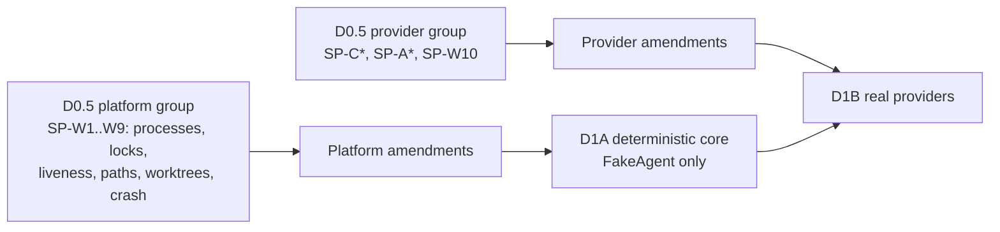

# ai-flow — Delivery Plan: D0.5 / D1A / D1B (revision r7)

> Status: **D0 r7 APPROVED** (seventh independent review, Codex: APPROVE, zero required changes; specification-level review, no executable implementation tested). **D0.5 (§2) is the next phase and has not started.** CHECKPOINT: the approval commit `docs: approve D0 r7 architecture` (full SHA recorded in the follow-up metadata commit `docs: record D0 r7 checkpoint`).
>
> Revision history: r7 is a minimal correction after the sixth independent review. Taking lock ownership no longer appends to the journal: every acquisition, recovery P3–P5 included, journals exactly one `LEASE_ACQUIRED`, and only after its checks pass under the held lock. `recover` refuses a predecessor with no valid record (`B = 0`) before it creates anything. Everything below from r6 stands. r6 was a strictly scoped safety correction after the fifth independent review. A recovery successor is built in a staging area and is published by an atomic directory rename only after its recovery records, its `JOURNAL_RECOVERED` suspension and the predecessor seal are durable. Every mutating command checks publication readiness before any side effect. `cancel --cleanup` quarantines and never deletes. The r5 rules stand: a damaged journal tail fails closed, and path-based destructive cleanup is disabled on Windows and on unproven platforms. Confirmed by the targeted re-review (APPROVE).
> Architecture: [`ARCHITECTURE.md`](./ARCHITECTURE.md) · Decisions: [`DECISIONS.md`](./DECISIONS.md)

## 1. Overview

r1 proposed a single D1. After review it is split into three gated milestones (ADR-018). r3 aligns the gates: each D0.5 spike group gates exactly one milestone, and its amendments flow only to that milestone.



| Milestone | Goal | Gate to start |
|---|---|---|
| **D0.5** | Replace assumptions with evidence. **No product code.** | D0 accepted at its latest revision (currently r7) after the targeted re-review |
| **D1A** | Prove the engine, recovery and routing policy with **FakeAgent only** | D0.5 **platform group** (SP-W1..W9) done + platform amendments merged. No provider spike gates D1A. |
| **D1B** | Prove the architecture with real Codex and Claude Code | D1A done + D0.5 **provider group** (SP-C*, SP-A*, SP-W10) done + provider amendments merged |

**Cross-cutting prerequisites (must be complete before D1A):**

- SP-W4: process identity / liveness. It is load-bearing for lease takeover (§13.5).
- SP-W6 + SP-W9: exclusive lock publish, journal append atomicity, crash windows; r5: torn-append shapes always classify as non-`clean`, and how often a damaged tail occurs (no truncate primitive is needed any more). r6: every successor publication boundary leaves the successor either unpublished or fully published.
- SP-W8: worktrees and the `git status --ignored` inventory; r5: race-resistant deletion verdict for non-Windows platforms (Windows cleanup is disabled regardless), link/reparse-point detection, and identity-verified quarantine-by-rename.
- SP-W1..W3: used by the D1A validation supervisor and Ctrl+C handling. Their provider-binary variants (provider CLI shims) are re-checked in the provider group before D1B.

Provider-group findings may amend the `ProviderAdapter` seam that D1A built against FakeAgent. That rework is accepted as D1B scope. The provider spikes may run in parallel with D1A.

**Final D1 definition of done** (end of D1B): one complete real end-to-end scenario plus a successful resume after interruption:

```text
task → IMPLEMENT (provider A) → staged VALIDATE → REVIEW (provider B, read-only)
     → FIX (A) → VALIDATE → RE-REVIEW (B, incremental) → APPROVE → DONE
+ kill the orchestrator during REVIEW → ai-flow resume → DONE without re-running IMPLEMENT/VALIDATE
+ reciprocal smoke test (B implements, A reviews)
```

General rules:

- Every slice ends with automated tests passing on **Windows and one POSIX environment**.
- No slice may introduce a capability listed as OUT for its milestone (§6).
- Real-provider tests are **opt-in** (they spend quota and are not deterministic). The default test suite uses FakeAgent and recorded fixtures.

## 2. D0.5 — Provider & platform feasibility spikes

**Nature:** time-boxed experiments. Spike scripts are throwaway, live outside the product source tree, and are not reviewed as product code.

**Every spike produces:**

- a short findings report (question, method, environment and versions, result, evidence, implication for the architecture);
- sanitised fixtures where useful (recorded event streams and error outputs, with no secrets and no account identifiers);
- entries in the capability matrix (ARCHITECTURE §8.2) and the enforcement matrix (§15.1);
- a proposed amendment if an assumption fails.

**Time box:** ≤ 1 day per spike group unless extended explicitly.

### 2.1 Codex spikes

| Id | Question | Pass criteria |
|---|---|---|
| SP-C1 | `codex exec` ground truth: non-interactive invocation, prompt via stdin/file, JSONL events, schema-constrained final output, exit codes | Documented flags/events for the installed version; fixtures recorded |
| SP-C2 | **Codex SDK**: thread start/resume, structured output, event stream, usage incl. cached tokens, model + effort options, sandbox/approval options, abort/interrupt behaviour, whether it spawns the CLI binary | Each capability marked verified/unsupported/workaround; process model understood |
| SP-C3 | Sandbox: read-only and workspace-write behaviour in a sibling worktree; network denial; can it write outside cwd? | Enforcement level per property determined |
| SP-C4 | **Auth/billing mode inspection**: a mechanism that **positively** distinguishes subscription (account) auth from API-key auth; which env vars and config files change it | Either a reliable mechanism is identified (→ `machine_verified`) **or** Codex subscription use is recorded as **blocked** for D1B |
| SP-C5 | Error signatures: auth missing/expired, 429, quota exhausted, network down, invalid model, context overflow | Distinguishable signatures recorded; ambiguous cases listed |
| SP-C6 | **App-server (only if SP-C2..C5 leave a D1 requirement unmet)**: interrupt with a resumable thread, account/auth inspection, rate-limit signals, approval policy | Recommendation: SDK, exec or app-server for D1B, with justification (ADR-003 amendment if app-server) |

### 2.2 Claude Code spikes

| Id | Question | Pass criteria |
|---|---|---|
| SP-A1 | Print-mode CLI: JSON and stream-JSON results; error results distinguishable from success; exit codes; prompt via stdin | Documented + fixtures |
| SP-A2 | Structured output: schema-constrained output support (version-dependent) or reliable extraction | Mechanism chosen for `review@2` / `fix_response@2` |
| SP-A3 | Session resume by id; behaviour after expiry; interrupt behaviour | Capability marked |
| SP-A4 | **Read-only reviewer**: permission modes / tool allow- and deny-lists; can shell tools write? Network denial options; behaviour with project-level settings files present in the worktree | Enforcement level per property; reviewer minimum (native fs read-only) met or not |
| SP-A5 | Model selection; effort/thinking control availability on this surface | Profile mapping axes known |
| SP-A6 | Usage: tokens, cache-read/cache-creation tokens, cost fields (informational only) | Usage fields mapped |
| SP-A7 | **Auth/billing mode**: is there a mechanism that positively proves subscription auth? Enumerate **every** billing-switching source (env vars, user/project/local settings, API-key helpers, cloud-provider switches) | Either `machine_verified` is possible, **or** the evidence that it is not (enables the owner-approved `human_attested` opt-in), plus the complete list of sources to verify absent |
| SP-A8 | Claude Agent SDK evaluation: capabilities vs CLI; **auth/billing implications** | Recommendation: CLI or Agent SDK for D1B |
| SP-A9 | Error signatures: auth, 429, usage limit reached, network, context overflow | Distinguishable signatures recorded |

### 2.3 Windows / platform spikes

SP-W1..W9 form the **platform group (gates D1A)**. SP-W10 exercises provider sandboxes, so it belongs to the **provider group (gates D1B)**.

| Id | Question | Pass criteria |
|---|---|---|
| SP-W1 | Process-tree termination: **Job Objects** (feasible from Node without fragile native builds?) vs `taskkill /T /F`; detached grandchildren (e.g. a test runner spawning a server) | Strategy chosen; no orphans in the test matrix |
| SP-W2 | Console processes and **PowerShell/`.cmd` wrapper shims** used by npm-installed CLIs: does killing the shim kill the real process? | Documented behaviour + required handling |
| SP-W3 | **First/second Ctrl+C** semantics through Node → shim → provider process; does the provider receive it; graceful vs hard stop | Behaviour table; chosen design for §13.6 |
| SP-W4 | **PID reuse and liveness** (r3: load-bearing for takeover): obtaining process start time reliably on Windows/POSIX; behaviour for processes in other sessions / elevated / other users (access denied ⇒ `unverifiable`); after reboot | Method chosen; `dead_verified` / `alive` / `unverifiable` classification validated, with no false `dead_verified` |
| SP-W5 | **Atomic rename contention**: temp+rename under Defender/indexer/open handles; EPERM/EBUSY frequency; retry policy | Helper design + retry bounds |
| SP-W6 | **Atomic lock acquisition**: exclusive publish of a complete lock (hard link vs `wx` + write); takeover marker exclusivity; rename-based marker clearing; lease renewal under heavy I/O; **single-line journal append atomicity** with concurrent appenders | Lock protocol (§13.5) validated or amended; publish mechanism chosen |
| SP-W7 | **Paths**: long paths (MAX_PATH, `core.longpaths`), Unicode in repo and user paths, **case-insensitive** comparisons, worktree on the same vs another volume | Path rules + limits documented |
| SP-W8 | **Git worktrees**: create/remove sibling worktrees, behaviour with locks (`index.lock`), crash mid-operation, hooks bypass (`--no-verify` + hooksPath override); r3: confirm `reset --hard` + `clean -fd` leave ignored files untouched; `git status --ignored` output and cost on large ignored trees (`node_modules`); worktree quarantine (move-aside) on Windows; (r4/r5) **no-follow detection and identity** (§13.2.1): does Node 22 `lstat` identify symlinks, junctions **and other reparse points** (mount points, OneDrive/cloud placeholders, dedup, AppExecLinks) without following them; is the file identity (`dev` + `ino`, or volume serial + file id) stable on NTFS and the POSIX test filesystem **and across a same-volume directory rename**; does quarantine-by-rename + Git administrative repair/prune work with open handles without touching worktree content; (r5) **race-resistant deletion (POSIX only)**: is any handle-relative, no-follow deletion mechanism (`openat`/`unlinkat` semantics) usable from D1 **without a native helper**? Windows is not evaluated for D1 cleanup, which is disabled regardless; (r6) **same-volume directory rename** of a closed-handle directory (successor publication, `cancel --cleanup` quarantine) under AV/indexer contention, and POSIX rename onto an existing empty directory | Git manager operations validated; ignored-inventory method + recursion bound chosen; quarantine identity checks validated; r5: per-POSIX-platform verdict "race-resistant deletion proven / not proven". Not proven, or Windows ⇒ `cleanup: delete` never executes (`NO_SAFE_DELETE_PRIMITIVES`). Node 22 path-based `fs` APIs never count as proof. |
| SP-W9 | **Crash recovery**: kill -9 / `taskkill /F` during journal append, during commit, and at **every lease crash window** of §13.5 (acquire, takeover, marker, release); reboot simulation (power-off of a VM, if available); (r4/r5) the **shapes a torn append takes** (partial line, zero-filled extension, complete line with a bad checksum) and fsync/`FlushFileBuffers` durability; r5: **how often a process kill alone** (no power loss) leaves a damaged tail; kill during `ai-flow recover`; (r6) kill at **every successor publication boundary** P1–P11 (ARCHITECTURE §12.1.2); (r7) kill between lock ownership and the `LEASE_ACQUIRED` append (§13.5 two-phase acquisition); and durability of the publication directory rename after a parent-directory fsync, including after power-off | Damaged-tail classification (§12.1.1), case-2 adoption and the lease crash-window table validated; r5: every observed torn shape classifies as non-`clean` (never as a valid record), or the protocol is amended; the frequency of damaged tails is recorded (it sets the expected human-recovery load); r6: after a kill at any publication boundary, the successor is either unpublished (only in `.recovering/`) or fully published, never partially visible |
| SP-W10 | **(provider group)** **Sandbox behaviour on Windows** for both providers (does the Codex sandbox work natively on Windows or need WSL? Claude permission enforcement on Windows) | Enforcement levels on Windows recorded; WSL requirement (if any) documented |

Provider-group addition (r3): SP-C2 and SP-A5 also record **whether the surface reports the served model** (ARCHITECTURE §16.4 model-floor check).

### 2.4 D0.5 exit criteria

**Platform group: gates D1A**

- [ ] SP-W1..W9 complete.
- [ ] Windows process, liveness (PID + start time), lock-publish, journal-append, path and worktree strategies chosen.
- [ ] Lease crash-window table (ARCHITECTURE §13.5) validated on Windows and POSIX.
- [ ] Ignored-state inventory method and bound chosen (SP-W8).
- [ ] (r5) Torn-append shapes validated as always non-`clean`; damaged-tail frequency after a process kill recorded (SP-W9).
- [ ] (r5) Race-resistant deletion verdict per POSIX platform (SP-W8); Windows is fixed as "cleanup disabled" for D1. "Not proven" ⇒ cleanup never executes; this is not a blocker for D1A.
- [ ] (r5) Link/reparse-point detection and rename-stable file identity validated for the quarantine checks (SP-W8).
- [ ] (r6) Directory-rename atomicity and durability validated for successor publication, and every publication crash boundary validated (SP-W5/W8/W9).
- [ ] Platform amendments merged into the D0 docs **before D1A starts**.

**Provider group: gates D1B**

- [ ] SP-C*, SP-A*, SP-W10 complete.
- [ ] Capability matrix (ARCHITECTURE §8.2) has no "expected"/"?" cells left for the selected surfaces, including served-model reporting.
- [ ] Enforcement-level matrix filled for both providers on Windows and POSIX.
- [ ] Integration surface selected per provider, with justification (ADR-003 amended if needed).
- [ ] Billing verification method per provider: `machine_verified`, Claude `human_attested` (with evidence that machine verification is impossible), or **blocked**.
- [ ] Provider amendments merged into the D0 docs **before D1B starts**.

## 3. D1A — Deterministic local core (FakeAgent only)

**Scope:** everything that can be proven without a real provider. **No real provider is ever invoked in D1A.** The billing attestor is a stub interface, exercised through FakeAgent-declared attestation results.

Slice sizes: S ≤ 1 day, M = 1–3 days, L = 3–5 days.

### A0 — Scaffold, CLI shell, config (S)
TypeScript on Node 22, strict mode, `node:test`. CLI commands: `init`, `run`, `status`, `pause`, `resume`, `cancel`, `approve`, `decide`, `doctor` (basic). `reroute` is a stub that returns "not available in D1A". Config resolution with monotonic rules; `AI_FLOW_HOME` override for tests.

- [ ] Precedence tests. A task raising a limit or lowering a floor is rejected with a clear error.
- [ ] The frozen config snapshot contains no secret-bearing fields.
- [ ] `ai-flow init` creates the `.ai/` templates and writes the repo-instance id into the git common dir (idempotent). The template ships **`fast_path.enabled: false`**, with the starting thresholds and `oracle_paths` present but inactive. A project without an explicit `enabled: true` never takes the fast path.
### A1 — Task contract (S)
`task@1` schema: risk LOW/NORMAL/HIGH/CRITICAL, `minimum_profile`, `size_hint`, `fast_path`, `plan`, AC `verify` + `tests` selectors. Canonical hash and snapshot.

- [ ] Field-level errors for missing required fields; unique AC/constraint ids; `project` must match.
- [ ] The hash is stable under key reordering and whitespace changes, and changes with content.

### A2 — Journal, derived state, fenced lease (M)
`events.jsonl` with fence/seq/schema/monotonic time and (r4) per-record `chk`; atomic state replace with Windows retry (per SP-W5); replay with the r3 observation-point fence rule; (r5) tail classification with the fail-closed invariant (no truncation, no append after a non-`clean` tail), the read-only `doctor --journal` diagnostic and the explicit `ai-flow recover` procedure per ARCHITECTURE §12.1.1; (r6) staged, idempotent successor initialization and atomic publication, the normal-run/successor classification rule, and the publication readiness gate on every mutating entry point per §12.1.2 (per SP-W5/W8/W9); lease lock per §13.5 (verified-death takeover, per SP-W4/W6); (r7) two-phase acquisition everywhere (`acquire_lock_only`, under-lock checks, then `append_lease_acquired`) and the `B = 0` refusal of `recover`.

- [ ] Kill-at-every-write-boundary property test: either the derived state equals the replay of the acknowledged, accepted events, or the run fails closed (`JOURNAL_TAIL_AMBIGUOUS`) with every acknowledged record still present and the journal byte-identical.
- [ ] Two live processes: the second cannot acquire.
- [ ] **Live owner with an expired lease** (process suspended/stopped, lease time elapsed): no automatic takeover. `status` shows `RECOVERY_REQUIRED` (owner alive), and `resume --break-lock` refuses while the owner is alive.
- [ ] Owner killed + lease expired → takeover. The new fence = max(journal, lock) + 1.
- [ ] Owner killed but lease not yet expired → no takeover until expiry.
- [ ] **Unverifiable owner** (foreign hostname, unparseable lock, simulated access-denied liveness query) → no takeover; `resume` exits `LEASE_UNVERIFIABLE`; `resume --break-lock --confirm-owner-stopped` succeeds and journals `mode: forced`.
- [ ] **PID reuse:** the lock's PID belongs to a new process with a different start time → `dead_verified`.
- [ ] **r2 race regression:** inject a stale-fence append **between** the taker's lock replace and its `LEASE_ACQUIRED` (and also after it) → the event is excluded on replay. The stale writer self-terminates with `FENCED` at its next check.
- [ ] **Crash windows** (each injected): after lock publish before `LEASE_ACQUIRED` (the next fence skips the orphaned lock fence); after marker creation; after lock replace before `LEASE_ACQUIRED`; after `LEASE_ACQUIRED` before marker deletion; at each release step. In every case recovery follows the §13.5 table, and no fence is reused.
- [ ] **Abandoned marker:** a marker from a dead creator is cleared and takeover proceeds. A marker from a live creator → back-off, then `RECOVERY_REQUIRED`.
- [ ] Two concurrent takers of the same dead owner: exactly one wins, and the other ends with no lock change.
- [ ] Clean release leaves no `run.lock` and a final `LEASE_RELEASED`. The next `run`/`resume` acquires fresh with fence + 1.
- [ ] A corrupt non-final journal line → `STATE_CORRUPT`: fail closed (no append, journal byte-identical), `RECOVERY_REQUIRED`.

**Damaged-tail fail-closed suite (r5, R4-M1; replaces the r4 torn-tail repair suite).** Fault injection writes the journal through a test seam. The I/O seam logs every operation. "Fail closed" in each case means all of the following:

- the journal is **byte-identical** (sha256 + size) to its state before the attempt;
- the operation log shows no `ftruncate`, no write and no append to `events.jsonl`, no `state.json` write, and no Git mutation;
- no seq is reused;
- the process exits non-zero, and `status` shows `RECOVERY_REQUIRED` with the class.

- [ ] **Crash during append:** kill the writer at every byte boundary of one append, and between the write and its fsync. The next acquirer (after a `dead_verified` takeover) classifies `clean` or `tail_ambiguous`, never `corrupt_middle`. On `tail_ambiguous` it fails closed. Every record whose fsync had returned is still present.
- [ ] **Acknowledged tail damaged, `state.json` missing:** a record is acknowledged (fsync returned), then its bytes are damaged and `state.json` is deleted → `JOURNAL_TAIL_AMBIGUOUS`, fail closed. The damaged record is **not** truncated.
- [ ] **Acknowledged tail damaged, `state.json` stale:** `state.json.last_event_seq` is below the damaged record's seq (crash between fsync and the state write) → `JOURNAL_TAIL_AMBIGUOUS`, fail closed, not truncated.
- [ ] **Acknowledged tail damaged, `state.json` current:** `last_event_seq` exceeds the last valid seq → `STATE_CORRUPT` (`acknowledged_tail_damaged`), fail closed.
- [ ] **Damaged tail, no `state.json` ever written** (run crashed before its first state write) → `JOURNAL_TAIL_AMBIGUOUS`, fail closed.
- [ ] **Ambiguous partial final record** (no trailing `\n`) → `JOURNAL_TAIL_AMBIGUOUS`, fail closed.
- [ ] **Ambiguous checksum-invalid final record:** a complete, `\n`-terminated line with a wrong `chk`; also a zero-filled extension and a garbage-filled extension → `JOURNAL_TAIL_AMBIGUOUS`, fail closed.
- [ ] **Damaged tail on a fresh acquire** (no `run.lock`) → `STATE_CORRUPT` (positive evidence: the lock is deleted only after `LEASE_RELEASED` was acknowledged), fail closed.
- [ ] **No truncation, no seq reuse, no append on every path:** each damaged-tail case above is also run through takeover, `resume`, `resume --break-lock --confirm-owner-stopped` and `doctor --journal`. The operation log is identical to the fail-closed definition. No `LEASE_ACQUIRED` is written. The orphaned lock fence is counted by the next acquisition.
- [ ] **Byte-identical after failed recovery:** `ai-flow recover` with no `--tail-sha256`, a wrong hash, a live owner, or a tail changed after the diagnostic (seam appends a byte) → refused; the journal and `state.json` are byte-identical, and no successor or `run.sealed` exists.
- [ ] **Read-only diagnostic:** `status` and `doctor --journal` on every damaged-tail case show the class, `B`, the last valid seq/type/fence, the damaged length + sha256, a bounded preview, the untrusted parse (labelled), the `state.json` evidence (labelled non-authoritative), the lock verdicts and the Git facts. Neither takes the lease, and neither changes any byte under the run directory.
- [ ] **Explicit human recovery does not overwrite evidence:**
  - the old `events.jsonl` (and every other existing file in the old run directory) is byte-identical afterwards;
  - the only new file there is `run.sealed`, created exclusively, so a second `recover` never overwrites it;
  - the successor's journal prefix is byte-identical to the old `[0, B)`;
  - `JOURNAL_RECOVERED` records the old journal hash and the tail offset/length/hash;
  - the successor's first new seq is `last_valid_seq + 2`;
  - the successor is suspended `JOURNAL_RECOVERED` before any Git command (Git command log empty);
  - `resume` on the old run → `RUN_SEALED`.
- [ ] **No fabricated reconstruction:**
  - the damaged final record is a human `DECISION_APPLIED` (approve) → after `continue`, the successor does **not** apply it and asks the human again;
  - the damaged record is `ROUTING_DECIDED`/`ESCALATED` → the router re-decides from the recovered state, and the report labels the lost record's usage/escalation as unknown;
  - the damaged record is `STEP_COMPLETED` with a checkpoint that meets every case-2 condition → adopted only after `continue`, via the normal adoption checks; with any condition violated → `CHECKPOINT_ADOPTED_RESULT_LOST`.
- [ ] **Crash during recovery:** superseded in r6 by the successor publication suite below.
- [ ] **Successor restart:** kill the successor after further appends, take over → replay succeeds across the seq gap, with no `STATE_CORRUPT`.
- [ ] **Non-final corruption fails closed:** an invalid record followed by a valid record; an invalid record followed by an invalid `\n`-terminated record; a bad `chk` in the middle → `STATE_CORRUPT`, fail closed.
- [ ] **No exclusive ownership:** a damaged tail with a live owner (lease expired or not) → no action, journal byte-identical, `RECOVERY_REQUIRED`; `recover` refuses while the owner is `alive`.
- [ ] **Append error:** the seam fails a write or an fsync during an append → the writer stops without truncating; the next acquirer fails closed if the tail is non-`clean`.
- [ ] **Append guard:** bytes appended to the journal behind the owner's back → the owner's next append stops (`STATE_CORRUPT`) instead of appending.
- [ ] Grep the D1A source for `ftruncate`/`truncate` on the journal path → none (static test).
- [ ] `ai-flow status` is read-only. Run against a live run, a crashed run, a live-owner/expired-lease run and a run with an abandoned takeover marker, it changes no byte under the run directory (journal, lock, markers, `state.json`). It displays `RECOVERY_REQUIRED` / `PAUSING` with the reason where applicable.
- [ ] The redactor scrubs seeded secrets from every persisted file.

**Successor publication suite (r6, R5-M1).** Crash injection uses the I/O seam: the process is killed immediately after each durable step P1–P11 of ARCHITECTURE §12.1.2, and also between the write and the fsync of every append within P5–P7. Assertions shared by every case:

- the predecessor `events.jsonl` (and every pre-existing file in the predecessor directory) is **byte-identical**;
- the **Git command log** and the **FakeAgent/validation spawn log** are **empty** for every ordinary command attempted before publication: zero Git mutation and zero workflow continuation;
- the **operation log** of every refused mutating command shows no write of any kind (no lock, marker, journal, `state.json`, worktree or ref);
- after every rerun, at most **one** successor id exists across `runs/<repo>/` and `.recovering/`, excluding human set-aside directories. It equals the deterministic id.

Cases:

- [ ] **Critical: crash after `LEASE_ACQUIRED`, before `JOURNAL_RECOVERED`.**
  1. Create a predecessor with a damaged tail and `B > 0`, and run `recover --journal --tail-sha256 <h> --confirm-tail-lost`. Kill it right after P5 (the staging journal holds the prefix + one `LEASE_ACQUIRED`).
  2. Attempt `resume TASK`, `resume TASK --break-lock --confirm-owner-stopped`, `decide TASK continue`, `run TASK`, `cancel TASK`, `reroute TASK`, and the internal Git-reconciliation entry point → each refused with `RECOVERY_PREPARING` before any side effect. Zero Git mutation, zero workflow continuation, no writes.
  3. Variant: move the staging directory by hand into the run namespace and retry → `RECOVERY_INCONSISTENT` (foreign first `run_id`, no marker). Zero Git mutation, no writes.
  4. Rerun `recover` (same arguments) → it takes over the staging lock after expiry + `dead_verified` without appending (P3), verifies the prefix and the earlier lease record (P4), appends exactly one new `LEASE_ACQUIRED` (P5), then exactly one `JOURNAL_RECOVERED` and one suspension, seals the predecessor, writes the marker and publishes.
  5. After publication, the successor is suspended `WAITING_HUMAN: JOURNAL_RECOVERED`. `resume` exits `WAITING_HUMAN` with no Git command. `decide continue` without the binding, or with a wrong predecessor hash or successor id → refused, nothing written.
  6. `decide continue --predecessor-journal-sha256 <h> --successor <id>` → journals `DECISION_APPLIED { continue, binding }`, and only then does the Git command log show reconciliation.
  7. Exactly one successor directory exists; the predecessor seal names it; `.recovering/` is empty.
- [ ] **Crash at every other boundary:** before P1; after P1 (empty staging directory, with and without leftover temp files); after P2; after P3; after P4; after P6; after P7; after P8; after P9; after P10 before P11; after P11. Each case runs the same ordinary-command battery (expected `RECOVERY_PREPARING`, or for a sealed predecessor `RUN_SEALED`, until P10), then reruns `recover` and checks: it continues at the first missing step; existing records are not re-appended (exactly one `JOURNAL_RECOVERED` and one suspension in the published journal); the descriptor, seal and marker are not rewritten (same bytes, same file identity); the final state equals that of an uninterrupted `recover`, apart from one extra `LEASE_ACQUIRED` per acquisition that reached P5 (never more than one per acquisition, never two with the same fence).
- [ ] **Crash immediately after publication** (after P10, lock still held by the dead process): the readiness check passes. `resume` waits for lease expiry + `dead_verified`, takes over, and then stops at `WAITING_HUMAN: JOURNAL_RECOVERED` with no Git command. A rerun of `recover` writes nothing and reports "recovered; awaiting `continue`".
- [ ] **Duplicate `recover` invocation:** two concurrent `recover` processes on the same predecessor → one holds the staging lock, and the other exits (`alive`) without writing. A sequential second `recover` after successful publication writes nothing. In both cases there is one successor, one `JOURNAL_RECOVERED`, one seal and one marker.
- [ ] **Missing provenance:** delete `recovery.json` from a published successor, and separately from a staging successor → every mutating command `RECOVERY_INCONSISTENT` (published: foreign first `run_id` without a descriptor) or `RECOVERY_PREPARING`/`RECOVERY_INCONSISTENT` (staging), nothing written. A rerun of `recover` does **not** re-create a descriptor next to an existing journal beyond the prefix; it refuses (`RECOVERY_INCONSISTENT`).
- [ ] **Inconsistent predecessor seal:** a `run.sealed` naming another successor id, another descriptor hash, or another generation; a seal from `--abandon` while a successor is staged → `RECOVERY_INCONSISTENT` for every mutating command and for `recover`. The seal is never overwritten.
- [ ] **Missing or mismatching publication marker:** delete `recovery.published` from a published successor, or alter one field (`descriptor_sha256`, `seal_sha256`, `journal_sha256_through_suspension`) → `RECOVERY_INCONSISTENT`, nothing written, zero Git mutation.
- [ ] **Other inconsistencies:** a predecessor journal changed after recovery (one byte appended or flipped); a successor prefix byte flipped; a descriptor whose `--tail-sha256` differs from the one given to the rerun; the same successor id present in both the staging area and the run namespace; a torn append in the staging journal (crash between write and fsync in P5–P7) → `RECOVERY_INCONSISTENT`, no automatic repair, no truncation.
- [ ] **Set-aside:** after a torn staging append, `recover … --set-aside-preparing` renames the staging directory (no unlink/rmdir in the operation log) and a rerun builds the successor under the same id. `--set-aside-preparing` is refused when a seal names the successor or when it is published.
- [ ] **Normal run vs successor classification:** a normal run's first record is `LEASE_ACQUIRED { mode: fresh, run_id: own, recovery_generation: 0 }`. A normal run with an injected `recovery.json` → `RECOVERY_INCONSISTENT`. `run TASK` never adopts an existing directory (a pre-created run directory with the new id → refused).
- [ ] **Gate coverage (static + dynamic):** a dependency test asserts that every mutating CLI command and the internal Git-reconciliation, validation and agent-step entry points open runs only through the gated function. A seam that flips the run to inconsistent between the pre-lease check and the first append is caught by the re-check under the held lock, before `LEASE_ACQUIRED` (r7: zero journal append, no Git command).
- [ ] **Read-only status of incomplete successors:** `status` and `doctor --journal` on a staging successor at every step P1–P10, on each inconsistent case above, and on a sealed predecessor show the last completed step, the descriptor/seal/marker values and the recomputed hashes, and the next command. They change no byte under `runs/<repo>/` (including `.recovering/`) and take no lease.
- [ ] **Recovery generation:** recovering a successor that is itself damaged later gives generation 2 and a different deterministic id. Its descriptor names the generation-1 successor as predecessor, and every gate check passes along the chain.

**Two-phase acquisition and `B = 0` suite (r7, R6-M1, R6-M2).** Uses the same I/O seam and operation log. "Zero journal append" means the operation log shows no append, write or rename to `events.jsonl` other than the P4 prefix publish where stated, and the journal's size and sha256 are unchanged.

- [ ] **1. P3 takes the lock and appends nothing:** stop `recover` right after P3 (fresh, and via takeover of a dead previous `recover`) → the staging `run.lock` holds the new fence; there is no `events.jsonl` (fresh case), or its bytes are unchanged (takeover case); the operation log shows zero journal appends, no `state.json` write and an empty Git command log.
- [ ] **2. P4 installs and verifies the clean prefix:** after P4 the staging `events.jsonl` equals the predecessor's `[0, B)` byte for byte and hashes to `prefix_sha256`, it was published by temp + fsync + rename, and it holds no `LEASE_ACQUIRED` yet. Variants where P4's checks fail (prefix byte flipped, descriptor identity mismatch, predecessor journal changed, a seal naming another successor, a staging record after `B` of a disallowed type) → `RECOVERY_INCONSISTENT` with zero journal append; the lock is expired, not deleted.
- [ ] **3. P5 appends exactly one `LEASE_ACQUIRED`:** between P4 and P6 the operation log shows exactly one append, a `LEASE_ACQUIRED { mode: recovered, run_id: successor }` whose fence equals the P3 lock fence, followed by its fsync, and it is the first record after `B`.
- [ ] **4. Crash after P3, before P4:** the ordinary-command battery is refused (`RECOVERY_PREPARING`) with no writes. A rerun takes over the lock (lock only), installs the prefix, appends exactly one `LEASE_ACQUIRED` with fence = the orphaned lock fence + 1, and finishes; the published journal contains no `LEASE_ACQUIRED` carrying the orphaned fence.
- [ ] **5. Crash after P4, before P5:** the staging journal is the verified prefix with no lease record. A rerun takes over (lock only), verifies the prefix without reinstalling it (same file identity), appends exactly one `LEASE_ACQUIRED`, and finishes.
- [ ] **6. Crash after P5, before `JOURNAL_RECOVERED`:** covered by the critical case above. Additionally assert that the rerun's P4 accepts the earlier lease record and that the final journal has exactly two `LEASE_ACQUIRED` records after `B`, with strictly increasing fences, and one `JOURNAL_RECOVERED`.
- [ ] **7. Ordinary `resume` detects an inconsistency under the lock:** a seam flips the run between the read-only readiness check and the under-lock re-check (descriptor byte changed, marker deleted, predecessor journal byte appended, a successor staged for the task) and, separately, damages the journal tail in the same window → `resume`, `resume --break-lock --confirm-owner-stopped`, `decide continue` and `cancel` each take the lock and then stop with zero journal append, no `state.json` write and an empty Git command log. The lock is left expired with its fence, and the next acquisition skips that fence.
- [ ] **8. No duplicate lease records:** run repeated acquisitions (resume → release → resume; takeover after each crash point of §13.5; three consecutive interrupted `recover` reruns) and assert across the final journal: every `LEASE_ACQUIRED` has a distinct fence; the number of `LEASE_ACQUIRED` records equals the number of acquisitions that reached `append_lease_acquired`; acquisitions that crashed before it or failed an under-lock check contributed none; and a sequential `recover` on an already published successor takes no lock and appends nothing.
- [ ] **9. `B = 0` is refused before any artifact:** a predecessor whose only record is damaged (first record torn; zero-filled first line; a single line with a bad `chk`) → `recover --journal --tail-sha256 <h> --confirm-tail-lost` exits non-zero with `RECOVERY_NO_VALID_PREFIX`. The diagnostic says that successor recovery is unavailable because no complete valid record exists, and names restore from a verified copy and `recover --abandon`. Afterwards `.recovering/` holds no entry for the task; no `recovery.json`, successor journal, `recovery.published` or `run.sealed` exists; no lock was written in the staging area; and the operation log shows no write at all. Repeated reruns behave identically. `status`/`doctor --journal` show the same diagnostic and do not offer the successor command. A hand-made staging descriptor with `prefix_end: 0` → `RECOVERY_INCONSISTENT`.
- [ ] **10. Predecessor byte-identical after the `B = 0` refusal:** the predecessor's `events.jsonl` and every other file in its directory have unchanged size, sha256 and file identity after the refusal and its reruns. A separate `recover --abandon` afterwards writes only `run.sealed { abandoned }`, exclusively, and the journal is still byte-identical.
- [ ] **11. `B > 0` still requires bound human continuation:** for a predecessor with one valid record followed by a damaged tail (the smallest `B > 0`), `recover` publishes a successor whose first record is the predecessor's (foreign `run_id`) and which is suspended `WAITING_HUMAN: JOURNAL_RECOVERED`. `resume` exits `WAITING_HUMAN` with an empty Git command log. `decide continue` without the binding, or with a wrong hash or successor id, is refused with nothing written. Only the bound `continue` journals `DECISION_APPLIED`, and only after that does the Git command log show reconciliation.

### A3 — Repo identity, sibling worktree, checkpoints, reconciliation (M)
Repo-instance id; sibling worktree creation (per SP-W7/W8) with declared `provision`; orchestrator-only checkpoint commits with trailers (incl. `ai-flow-result`) and hooks bypassed; detection of agent commits; the three-case Git reconciliation (§13.3); ignored-state inventory, `ignored_local` policy and worktree quarantine/recreation (§13.2); (r4) policy-precedence and overlap validation on every platform; (r5) the cleanup platform gate (Windows: never deletes; other platforms: deletes only after a positive SP-W8 race-resistance verdict, using handle-relative deletion), `on_cleanup_unavailable`, and identity-verified quarantine/recreation (§13.2.1). Without a positive SP-W8 verdict, no deletion executor is built.

- [ ] The main working tree (including uncommitted and ignored files such as `.env`) is byte-identical after a full run, including after `recreate_worktree`.
- [ ] Case 1 (HEAD == S with dirty worktree) → partial patch saved (tracked + untracked-non-ignored), reset + `clean -fd`, ignored-state check, new attempt. `git clean` is never invoked with `-x`/`-X` (asserted on the Git command log).
- [ ] Case 2 (single own checkpoint, verified result) → adopted without re-running.
- [ ] Case 2 with each adoption condition violated → `CHECKPOINT_ADOPTED_RESULT_LOST`, reset, retry. Cases: no `result.json`; only a leftover temp file; schema-invalid JSON; `attempt_id`/`fence` not matching the trailers (e.g. a result from an earlier attempt); hash not matching the `ai-flow-result` trailer.
- [ ] Case 3 (extra commit / foreign commit / missing worktree) → `GIT_DIVERGED` with permitted decisions.
- [ ] A copied clone with the same instance id at another path → `REPO_IDENTITY`.
- [ ] A repository hook that writes a marker file is **not** executed during checkpoints.
- [ ] Config load rejects an `ignored_local` `cleanup: delete` glob that matches a secret pattern (`.env*`, `*.pem`), `.git/**`, or a path outside the worktree.
- [ ] (r4) Config load rejects cleanup patterns that are absolute (`/x`, `C:\x`, `\\srv\x`, `\\?\C:\x`), contain `..`, `.`, empty segments, backslashes, `:` or a trailing dot/space, or have no literal root (`**/dist`, `*`, `**`).
- [ ] (r4) **Overlapping derived/stateful policies** (`cleanup: data/**` + `stateful: data/dev.sqlite`) → config error. **Overlapping derived/protected policies** (`cleanup: config/**` + `protected: config/local.key`) → config error. Also rejected: overlap with `provision`/`preserve` targets, with a `restore: bootstrap` rule, a case-only difference on Windows, and an undecidable glob intersection.
- [ ] (r5) Config validation and overlap rejection run identically on Windows, where cleanup never executes: a misconfigured rule is an error even though it would be inert.
- [ ] (r4/r5) Worktree recreation renames the old worktree into quarantine. Its content and identity are retained (identity equals the old `WORKTREE_CREATED.identity`), nothing in it is deleted, and `WORKTREE_CREATED` records the identity of the new worktree. Failure cases are in the A9 safe-cleanup suite.

### A4 — Typed code workflow, reducer, suspensions, FakeAgent (L)
Transition table (full + fast path), pure reducer, Run Driver, suspension records with permitted decisions, `approve`/`decide` handling, FakeAgent with scripted behaviours and declared capabilities/enforcement levels.

- [ ] Exhaustive reducer tests: every (step, outcome) pair in the table. Unknown outcomes are rejected.
- [ ] Only DONE/FAILED/CANCELLED are terminal. Every suspension carries a complete continuation record. Applying a decision that is not permitted is rejected.
- [ ] Counters/limits produce the documented suspensions (`FIX_LIMIT`, `REVIEW_LIMIT`, `VALIDATION_FIX_LIMIT`).
- [ ] Replay of any journal prefix yields the same state as live execution.
- [ ] The engine package imports no concrete adapter except via the seam (dependency test).

### A5 — Staged validation (M)
Stages 0–5 with collect-within / fail-fast-between, effect classes (only pure/workspace_local accepted), bootstrap-if-needed, baseline on `base_sha` with check-level exclusion decision, environment-vs-code failure classification, minimal gate detectors (`dependency_change`, `migration`), scope/protected-path policy, AC-mapped focused tests. The Process Supervisor is built here (per SP-W1..W4).

- [ ] Two static-check failures in one stage are reported together. A static failure prevents the test stages.
- [ ] Missing tool → `VALIDATION_ENVIRONMENT` suspension; the FakeAgent repair is **not** invoked.
- [ ] Failing baseline → `BASELINE_BROKEN` decision; `proceed_excluding` excludes those checks.
- [ ] A config declaring an `external_side_effecting` check is rejected at load.
- [ ] Timeout kills a check that spawns a detached grandchild; no orphan remains (Windows + POSIX).
- [ ] The child env lacks seeded secret and billing-changing variables.
- [ ] A lockfile change → `APPROVAL` gate; `approve` continues the run.

### A6 — Review protocol (M)
`review@2` / `fix_response@2`; actionability rules; evidence validation against the checkpoint; structural lineage; test-decided ACs; verdict normalisation; disagreement detection and record; invalid-output repair.

- [ ] Table tests for every rule in §9.2. A finding without evidence is never actionable.
- [ ] A reviewer that returns only style findings with `CHANGES_REQUESTED` → normalised approval → DONE.
- [ ] A reworded repeat of the same issue maps to the same lineage. A model `repeat_of` pointing elsewhere does not override the structural key.
- [ ] A test-verified AC whose tests pass stays MET even if the reviewer marks it NOT_MET. The reviewer's evidenced `tests` finding is handled per §9.2.
- [ ] Repeat after `DISPUTED` → `AGENT_DISAGREEMENT` with both positions; `decide reject_finding` suppresses the lineage.

### A7 — Context bundle builder (M)
Ordered segments, bundle hash + per-item hashes + checkpoint SHA, profiles from §10.3 (incl. incremental `re_review`), secret-file exclusion, budget truncation with stubs, size estimate handed to the router.

- [ ] The re-review bundle contains unresolved lineages + validation delta + diff since the last reviewed checkpoint, and **not** the full original diff (unless the epoch changed).
- [ ] The same inputs produce byte-identical bundles (same hash). Stable segments precede volatile ones.
- [ ] Mandatory overflow → `CONTEXT_TOO_LARGE`. A referenced `.env` is excluded with its reason in the manifest.

### A8 — Model & Effort Router (pure) + fast-path eligibility + model-floor check (M)
Profile resolution (step class base, effective floor from all sources), per-lineage ladders with effort/model steps, bounds and ceiling, CRITICAL permission, context-window eligibility, `ROUTING_DECIDED`/`ESCALATED` events, fast-path pre-run and post-diff checks with promotion. Uses **fake provider mappings** (placeholder model ids) only.

- [ ] Floors: a HIGH-risk task never routes its reviewer below STRONG. `minimum_profile` raises but never lowers. Detector-raised risk raises the floors.
- [ ] Escalation: monotonic; never repeats a rung; stops at `max_rungs_per_lineage`, `max_escalations_per_run` and the ceiling. Exhaustion → `ESCALATION_EXHAUSTED`. Rate-limit/quota failures never escalate.
- [ ] De-escalation: after a lineage escalated to STRONG, an unrelated new FIX lineage starts at base.
- [ ] Unsupported mapping (profile/effort not declared for the provider) → clear routing failure, no substitution.
- [ ] Reviewer requiring native read-only, routed to a FakeAgent declaring `posthoc` → refused unless the project accepts `posthoc`.
- [ ] Fast path (project explicitly opted in): an eligible LOW task finishes without REVIEW. A post-diff violation (too many files, lockfile touched) promotes to REVIEW. A NORMAL-risk task never enters the fast path.
- [ ] Fast path **disabled by default**: the same eligible task in a project without `fast_path.enabled: true` takes the full path.
- [ ] **No self-certification** (R2-M3). Each of these promotes to full REVIEW (or is ineligible pre-run), and DONE without REVIEW never happens:
  - FakeAgent modifies a mapped test file (e.g. loosens an assertion);
  - FakeAgent adds a skip marker to a mapped test;
  - FakeAgent deletes or renames a mapped test;
  - FakeAgent edits a declared `oracle_paths` helper/fixture or the test-runner config;
  - FakeAgent adds a new test file;
  - an AC whose selector matches no file at `base_sha` → ineligible pre-run;
  - a selector that resolves to a different file set at the checkpoint;
  - collected test ids for the mapped selectors are fewer than at `base_sha`.
- [ ] Oracle blob hashes at the checkpoint equal those at `base_sha` on every fast-path DONE (asserted from the journaled `FAST_POSTCHECK` record).
- [ ] Changing `max_files`/`max_lines` in project config changes eligibility (thresholds are configuration, not constants).
- [ ] **Model-floor check** (FakeAgent reports a resolved model): equal or declared in `accepted_resolutions` → accepted (mismatch logged). Undeclared → `MODEL_UNVERIFIED`, no `STEP_COMPLETED` and no checkpoint. `accept_resolved_model` proceeds. A FakeAgent declaring no model reporting → `resolved_model: unreported`, labelled request-verified.
- [ ] **Escalation policy is configuration, not invariant:** with the ladder policy switched to `model_first` for `same_failure_persists`, the router follows it. Every `ESCALATED` event carries `trigger` + `trigger_evidence` (check/test ids or lineage), with no diagnostic claim.
- [ ] `reroute` CLI returns "not available in D1A", and no D1A suspension record lists `reroute` as a permitted decision.
- [ ] Replaying the journal reproduces identical routing decisions.

### A9 — Interruption and recovery suite (M–L; r3 adds the ignored-state suite; r4 adds the safe-cleanup suite; r5 rewrites it fail-closed)
Pause (finish-step and `--now`), first/second Ctrl+C (per SP-W3), cancel with/without cleanup, resume order (§13.3), verified-death lease takeover (§13.5), ignored-state recovery (§13.2), FakeAgent-scripted failures of every class.

- [ ] For each step kind: kill the orchestrator mid-step → resume → accepted steps are not re-executed (asserted from the journal), and the in-flight step is reconciled per case 1/2/3.
- [ ] Crash injected between the checkpoint commit and `STEP_COMPLETED` → case-2 adoption.
- [ ] Scripted 429 (short/long retry-after), auth, quota, network, timeout, invalid output and context limit → the documented suspension or retry, with uncertain classifications suspending.
- [ ] Ctrl+C on Windows leaves no orphan processes and a `PAUSED: INTERRUPTED` suspension. While the interrupt is in progress, `status` displays `PAUSING`. The journal contains `PAUSE_REQUESTED` followed by the suspension, and no `PAUSING` status.
- [ ] Hard exit after `PAUSE_REQUESTED`, before the suspension → `resume` reconciles, journals `PAUSE_SUPERSEDED` and continues.
- [ ] (r6) **`cancel --cleanup` is quarantine-first:**
  - on Windows and POSIX, the worktree is renamed into `.quarantine/` with identity verified before and after; its full content and identity are retained, and no replacement is created;
  - the operation log shows **zero** destructive operations (no `unlink`/`rmdir`/recursive delete, no `git worktree remove`, no `git clean`), and the branch still exists;
  - with the worktree replaced by a junction/symlink, an identity mismatch, a missing worktree, or a seam `EBUSY`/`EPERM`/`EXDEV` on the rename → the worktree is left in place, nothing is renamed or deleted, the run is `CANCELLED`, and `status` shows `CLEANUP_SKIPPED_UNVERIFIED` with the path;
  - external and main-tree sentinels are byte-identical.
- [ ] Editing the task file mid-run → `CONTRACT_CHANGED` on resume.

**Ignored-state recovery suite (r3, R2-M2).** Goal: prove that ignored local state cannot silently contaminate a retried attempt. Each case scripts a FakeAgent writing attempt that creates or changes ignored files and is then killed. The **retried** FakeAgent attempt is scripted to fail loudly (`CONTAMINATION_OBSERVED`) if it sees any contaminant. Every case must end either with a clean retry (no contaminant observed) or with a suspension. It must never end with a retry that observes the contaminant without a recorded human `retry_as_is`.

- [ ] Undeclared ignored file (`.cache/poison`) created → `IGNORED_STATE_UNSAFE`, no automatic retry. The file still exists (not deleted).
- [ ] Undeclared change inside an ignored directory beyond the recursion bound → `unverifiable` → `IGNORED_STATE_UNSAFE`.
- [ ] `stateful` ignored DB (`data/dev.sqlite`) modified → `IGNORED_STATE_UNSAFE`. File content is unchanged by ai-flow.
- [ ] `protected` ignored secret (`.env`) modified by the agent → `POLICY_VIOLATION`. ai-flow neither restores nor deletes it, and the main-tree `.env` is untouched.
- [ ] (r5) Declared `cleanup: delete` path (`dist/poison.js`) on Windows, or on a platform without a positive SP-W8 verdict → **nothing is deleted**. `IGNORED_STATE_UNSAFE` (`NO_SAFE_DELETE_PRIMITIVES`), and `dist/poison.js` still exists. With `on_cleanup_unavailable: recreate_worktree` → quarantine/recreation, and the retry observes no contaminant. Unchanged `dist/` (fingerprint equal) → retry proceeds without suspension.
- [ ] (Only on a platform with a positive SP-W8 verdict.) Declared `cleanup: delete` path → exactly the declared paths are deleted via handle-relative deletion; a sibling undeclared ignored file is untouched. Retry proceeds and the retried attempt observes no contaminant.
- [ ] Declared `restore: bootstrap` path (`node_modules/x/poison`) → bootstrap is forced (skip-cache invalidated) before the retry. The retry observes the regenerated state.
- [ ] Decision `recreate_worktree` (and the opt-in `on_undeclared_change: recreate_worktree`) → the old worktree is quarantined byte-identical. The new worktree at `S` has no contaminant, has the declared `provision` files, and has no undeclared `preserve` carry-over. Retry proceeds.
- [ ] Decision `retry_as_is` → journaled with the human decision. The retried attempt is allowed to observe the contaminant, and the report flags it.
- [ ] Interrupted **validation** whose `workspace_local` check left an ignored local DB → same gating before validation is re-run.
- [ ] Uninterrupted flow (attempt completed and accepted) → no ignored-state gating between steps (no false suspensions).

**Safe-cleanup suite (r5, R4-M2; replaces the r4 suite).**

Fixtures for every case:

- a **sentinel** file outside the worktree, in an external directory;
- sentinels on the `stateful`, `protected`, `provision` (main-tree source and in-worktree copy) and `preserve` paths.

Assertions for every case:

- every sentinel is **byte-identical** afterwards (content hash + size + mtime);
- the FS/Git operation log is checked against the case's expected count of **destructive operations**: `unlink`, `rmdir`, `rm`, a rename of an ignored path, `git clean`, `git worktree remove`.

POSIX and Windows variants run where the platform allows (Windows symlink creation may need Developer Mode; junctions do not).

- [ ] **Windows `cleanup: delete` is blocked:** a valid declared rule, `dist/` contaminated by the interrupted attempt → `IGNORED_STATE_UNSAFE` (`NO_SAFE_DELETE_PRIMITIVES`), **zero** destructive operations, `dist/` byte-identical. The same result holds even when the capability seam claims every primitive is available: Windows is not overridable in D1.
- [ ] **Unsupported POSIX cleanup is blocked:** no positive SP-W8 verdict (the D1 default), or the seam reports "race-resistant deletion unavailable" → same outcome, zero destructive operations.
- [ ] **Symlink/junction ancestor replacement results in zero destructive cleanup operations:** the cleanup root is `build/out/**`, and the seam replaces `build` with a symlink (POSIX) or a junction / directory symlink (Windows) to the external directory, before the gate, during the inventory, and immediately before the point where a deletion would occur.
  - The case **passes only if** the operation log shows zero destructive operations.
  - On a platform with a positive SP-W8 verdict it may instead pass if the log shows **only handle-relative** deletions **and** the external sentinel is byte-identical.
  - A post-deletion detection (journaled mismatch after a deletion) **fails** the test.
- [ ] **Linked root and nested link:** `dist` is a symlink/junction to the external directory, or `dist/sub/escape` is → zero destructive operations, `IGNORED_STATE_UNSAFE`.
- [ ] **No unsafe fallback:** across every case in this suite and the ignored-state suite, the log contains no recursive delete (`fs.rm` with `recursive`, `rm -rf`, `rd /s`), no path-based `unlink`/`rmdir` of an ignored path on Windows or on an unproven platform, no `git clean -x`/`-X`, no `git worktree remove`, and no copy-then-delete. A seam that makes the "preferred" path fail (e.g. quarantine rename `EXDEV`) never leads to deletion.
- [ ] **Quarantine/recreation retains old content and identity:** with `on_cleanup_unavailable: recreate_worktree`, or the human decision `recreate_worktree`:
  - the quarantined directory's identity equals the old `WORKTREE_CREATED.identity`;
  - its full tree (tracked, untracked, ignored, `stateful`, `protected`) is byte-identical;
  - `WORKTREE_QUARANTINE_PLANNED` → `WORKTREE_QUARANTINED` → `WORKTREE_CREATED` are journaled in that order;
  - the new worktree has the `provision` files and only the declared `preserve` carry-over.
- [ ] **Quarantine failure suspends without creating a replacement.** Each of the following → `IGNORED_STATE_UNSAFE` (`QUARANTINE_UNVERIFIED`), **no `git worktree add`**, zero destructive operations, all content still present at its pre-failure or renamed location:
  - the rename fails (Windows locked file; seam `EBUSY`/`EPERM`/`EXDEV`);
  - `W` was replaced by a junction or another directory before the rename (identity ≠ `WORKTREE_CREATED`);
  - the quarantined identity does not match after the rename (seam swaps);
  - `W` reappears, or `R` changes identity, between the rename and the replacement creation.
- [ ] **Crash during quarantine:** kill after `PLANNED`, after the rename, and after `QUARANTINED` → resume continues only from verified state, or suspends. A replacement is never created over unverified state.
- [ ] **All protected/external sentinels unchanged:** the external, `stateful`, `protected`, `provision` and `preserve` sentinels are byte-identical in every case above, including successful quarantines. The main working tree is unchanged.
- [ ] **Proven-platform variant** (runs only where SP-W8 gave a positive verdict; otherwise recorded as not applicable):
  - a newly created path after the inventory is not deleted, and the parent's removal stops the procedure;
  - a candidate matching a secret/`stateful`/`protected` path stops the whole cleanup before any deletion;
  - a crash between deletions → resume re-runs from step 1.

  All deletions in this variant are handle-relative and non-recursive.

### A10 — D1A end-to-end on the fixture (S)
The full scenario of §1 using FakeAgent on the fixture repo (§5), including the fix loop, kill during REVIEW and resume, the fast-path scenario, and an escalation scenario. `report.md` generated with labelled (estimated) usage and the routing table.

- [ ] All three scenarios pass on Windows and POSIX.
- [ ] Grepping the run directory for seeded secrets finds nothing.

## 4. D1B — Real provider integrations

**Gate:** D1A complete; D0.5 provider spikes complete; amendments merged.

### B0 — Provider configs and billing attestation (M)
`~/.ai-flow/providers/{codex,claude}.yaml` with surface, billing class, verification mode and real profile mappings (model names only here). An attestor per provider using the D0.5-selected mechanism. Env and config-source verification. `BILLING_UNVERIFIED` / `BILLING_ATTESTATION` suspensions.

- [ ] Codex `billing: subscription` without a successful machine verification → blocked (no attestation option offered).
- [ ] With an API-key env var or a billing-changing config override present → refused for both providers, including `human_attested`.
- [ ] Claude `human_attested` (only if D0.5 proved machine verification impossible and the project opted in): requires the explicit `decide attest_subscription`, is recorded as `human_attested`, and appears distinctly in status/report.
- [ ] An auth-mode change between turns (simulated via fixtures) → suspension before the next turn.

### B1 — Codex adapter (M–L)
On the D0.5-selected surface (SDK preferred). Capabilities/enforcement report, profile translation, structured output, usage incl. cached tokens, ids (thread/turn/request), error classification from SP-C5 fixtures, interrupt per SP-C2/C6, Supervisor integration.

- [ ] Contract tests against the recorded fixtures pass offline.
- [ ] Opt-in live smoke: IMPLEMENT on the fixture produces a valid checkpoint. A REVIEW (if Codex is the reviewer) returns valid `review@2` under native read-only.
- [ ] The served model, if the surface reports it, is checked against `accepted_resolutions`. An undeclared model → `MODEL_UNVERIFIED` (fixture-driven). A surface that does not report it is labelled request-verified in the report.

### B2 — Claude Code adapter (M–L)
On the D0.5-selected surface (CLI expected). Same responsibilities as B1, using the SP-A* fixtures.

- [ ] Contract tests pass offline, including the model-floor check against recorded fixtures.
- [ ] Opt-in live: the reviewer cannot modify the worktree (native), and a deliberate write attempt is blocked or detected (`POLICY_VIOLATION`). REVIEW returns valid `review@2`.

### B3 — Enforcement recording and Windows provider tests (M)
Effective enforcement levels recorded per attempt. Windows tests: provider process trees, shims, Ctrl+C through the provider, sandbox behaviour (per SP-W10).

- [ ] The report shows the per-property enforcement level for each attempt.
- [ ] Interrupting a live provider turn on Windows leaves no orphans, and resume reconciles correctly.

### B4 — Human-approved reroute (S–M) — D1B implementation (D1A: CLI stub only, A0)
`ai-flow reroute` per §16.10: suspended-only, independence re-check, billing re-attestation, separate paid-billing approval, epoch events, full-diff re-review after an epoch change.

- [ ] A reroute making reviewer = implementer is refused (unless self-review was explicitly allowed).
- [ ] A reroute to a `billing: api` provider without `--approve-paid-billing` + `allow_paid_api` + a ceiling is refused.
- [ ] After a reroute, earlier attempts keep epoch 1 attribution in the report.

### B5 — Real end-to-end, resume and reciprocal smoke (M)
- [ ] **E2E-1:** Codex implements, Claude reviews (or the reverse, per D0.5 outcome) → DONE on the fixture. `main` is unchanged.
- [ ] **E2E-2 (fix loop):** a fixture task designed to miss an AC first → actionable lineage citing that AC → FIX → re-validate → incremental RE-REVIEW → APPROVE → DONE. A scripted first implementation is allowed for determinism, with real providers for the rest.
- [ ] **E2E-3 (resume):** kill the orchestrator during REVIEW → `status` shows the suspension and required action → `resume` → DONE. The journal proves IMPLEMENT and VALIDATE ran once.
- [ ] **Reciprocal smoke:** a minimal task with the roles swapped completes (proves both adapters in both roles).

### B6 — Audit report (S)
`report.md` includes:

- outcome;
- AC statuses (test-decided vs reviewed);
- lineages and resolutions, plus follow-ups;
- validation history by stage;
- routing per attempt (provider, surface, model, effort, profile, rung, epoch, floor sources);
- escalations;
- billing attestations (machine_verified/human_attested);
- enforcement levels;
- usage labelled measured/estimated/unknown with cached tokens;
- branch + final SHA;
- environment versions.

- [ ] The report answers, for each attempt: who ran it, with what configuration, what context bundle (hash), and what it cost (labelled).

## 5. Fixture repository

A dependency-free fixture (A18), unless D0.5 shows a reason not to:

- **Node.js 22**, **ESM JavaScript**, built-in **`node:test`**, no framework, **no third-party dependencies**. Validation needs no bootstrap stage, so network is not required for validation.
- A tiny library, e.g. `slugify(text, options)` + `parseDuration(str)` with tests.
- Seeded scenarios:

| Scenario | Proves |
|---|---|
| Task with 2 test-verified ACs + 1 review AC; correct implementation | Modification, validation, review, DONE |
| First implementation intentionally lacks the test for AC-2 (scripted in D1A; scripted first attempt in D1B) | `UNVERIFIED` AC → actionable lineage → FIX loop → re-review |
| A lint rule (via a tiny `node` script, still dependency-free) that a careless change violates | Static-stage collection; validation FIX loop |
| Kill during REVIEW | Interruption, reconciliation, resume without re-running earlier steps |
| One-line typo fix with an existing test, LOW risk, fixture project with `fast_path.enabled: true` (explicit opt-in) | Fast path → DONE without review |
| Same task in a fixture project without the opt-in | Fast path disabled by default → full path |
| Fast-path task where the scripted implementation also edits the mapped test | Oracle change → promotion to full review (no self-certification) |
| Change touching `package-lock.json` (fixture includes a stub lockfile) | Gate + fast-path promotion |
| A pre-seeded hook in the fixture's `.git/hooks` writing a marker | Hooks bypassed during checkpoints |
| `.gitignore` declaring `.cache/`, `dist/`, `data/*.sqlite`, `.env`; `.ai/project.yaml` with an `ignored_local` policy | Ignored-state recovery suite (A9) |
| (r4/r5) Test-time setup creating links/junctions under `dist/` and `build/`, and an external sentinel directory (created by the test harness, never committed to the fixture) | Safe-cleanup suite (A9): zero destructive operations, quarantine identity |
| (r5) Journal fault-injection seam (damaged final record, stale/missing `state.json`) | Damaged-tail fail-closed suite (A2) |

## 6. Explicitly OUT

### OUT of D0.5
- Any product code: no CLI, engine, journal, adapters or workflow implementation.
- Performance tuning, UX, packaging.
- Model quality comparisons or routing evals (only capability facts are gathered).

### OUT of D1A
- Real provider invocation of any kind; billing attestation beyond the stub interface.
- `reroute` (stub only); thread-continuation optimisation.
- YAML/DSL workflows, a plugin registry, dynamic loading, additional workflows (architecture/content/Spec Kit).
- `external_side_effecting` checks; test-level baseline exclusion; validation caching beyond bootstrap.
- Token/monetary budgets, the usage ledger, `rollback`, `gc`, `task amend`, `report --export`.
- Tag-based doc discovery (r3), dependency expansion and doc-index search in context building. D1 uses explicit `references` only.
- Queue, parallel runs, daemon, notifications, dashboards.

### OUT of D1B
- Providers beyond Codex and Claude Code.
- Codex app-server, unless D0.5 required it (then it is IN, via an ADR-003 amendment).
- Thread-continuation optimisation, unless D0.5 demonstrated clear value (then opt-in per step class).
- OS-level isolation (containers/VMs).
- PR creation, push, merge, deploy, CI integration.
- Learned/ML routing, the eval framework, cost-optimised routing.
- Spec Kit automation, MCP integrations, skills beyond pass-through recording.
- Multi-repo tasks, non-Git workspaces.

## 7. Risks

| Risk | Impact | Mitigation |
|---|---|---|
| D0.5 shows no machine-verifiable Codex subscription auth | Codex unusable for subscription work in D1B | Recorded as **blocked**; D1B proceeds with the reciprocal test limited accordingly, and the owner decides (e.g. API with explicit approval and a budget, or waiting for provider support) |
| D0.5 shows Claude read-only cannot be `native` | Claude cannot review under the default minimums | Project-level explicit `posthoc` acceptance (recorded), or Claude as implementer only |
| Codex SDK lacks interrupt/auth/limit signals | App-server is needed | ADR-003 amendment; app-server moves into D1B scope |
| Windows Job Objects are infeasible without native builds | Orphan risk | `taskkill /T` + PID/start-time identity + idle watchdogs; documented residual risk |
| Error signatures drift with provider updates | Misclassification | Versioned fixtures; uncertain ⇒ suspend; `doctor` reports version changes |
| Lineage false merges | Earlier human escalation | Acceptable by design; data collected for tuning |
| Fast-path misclassification | A defect slips through without review | Off by default; explicit project opt-in; only pre-existing, unchanged oracles decide ACs; deterministic pre/post checks; configurable conservative thresholds |
| Process start time unreadable on Windows (access denied, other sessions) | Many `unverifiable` verdicts ⇒ frequent human lock recovery | SP-W4 measures it; same-user operation is the norm; `resume --break-lock` with explicit confirmation. The safety rule is not relaxed. |
| Ignored-state inventory too slow on large trees | Slow attempt starts, or many `unverifiable` suspensions | SP-W8 chooses the method and bound; projects declare `node_modules` etc. as `restore: bootstrap`, so they need no deep fingerprint |
| Projects do not declare `ignored_local` | Interrupted attempts suspend instead of retrying | Safe by design; the `init` template proposes common entries; `status` names the offending paths |
| (r5) Damaged journal tails are frequent (e.g. process kill leaves partial appends on some platform) | Many runs need human journal recovery | SP-W9 measures the frequency. Fail closed is kept regardless [OWNER]. [ASSUMPTION] single-write appends make kill-only tears rare (SP-W9 verifies); runtime state must live on a supported local filesystem. Revisit an acknowledgement protocol only after D1, with data. |
| (r5) Human recovery loses a non-Git event (decision, routing, suspension) | A human must re-make a decision; usage/escalation of one record unknown | Accepted. The successor run never fabricates the event; the report flags `lost_seq`; the old journal stays as evidence |
| (r5) `cleanup: delete` inert on Windows (and likely on POSIX) in D1 | More `IGNORED_STATE_UNSAFE` suspensions after interrupted attempts | Unchanged derived paths do not suspend (fingerprint); projects may opt into `on_cleanup_unavailable: recreate_worktree`; `restore: bootstrap` covers dependency trees. A native handle-relative helper is a post-D1 option. |
| (r5) Node cannot detect every Windows reparse point, or file ids change across rename | Quarantine identity checks fail | SP-W8 verdict; failure suspends with no replacement worktree (`QUARANTINE_UNVERIFIED`) |
| (r5) Quarantined worktrees accumulate | Disk usage | Human removal; `gc` is [SOON] and human-invoked; `status` lists quarantined paths |
| (r6) The successor publication rename is blocked on Windows (AV/indexer handles), or a recovery artifact is damaged later | The successor stays unpublished, or `RECOVERY_INCONSISTENT` blocks the task | Fail closed by design. A rerun of `recover` retries publication. `status`/`doctor` show the exact step and mismatch. Evidence is restored from a copy, or an unpublished successor is set aside by rename. Nothing is repaired automatically. |
| (r6) A mutating code path forgets the readiness gate | An incomplete successor could be continued | All mutating entry points open runs through one gated function; a dependency test plus the A2 publication suite (every command × every boundary) enforce it |
| Scope creep in D1 itself | Late delivery | The §6 OUT lists are binding; changes require updating this plan |

## 8. Questions to settle before D0.5 starts

1. Confirm the Windows test environment(s) available (local machine only, or also a VM for reboot/power-loss tests).
2. Confirm that spending a small amount of subscription quota on D0.5 spikes is acceptable, and on which accounts.
3. Confirm the POSIX environment for the cross-platform matrix (WSL vs a Linux/macOS machine).
